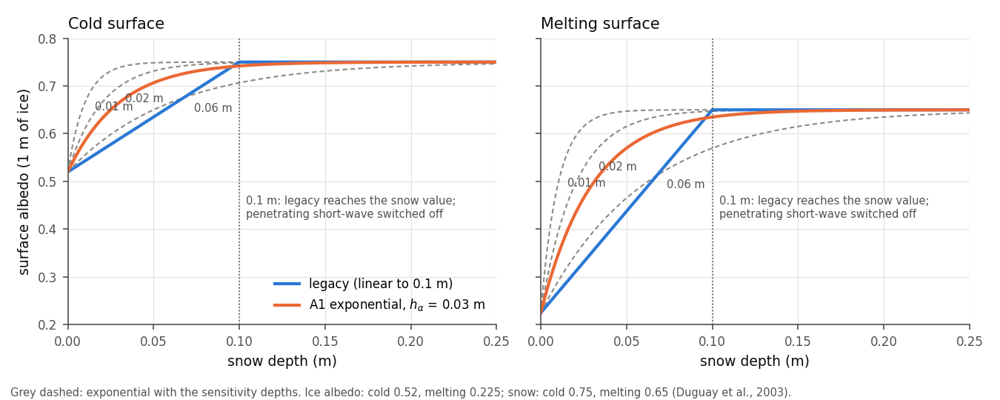
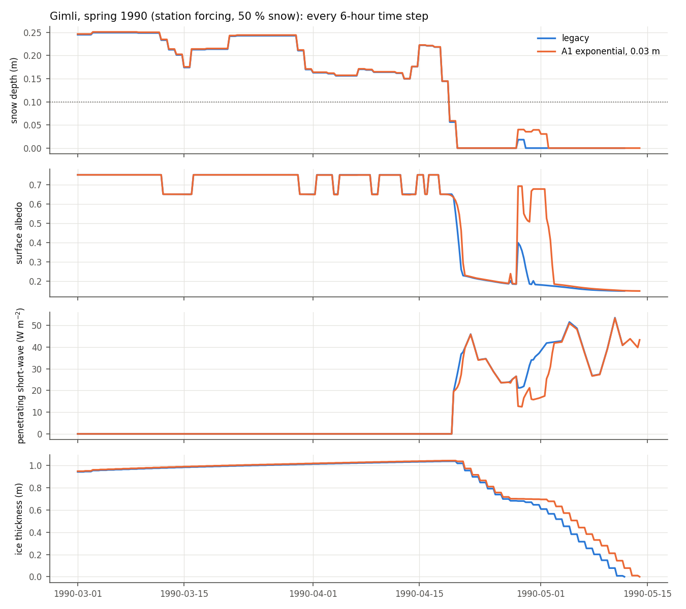
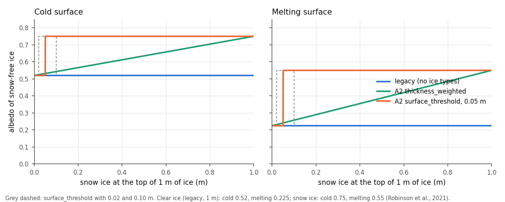
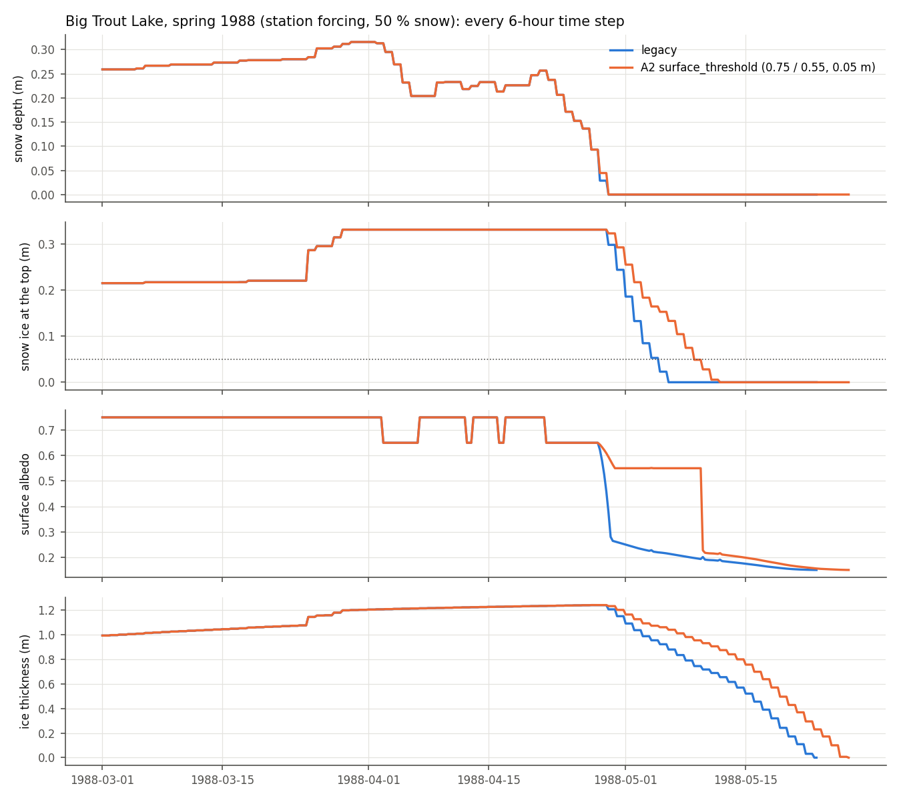
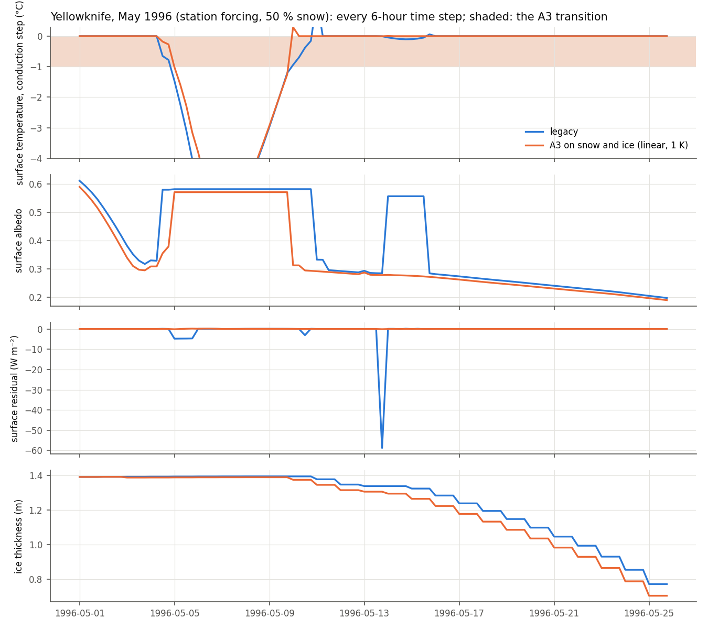
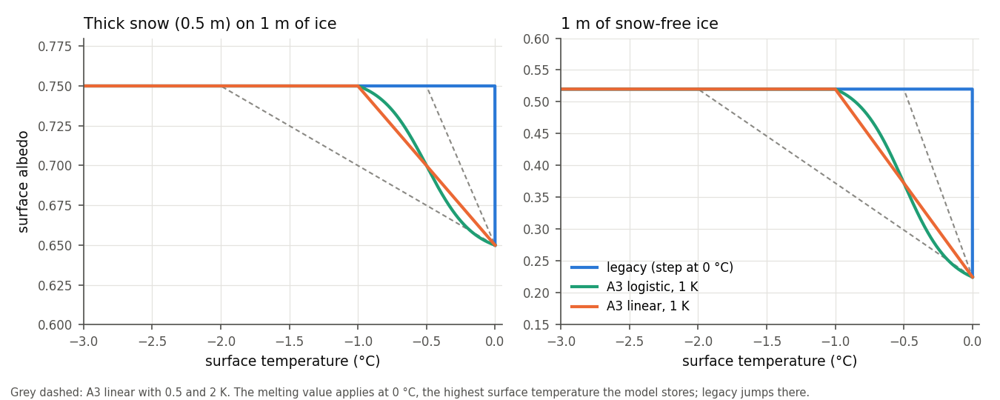

# Formulation options

> **The practical guide is [options.md](options.md):** what each option
> does, how to turn it on (command line, sites file, GUI, Python), where it
> helps and where it hurts at the six validation lakes, and the recommended
> combinations. This page is the detailed science record behind it.

CLIMo Classic reproduces the legacy model exactly. Roadmap step 3 adds
optional replacements for single legacy equations, taken from
the conservative update specification
(the "spec"). Each option:

- defaults to legacy CLIMo, so a run without options is unchanged (the
  regression test and experiment E0 check this);
- is one function in the code, with its source in the docstring;
- is set on `climo.Parameters`, on the command line (`climo run` and
  `climo batch`), in sites files and in the GUI's Model tab;
- is judged at every validation site with `validation/compare.py`
  ([validation.md](validation.md#experiment-harness-judging-the-step-3-options)),
  with its parameters set from the literature before the run, not tuned.

Defaults change only after multi-site validation.

The same harness also judged the fixes of legacy numerics listed in
[legacy_notes.md](legacy_notes.md) (roadmap `fixes`), each as its own switch
that defaults to legacy: F1, the surface-temperature solver's fall-back
(note 5), F2, what its Newton–Raphson iteration accepts (note 4), and F3,
the length of its Newton–Raphson step (note 11). Users switch the three on
together, with the one option `fixes` (`off`, the default, or `on`; see
[The `fixes` option](#the-fixes-option-f1--f2--f3)); the three switches
remain `Parameters` fields for the harness, to reproduce the F1–F3
experiments, but are not on the command line, in sites files or in the GUI.

| Option | Values | What it replaces | Status |
|---|---|---|---|
| `thin_snow_albedo` (+ `thin_snow_albedo_depth`) | `legacy`, `exponential` | the albedo of snow thinner than 0.1 m | [A1](#a1-thin-snow-albedo): option; not a default candidate on present evidence |
| `ice_type_albedo` (+ `snow_ice_albedo`, `snow_ice_albedo_melt`, `snow_ice_albedo_thickness`) | `legacy`, `surface_threshold`, `thickness_weighted` | the albedo of snow-free ice, which legacy takes from the ice thickness only, whatever the ice type | [A2](#a2-clear-ice-versus-snow-ice-albedo): option; not a default candidate on present evidence. Helps where legacy breaks up early (Gimli, Big Trout, Island, 50–54° N), hurts where it is close or late (Lac des Sables 46° N, Yellowknife 62° N): [where it helps and hurts](#where-it-helps-and-where-it-hurts) |
| `melt_albedo_transition`, `melt_albedo_transition_ice` (+ `_width`, `_ice_width`) | `step`, `linear`, `logistic` | the jump of the snow (and ice) albedo from its cold to its melting value when the surface reaches 0 °C | [A3](#a3-smooth-melt-state-albedo-transition): option; not a default candidate on present evidence. Snow only: under half a day everywhere. Snow and ice: break-up 0.1–1.4 days earlier, which helps where legacy is late (Yellowknife 62° N, Baker Lake at 0 % snow 64° N) and hurts where it is early (Gimli, Big Trout, Island, Lac des Sables 50 %, 46–54° N); removes the melting-point residuals but triggers more solver fall-backs: [where it helps and hurts](#where-a3-helps-and-where-it-hurts) |
| `fixes` | `off`, `on` | not an equation: `on` sets the three solver corrections below together (`surface_solver` `fixed`, `newton_acceptance` `fixed`, `newton_step` `limited` at 20 K) | [the `fixes` option](#the-fixes-option-f1--f2--f3): the user-facing switch of F1 + F2 + F3; validated identical to them (FIXES, FIXES_A3). Recommended for new work and with A3 and S1; default `off` (legacy) |
| `surface_solver` (internal; set by `fixes`) | `legacy`, `fixed` | not an equation: the surface-temperature solver's fall-back when Newton–Raphson fails and the solution lies below the starting temperature (legacy note 5, most likely a translation fault), which returns the starting temperature instead of the solution | [F1](#f1-surface-temperature-solver-fall-back-legacy-note-5): a fix (roadmap `fixes`). Changes no date or thickness beyond 0.1 day and 0.3 mm; removes every fall-back and the largest legacy energy residual (59.8 → 32.2 W m⁻²); with A3 (snow and ice, 1 K) the largest residual improves in 25 cases, degrades in 5 (without it 18 / 15). Recommended for new work and with A3; part of `fixes` |
| `newton_acceptance` (internal; set by `fixes`) | `legacy`, `final_estimate`, `fixed` | not an equation: what the surface-temperature solver's Newton–Raphson iteration accepts when it converges on its step size (legacy: the evaluation 0.1 K below the estimate, at about 15 % of ice time steps) or its derivative vanishes (legacy note 4, most likely original Flato and Brown behaviour) | [F2](#f2-newton-raphson-acceptance-legacy-note-4): a fix (roadmap `fixes`). With F1: dates and thickness within tolerance (largest 5.6 mm, 0.33 day, one freeze-up season 6 days); mean daily surface residual 0.63 → 0.02 W m⁻² in all 36 cases; largest 32.2 → 24.6 W m⁻² (22 improved / 4 degraded against F1, through legacy's melting-point albedo jump); with A3 and F1 32.8 → 4.2 W m⁻², 36 / 0. Recommended (`fixed`, always with F1, and with A3); part of `fixes` |
| `newton_step` (+ `newton_step_limit`) (internal; set by `fixes`) | `legacy`, `limited` | not an equation: the surface-temperature solver's Newton–Raphson step, unbounded in legacy, so where the centred derivative straddles the kink of the mismatch at the melting point it can jump hundreds of kelvin and, once, converged on a meaningless −72.5 K (legacy note 11, original behaviour) | [F3](#f3-newton-step-limit): a fix (roadmap `fixes`). A step longer than 20 K is shortened to 20 K; changes only those calls (0.01–0.04 per case-year), nothing else: identical runs with legacy, with F1 + F2 and with S1 fresh 200, rounding with A3; removes the only implausible surface temperatures (S1 fresh 150 + F1 + F2: largest residual 51.3 → 28.2 W m⁻²). Recommended with F1 + F2; with them, the `fixes` option |
| `snow_density_scheme` (+ `snow_density_fresh`, `snow_density_timescale`, `snow_density_transition_width`) | `legacy`, `bulk_relaxation` | the snow density, which legacy chooses anew at every step (330 kg m⁻³, or 450 when the mean snow temperature reaches 0 °C, almost never: note 6) | [S1](#s1-bulk-snow-density-evolution): option; not a default candidate. A density with memory (new snow mixed in, relaxing upward, 100 h), same snow mass. Defaults: spring density about 360 kg m⁻³, nothing beyond tolerance (largest 2.6 mm, 0.22 day). With lighter fresh snow (150–200, sensitivity): ice 4–11 cm thinner, break-up 1–3 days earlier at every lake, helping where legacy is thick and late (Yellowknife 62° N) and hurting where it is early or thin (Gimli, Big Trout, Baker Lake): [where it helps and hurts](#where-s1-helps-and-where-it-hurts) |

## A1: thin-snow albedo

> **What is literature-backed and what is a proposal**
>
> *Literature-backed:* thin snow lets some sunlight reach the ice below, so
> its albedo lies between the ice and the deep-snow values and approaches
> the snow value as the snow deepens. The exponential form used here has
> been fitted to measured albedo on a glacier (Oerlemans and Knap, 1998,
> depth scale 3.2 cm) and is used with 2–3 cm in the NEMO-LIM sea-ice model
> (attributed there to Grenfell and Perovich, 2004). Two other models use a
> related hyperbolic form with 2 cm (CCSM3/CICE, HIGHTSI).
>
> *Proposal (not published for lake ice or for CLIMo):* using this form in
> CLIMo, with one depth for cold and melting snow, on top of CLIMo's own ice
> and snow albedos, and the value 0.03 m. The spec calls A1 "a conservative
> engineering proposal rather than a published CLIMo equation". The only lake
> measurements of thin-snow albedo found are four values under 10 cm at two
> Ontario lakes, averaging 0.83, as high as deeper snow (Robinson et al.,
> 2021, p. 11 and Fig. 4). They point the same way as A1 (thin snow brighter
> than legacy's straight line) but are too few to test it or set the depth.

### In plain language

Snow is a loose pile of small ice grains. Each grain lets light through,
but every grain surface bends and reflects it, so light entering snow is
scattered many times and most of it comes back out: deep snow reflects 75–90
% of sunlight. When the snow is thin, part of the light gets through it to
the ice below, which is darker (clear lake ice reflects 10–50 %). The
surface then looks partly like snow and partly like ice. The deeper the
snow, the less light reaches the ice and returns, until the snow alone sets
the albedo.

How deep is "deep enough" depends on how quickly light is lost in the snow:

- near-infrared light (about half of sunlight) is absorbed by ice within
  millimetres to a centimetre of snow, so the ice below barely matters for
  it;
- visible light is hardly absorbed by ice, only scattered, so it reaches
  further down: centimetres in fresh fine-grained snow, more in old coarse
  or wet snow, in which light is scattered less often per centimetre.

The visible part therefore sets the depth at which the albedo of the whole
spectrum stops depending on the ice: a few centimetres for fresh dry snow,
more for wet, coarse snow. These two points are standard snow optics
(Warren, 1982), which we could not open; the numbers used below come from
the sources we read (see the table).

Why it matters for lake ice: in spring, as the snow melts down to the last
centimetres, and after a light snowfall on bare ice, the albedo decides how
much sunlight melts the snow and then the ice. A brighter thin snow layer
melts more slowly and delays ice-off.

### Legacy CLIMo now

`climo/surface.py`: `surface_albedo` and `thin_snow_albedo_legacy`
(legacy code: `legacy/CLIMo_legacy.py`, lines 402–443). Duguay et al.
(2003), Eq. 10, as listed in [model.md](model.md#surface-energy-budget--surfacepy):

$$
\alpha = \begin{cases}
\alpha_w & h_i < 0.001\ \text{m (open water)}\\
\alpha_i + h_s(\alpha_s - \alpha_i)/0.1 \ \ (\text{at most } \alpha_s) & h_s \le 0.1\ \text{m}\\
\alpha_s & h_s > 0.1\ \text{m}
\end{cases}
$$

| Symbol | Value | Source as cited in the code and docs |
|---|---|---|
| $\alpha_w$, open water | 0.05 | "Churchill lakes (C. Duguay, 2000-08-23)"; 0.15 in the sea-ice original |
| $\alpha_i$, cold ice ($T_s$ < 273.15 K) | $0.44\thinspace h_i^{0.28} + 0.08$, at least 0.05 | Maykut (1982) |
| $\alpha_i$, melting ice ($T_s \ge$ 273.15 K) | $\min(0.075\thinspace h_i^2 + 0.15,\ 0.55,\ \text{cold value})$ | Heron and Woo (1994), Arctic lake ice; 0.55 cap from Langleben (1971) |
| $\alpha_s$, snow | 0.75 cold, 0.65 melting (0.75 − 0.1) | "fixed values" in the legacy code; no source given |
| 0.1 m, thin-snow depth | linear blend up to 0.1 m | no source in the code. Robinson et al. (2020, preprint, p. 7–8) say the 0.1 m and the ice coefficients "are derived from various field observations ... documented by Maykut (1982)"; not checked |
| $i_0$, penetrating short-wave | 0.17 of the absorbed short-wave when $h_s$ < 0.1 m, 0 otherwise | same 0.1 m threshold, applied as a step (`surface_energy_budget`) |

The melting test is the surface temperature: when $T_s$ reaches 273.15 K,
both the snow and the ice albedo jump to their melting values (spec A3
smooths this). The thin-snow blend is continuous in snow depth: it has a
kink at 0.1 m but no jump. The same linear blend (to 0.05 m for cold snow,
0.1 m for melting snow) is in NEMO's implementation of Shine and
Henderson-Sellers (1985).



*Albedo on 1 m of ice against snow depth. Blue: legacy. Orange: A1 with
0.03 m. Grey: A1 with the sensitivity depths 0.01, 0.02 and 0.06 m. Made by
`validation/experiments/E1_A1/figures.py`.*

On 1 m of ice the legacy albedo goes from 0.52 (bare cold ice) to 0.75 at
10 cm of snow, and from 0.225 (bare melting ice) to 0.65 when melting. At
2 cm of snow it is 0.57 cold and 0.31 melting: 2 cm of snow is counted as
80 % ice.

### The A1 equation

`climo/surface.py`, `thin_snow_albedo_exponential`:

$$
\alpha = \alpha_i + (\alpha_s - \alpha_i)\left[1 - \exp\left(-\frac{h_s}{h_\alpha}\right)\right]
$$

with $\alpha_i$ and $\alpha_s$ the legacy values above (cold or melting),
$h_s \ge 0$ (a negative rounding value counts as 0) and the result kept
between $\alpha_i$ and $\alpha_s$. Open water is unchanged. One snow layer
stays one layer: the formula is an effective optical transition for snow
of uniform depth, not a fraction of the lake covered by snow.

| Parameter | Value | Meaning | Provenance |
|---|---|---|---|
| `thin_snow_albedo_depth`, $h_\alpha$ | 0.03 m | e-folding snow depth: at $h_\alpha$ the albedo is 63 % of the way from ice to snow, at $3h_\alpha$ (9 cm) 95 % | set before any run from the literature and from legacy's 0.1 m (below) |
| $\alpha_i$, $\alpha_s$ | legacy | ice and snow albedos, cold or melting | Duguay et al. (2003), unchanged |

Allowed range: above 0 and at most 1 m.

**Choice of 0.03 m.** Set before the validation runs, without looking at
the sites' results (the spec rules out calibrating and replacing an
equation in the same experiment):

1. *Legacy's own depth.* Legacy reaches the snow value at 0.1 m. An
   exponential reaching 95 % at 0.1 m has $h_\alpha$ = 0.1/ln 20 = 0.033 m;
   0.03 m reaches 96 %. So A1 keeps legacy's "snow is optically thick at
   about 10 cm" and changes only the shape below it.
2. *Fitted value.* Oerlemans and Knap (1998) fitted 3.2 cm to a year of
   daily albedo and snow depth, and noted that at 10 cm 95 % of the albedo
   comes from the snow, in agreement with radiative-transfer theory
   (Wiscombe and Warren, 1980).
3. *Models.* NEMO-LIM uses 0.02 m (cold) and 0.03 m (melting). The
   CCSM3/CICE and HIGHTSI form $h_s/(h_s + 0.02)$ is half-way at 2 cm, as
   the exponential with 0.029 m.
4. *Optics (our estimate, not from a source).* Under a simple two-stream
   picture the albedo approaches the deep-snow value roughly as
   $\exp(-2kh_s)$, with $k$ the extinction coefficient. Grenfell and Maykut
   (1977) measured $k$ up to 16 m⁻¹ at 500 nm in dense dry Arctic snow,
   and half that in melting snow: $1/(2k)$ ≈ 3 cm dry, 6 cm melting.

The four point to 2–3 cm. A single value is used for cold and melting snow
because A1 adds one parameter; the optics suggest wet snow would need a
larger one (see Limitations).

### Literature

"Checked" means we opened the source and read the passage; "second-hand"
means it is cited from another document, which is named.

| Source | What, where | Form | Depth scale | Location | Checked |
|---|---|---|---|---|---|
| Legacy CLIMo code | the model | linear to 0.1 m | 0.1 m | `legacy/CLIMo_legacy.py`, lines 436–439 | checked |
| Duguay et al. (2003) | CLIMo, High Arctic and subarctic lakes | linear to 0.1 m | 0.1 m | Eq. 10 | second-hand (repo docs; Robinson et al., 2020, Eq. 3) |
| Robinson, Ariano and Brown (2020), HESS discussion preprint hess-2020-156 | CLIMo at High Arctic (Resolute) and temperate (Haliburton, Ontario) lakes; snow albedo measured with a hand-held pyranometer and a CNR4 | CLIMo Eqs. 3–5 restated | 0.1 m | §3.4.1, p. 7 (lines 202–218); snow albedo mean 0.82, Jan–8 Mar 2019, fresh snow most weeks, §3.5 p. 9 (lines 260–264); on-ice snow 0.6–30 cm (Table 2), season means 7–14 cm | checked; albedo is not analysed against snow depth |
| Robinson, Ariano and Brown (2021), *Hydrology* 8(1), 11 | final version of the above; MacDonald and Clear lakes (Haliburton, Ontario), 2018–2019, hand-held pyranometer and CNR4; Small Lake (Resolute) | CLIMo Eqs. 3–5 restated (p. 8); for snow under 10 cm the measured albedo "remains as high as deeper snow", mean 0.83 from only four values, cold snow or slush only | none fitted; data suggest thin snow is as bright as deep snow | §3.4, p. 11 and Fig. 4 (blue squares); snow albedo mean 0.82 (0.69–0.92), p. 10–11 | checked (PDF supplied by the user) |
| Grenfell and Maykut (1977), *J. Glaciol.* 18(80), 445–463 | spectral albedo and extinction of snow and sea ice, Point Barrow and Fletcher's Ice Island, Beaufort Sea | measurements, no blending formula | extinction at 500 nm 0.6–16 m⁻¹, highest in dense dry snow, halved in melting snow | abstract; p. 454; Fig. 1 curve b: 5 cm of wet new snow over white ice, albedo 0.85 | checked |
| Oerlemans and Knap (1998), *J. Glaciol.* 44(147), 231–238 | daily albedo, one year, ablation zone of Morteratschgletscher, Switzerland (glacier ice, not lake ice) | exponential, the A1 form | $d^*$ = 3.2 cm, fitted; "for a snow depth of 10 cm, 95 % of the albedo is determined by the snow cover" | Eq. 5, §5 "Modelling albedo", p. 236; Fig. 7 (fit against $d^*$, 0–0.1 m); Table 2 | checked |
| Grenfell and Perovich (2004), *J. Geophys. Res.* 109, C01001 | albedo of snow, sea ice and land near Barrow, Alaska | exponential, as used by NEMO-LIM | 0.02 m freezing, 0.03 m melting | NEMO `albedo.F90` (`albedo_ice`, `nn_ice_alb = 1`) attributes the depths to this paper | code checked; paper not opened, attribution second-hand |
| Shine and Henderson-Sellers (1985), *J. Geophys. Res.* 90(D1) | sea-ice model albedo | linear | 0.05 m cold, 0.1 m melting | NEMO `albedo.F90` (`nn_ice_alb = 0`) | code checked; paper not opened |
| Briegleb et al. (2004), CCSM3 sea ice; CICE/Icepack `ccsm3` albedo | sea-ice model | snow-covered fraction $h_s/(h_s + 0.02)$ | 0.02 m (`snowpatch`) | Icepack `icepack_shortwave.F90` (`compute_albedos`), `icepack_parameters.F90` | code checked; tech note not opened |
| Briegleb and Light (2007), NCAR/TN-472+STR, delta-Eddington | sea-ice model, radiative transfer through snow and ice layers | snow area fraction $\min(h_s/h_{s0}, 1)$ plus explicit transmission through the snow | $h_{s0}$ = 0.03 m in current Icepack | Icepack `shortwave_dEdd_set_snow`; the note's §5.2C (p. 35) covers the transition | code checked; note not opened |
| HIGHTSI (Launiainen and Cheng, 1998; Cheng et al., 2003) | sea- and lake-ice model | uses the Briegleb et al. (2004) albedo (so $h_s/(h_s+0.02)$) | 0.02 m | Semmler et al. (2012), *Tellus A* 64, 17339, §2.2 p. 4 | Semmler checked; the form second-hand |
| FLake (Mironov, 2008) | lake model | albedo depends on surface temperature only, not on snow depth | none | Semmler et al. (2012), Eq. 4 | Semmler checked; Mironov not opened |
| Wiscombe and Warren (1980); Warren (1982), *Rev. Geophys.* 20(1) | radiative-transfer theory of snow albedo | albedo of thin snow depends on the underlying surface; visible needs more depth than near-infrared; coarser grains need more | — | cited by Oerlemans and Knap (1998) | not opened (download refused) |
| Perovich (1996), CRREL Monograph 96-1; Mellor (1977); Henneman and Stefan (1999, Ryan Lake, Minnesota); Svacina et al. (2014a, b, CLIMo albedo against field and MODIS albedo at Churchill) | albedo of snow, sea ice and lake ice | — | — | — | not opened; nothing from them is used here |

No lake-ice model with an exponential snow-depth blend was found (LIMNOS
was not checked). No lake measurements of albedo against snow depth were
found.

### How to switch it on

```bash
climo run --forcing results/lake --start 2015 --end 2024 --mixing-depth 10 \
          --thin-snow-albedo exponential                       # 0.03 m
climo run ... --thin-snow-albedo exponential --thin-snow-albedo-depth 0.02
climo batch sites.csv ... --thin-snow-albedo exponential      # every site
```

In a sites file, the columns `thin_snow_albedo` and `thin_snow_albedo_depth`
set it per site (empty cells take the command-line values; see
[workflow.md](workflow.md)), e.g. to compare depths across sites in one batch:

```text
site,forcing,latitude,mixing_depth,thin_snow_albedo,thin_snow_albedo_depth
yk_legacy,yk/forcing.csv,62.4,10,legacy,
yk_h003,yk/forcing.csv,62.4,10,exponential,0.03
yk_h001,yk/forcing.csv,62.4,10,exponential,0.01
```

```python
from climo import Parameters, run
params = Parameters(latitude=62.4, mixing_depth=10, thin_snow_albedo="exponential",
                    thin_snow_albedo_depth=0.03)
```

`run_scenarios`, `run_grid` and `run_sites` take the options as
`formulations={"thin_snow_albedo": "exponential"}`. Gridded results record
them in the netCDF attributes, batch runs in `batch.json` (with each site's
own options under `sites`). In the GUI: Model tab, Model options.

### Validation (E1)

Experiment folders: [`validation/experiments/E1_A1/`](../validation/experiments/E1_A1/summary.md)
(0.03 m), and the sensitivity runs
[`E1_A1_h0.01`](../validation/experiments/E1_A1_h0.01/summary.md),
[`E1_A1_h0.02`](../validation/experiments/E1_A1_h0.02/summary.md),
[`E1_A1_h0.06`](../validation/experiments/E1_A1_h0.06/summary.md).
The expectations were written before the run:
[`E1_A1/expectations.md`](../validation/experiments/E1_A1/expectations.md).

**What could not be checked.** A1 changes the albedo, and there are no
albedo measurements at the six validation sites. E1 shows only the knock-on
effect on ice thickness and dates; it cannot say whether thin snow is now
brighter by the right amount.

**E1_A1 (0.03 m), 36 cases** (improved / degraded / unchanged; unchanged
within 0.005 m or 0.5 days):

| Metric | MAE | Bias | Change in bias, snow cases (mean, range) |
|---|---|---|---|
| ice thickness | 0 / 0 / 36 | 1 / 4 / 31 | +0.4 cm (+0.2 to +0.8) |
| seasonal maximum | 0 / 2 / 34 | 0 / 4 / 32 | +0.3 cm (+0.1 to +0.6) |
| freeze-up | 0 / 1 / 35 | 1 / 0 / 35 | 0 (one case −0.5 day) |
| break-up | 3 / 0 / 33 | 9 / 2 / 25 | +0.5 day (+0.2 to +0.9) |
| effective break-up | 5 / 0 / 31 | 9 / 0 / 27 | +0.5 day (+0.1 to +0.9) |
| snow on the ice | 0 / 0 / 36 | 0 / 0 / 36 | +0.08 cm |

- **0 % snow** (12 cases): identical to legacy in every metric, as
  expected.
- **Break-up** comes 0.2–0.9 days later in all 24 snow cases. Baseline
  break-up is too early at most sites, so the later date mostly helps: Lac
  des Sables ERA5 50 % −4.5 → −3.6 days, Gimli station 50 % −10.3 → −9.5.
  Where the baseline is late (Yellowknife, Lac des Sables 100 %) it gets
  slightly worse (+1.8 → +2.3 days at Yellowknife ERA5 50 %). The changes
  are a few percent of the errors: Big Trout Lake and Gimli stay 10–12 days
  early.
- **Ice** grows 0.1–0.8 cm thicker, most at the southern sites (seasonal
  maximum: Lac des Sables +0.55 cm, Gimli +0.4 cm, Baker Lake +0.1 cm,
  mean bias change of the snow cases) where early-winter sun on thin snow
  is strongest. Congelation ice takes the
  change; snow ice and snow depth are practically unchanged.
- **The spec's warning fires.** Break-up MAE improves in 3 cases while the
  seasonal-maximum MAE degrades in 2 (Lac des Sables 100 %, both forcings,
  by 0.52 and 0.60 cm, just past the 0.5 cm tolerance, on a baseline error
  of 39–52 cm). The trade-off is real in direction but tiny in size.
- **Closure** is unchanged in substance. The harness counts 6 "worse"
  case-checks (11 before closure tolerances got a floor, when 5 were
  rounding noise in the bottom energy and mass residuals, now unchanged in
  all 36 cases); all 6 are the surface residual, mostly the largest
  single-day value moving to another day. Those days are at the melting point with
  10–15 cm of snow (Baker Lake station 50 %: 26.8 → 37.4 W m⁻² on 2 June
  1990; Gimli ERA5 100 %: 16.5 → 25.0 W m⁻²): the albedo jump at 0 °C
  that A3 targets, not A1. The mean daily residual on days with thin snow
  is about the same as on days with deep snow, in both runs (0.7–1.8
  W m⁻² per case). The largest
  value over all cases is 59.79 → 59.72 W m⁻²; short-wave residuals
  improve slightly (less penetrating short-wave).
- **Energy terms** (mean over ice time steps): reflected short-wave
  +0.8 W m⁻², incoming +0.5 (ice lasts into sunnier days, and CLIMo's
  cloudy-sky short-wave rises with albedo), penetrating −0.06.
- **One freeze-up** moved 6 days earlier (Yellowknife station 100 %, autumn
  1992): 1.2 mm of snow fell on 1 cm of new ice; brighter under A1, the ice
  survived a thaw with 0.3 mm left instead of melting to zero, so the
  freeze-up (start of the longest ice cover, ice above 0.01 kg m⁻²) moved
  to the first ice. A sensitivity of the phenology threshold, not of the
  physics.

**Against the expectations.** The directions all matched: break-up later
(+0.2 to +1 day expected, +0.2 to +0.9 found), thicker ice (0 to +1 cm
expected, +0.1 to +0.8 found, largest in the south), freeze-up and snow
unchanged, 0 % cases unchanged. Two things were not expected: the
spec's warning did fire, because the Lac des Sables 100 % cases crossed the
0.5 cm tolerance by about 0.1 cm (we had said it would fire only if the
thickness changes were larger than estimated; they were not larger, the
baseline was just already near the threshold); and the freeze-up flip
above. The closure flags were anticipated as day-to-day moves of the
largest residual.

**Where the effect comes from.** In the example below, the snow pack melts
through the last 10 cm in a day or two either way: the spring melt-out is
too fast for the shape of the blend to matter much. Most of the delay comes
from light snowfalls on melting ice in late April: with legacy the albedo
of the fresh snow peaks at 0.40 and the snow is gone in about a day and a
half; with A1 it peaks at 0.69, the snow lasts about five days, ice melt
pauses, and the ice is gone 2 days later.



*Gimli, station forcing, 50 % snow, every 6-hour time step. Panels: snow
depth, albedo, penetrating short-wave, ice thickness.*

**Sensitivity to the depth** (not calibration; 24 snow cases, mean change of
the bias):

| $h_\alpha$ | break-up | seasonal maximum | break-up MAE improved / degraded | spec warning |
|---|---|---|---|---|
| 0.01 m | +1.2 days | +0.55 cm | 12 / 5 | fires |
| 0.02 m | +0.8 days | +0.41 cm | 10 / 2 | fires |
| **0.03 m** | **+0.5 days** | **+0.26 cm** | **3 / 0** | **fires** |
| 0.06 m | −0.4 days | −0.30 cm | 0 / 4 | no |

The result depends on $h_\alpha$ about as much as on the switch itself, and
changes sign between 0.03 and 0.06 m. With 0.06 m the snow below 4 cm is
brighter than legacy but the snow from 7 to 20 cm is darker (92 % of the
snow value at 15 cm), and the model spends more time at those depths, so
the net effect is darker: earlier break-up and thinner ice. The
expectations had said 0.06 m would be "close to legacy, perhaps a slightly
earlier break-up"; the direction was right and the size larger. None of
these depths is chosen from these results.

### Does legacy have threshold artifacts that A1 removes?

The spec says to replace the legacy blend "only if testing shows numerical
or threshold artifacts". What we found:

- **The legacy albedo has no jump in snow depth.** It is continuous, with a
  kink at 0.1 m. In the time series above the albedo falls smoothly as the
  snow melts; the jumps in it (0.75 ↔ 0.65) are the switch to melting
  albedos when the surface reaches 0 °C (spec A3).
- **No residual signature.** The surface residual (the energy-budget
  mismatch of the solver) is no larger on days with thin snow than on days
  with deep snow, in legacy or with A1. The largest residuals are at the
  melting point or in mid-winter cold spells.
- **A real step at 0.1 m remains, and A1 does not touch it:** the
  penetrating short-wave is switched off when snow reaches 0.1 m. When the
  spring snow melts below 0.1 m, the daily mean penetrating short-wave jumps
  from 0 to 5–7 W m⁻² (mean over 719 such days in the 24 snow runs), heat
  moved from the surface into the ice. This is a separate legacy behaviour
  and would be a separate option.
- **What A1 changes is the size of the thin-snow effect, not an artifact.**
  Legacy treats 2 cm of fresh snow as 80 % ice; observations of a few
  centimetres of new snow (Grenfell and Maykut, 1977, Fig. 1b: 0.85 for 5 cm
  on white sea ice) and the fitted exponential suggest it is mostly snow.
  That is a physical argument for A1, but at these sites it moves dates by
  less than a day.

### Limitations

- No albedo observations at the validation sites; A1's direct target is
  untested here. Lake measurements of albedo against snow depth (e.g. a
  radiometer over a lake through spring snowfalls) are what would test it.
- The depth scale comes from a glacier and from sea-ice models, not from
  lake snow. Wet, coarse spring snow should need a larger depth than dry
  snow (Grenfell and Maykut's extinction halves when snow melts); A1 uses
  one depth for both.
- The ice and snow albedos are legacy's. Robinson et al. (2020, 2021)
  improved CLIMo's early break-up at temperate lakes by changing these
  values (A2 and the albedo presets). On the thin-snow blend they report
  only that their four values under 10 cm were as bright as deep snow
  (2021, p. 11), which suggests a depth scale at or below 0.03 m for fresh
  temperate snow, but four points cannot set one.
- The 0.1 m penetrating short-wave step and the melting-point jump remain.
- One snow layer, no patchiness: wind-scoured lake snow is often patchy, and
  a patchy cover is a different process (an area fraction) from a thin
  uniform layer.

### Recommendation

Keep `exponential` as an option; do not make it a default. It is
physically sounder for very thin snow, but the evidence available here
cannot separate it from legacy: the changes are below a day and below a
centimetre, they trade a slightly better break-up for slightly thicker ice
where the model is already too thick, and their sign depends on the
uncertain depth scale. Revisit with albedo observations, and after A3 (the
melting-point jump) and A2 (ice type), which act on the same days with
larger albedo changes.

### References

- Briegleb, B. P., Bitz, C. M., Hunke, E. C., Lipscomb, W. H., Holland, M. M., Schramm, J. L., and Moritz, R. E. (2004). Scientific description of the sea ice component in the Community Climate System Model, version three. NCAR/TN-463+STR.
- Briegleb, B. P., and Light, B. (2007). A Delta-Eddington multiple scattering parameterization for solar radiation in the sea ice component of the Community Climate System Model. NCAR/TN-472+STR. https://doi.org/10.5065/D6B27S71
- CICE Consortium. Icepack, `columnphysics/icepack_shortwave.F90` and `icepack_parameters.F90`. https://github.com/CICE-Consortium/Icepack
- Duguay, C. R., et al. (2003). *Hydrological Processes*, 17, 3465–3483. https://doi.org/10.1002/hyp.1394
- Grenfell, T. C., and Maykut, G. A. (1977). The optical properties of ice and snow in the Arctic Basin. *Journal of Glaciology*, 18(80), 445–463. https://doi.org/10.3189/S0022143000021122
- Grenfell, T. C., and Perovich, D. K. (2004). Seasonal and spatial evolution of albedo in a snow-ice-land-ocean environment. *Journal of Geophysical Research*, 109, C01001.
- Heron, R., and Woo, M.-K. (1994). *Journal of Glaciology*, 40(135), 283–292.
- Langleben, M. P. (1971). *Journal of Glaciology*, 10(58), 101–104.
- Maykut, G. A. (1982). *Journal of Geophysical Research*, 87(C10), 7971–7984.
- NEMO ocean model, `OPA_SRC/SBC/albedo.F90` (routine `albedo_ice`). https://svn-mirror.nemo-ocean.eu/
- Oerlemans, J., and Knap, W. H. (1998). A 1 year record of global radiation and albedo in the ablation zone of Morteratschgletscher, Switzerland. *Journal of Glaciology*, 44(147), 231–238. https://doi.org/10.3189/S0022143000002574
- Robinson, A. L., Ariano, S. S., and Brown, L. C. (2020). The influence of albedo parameterization for improved lake ice simulation. *Hydrology and Earth System Sciences Discussions*, hess-2020-156. https://doi.org/10.5194/hess-2020-156
- Robinson, A. L., Ariano, S. S., and Brown, L. C. (2021). The influence of snow and ice albedo towards improved lake ice simulations. *Hydrology*, 8(1), 11. https://doi.org/10.3390/hydrology8010011
- Semmler, T., Cheng, B., Yang, Y., and Rontu, L. (2012). Snow and ice on Bear Lake (Alaska) – sensitivity experiments with two lake ice models. *Tellus A*, 64, 17339. https://doi.org/10.3402/tellusa.v64i0.17339
- Shine, K. P., and Henderson-Sellers, A. (1985). The sensitivity of a thermodynamic sea ice model to changes in surface albedo parameterization. *Journal of Geophysical Research*, 90(D1), 2243–2250.
- Warren, S. G. (1982). Optical properties of snow. *Reviews of Geophysics*, 20(1), 67–89.
- Wiscombe, W. J., and Warren, S. G. (1980). A model for the spectral albedo of snow. I: Pure snow. *Journal of the Atmospheric Sciences*, 37, 2712–2733.

## A2: clear-ice versus snow-ice albedo

> **What is literature-backed and what is a proposal**
>
> *Literature-backed:*
> - White (snow) ice reflects more sunlight than clear (black, congelation)
>   ice: on lakes, clear ice 0.10 and snow ice 0.46 (Bolsenga, 1969, Great
>   Lakes, second-hand), snow ice 0.40–0.42 under cloud (Bolsenga, 1980,
>   checked), cold white ice 0.71–0.84 at two Ontario lakes (Robinson et
>   al., 2021, checked); published black-ice values 0.08–0.35 (compiled by
>   Donini et al., 2026, checked).
> - The cause is scattering by the air bubbles of white ice, below the
>   surface, which sends visible light back up (Mullen and Warren, 1988,
>   abstract read; Robinson et al., 2021, p. 2).
> - Legacy CLIMo's melting-ice albedo comes from High Arctic lake ice that is
>   almost all clear ice (Small Lake: white ice under 4–7 % of the column),
>   whereas temperate lakes have 25–73 % (Robinson et al., 2021, p. 2 and
>   8).
> - Raising the ice albedo at such a white-ice lake fixed CLIMo's ice-off,
>   3–5 weeks too early before (Robinson et al., 2021, Tables 7–10). They
>   changed the albedo of *all* ice at two lakes for three seasons, not as a
>   function of ice type.
> - A highly scattering top layer of a centimetre or a few already makes
>   ice white in a radiative-transfer model (Perovich and Grenfell, 1982,
>   Fig. 9, checked).
>
> *Proposal (spec A2; not published for CLIMo or, in this form, for lake
> ice):*
> - letting CLIMo's own modelled snow ice set the ice albedo, by a threshold
>   on the snow ice at the top (`surface_threshold`, the spec's preference)
>   or by its share of the ice (`thickness_weighted`);
> - the bookkeeping of the snow ice still at the top of the ice (new:
>   legacy keeps only the snow ice grown);
> - the threshold 0.05 m (our estimate from optics);
> - using Robinson et al.'s values, measured at two lakes in one winter, as
>   general white-ice values (0.75 cold, 0.55 melting): they are at the
>   high end of the published range;
> - keeping legacy's thickness formula for the clear ice, although
>   measured clear-ice albedos are lower than its cold values.

### In plain language

Lake ice grows in two ways. **Congelation ice** freezes onto the bottom of
the ice from the lake water. It grows slowly and calmly, crystal by
crystal, pushing gas out of the way, so it is clear: with the dark water
showing through it looks black, hence "black ice". **Snow ice** (white ice)
forms on top: when the snow is heavy enough to push the ice below the water
level, water floods into the snow at the base, and the slush freezes. It
keeps the snow's air as many small bubbles and many small crystals, so it is
milky white.

Why white ice is brighter: sunlight entering clear ice meets almost nothing
until it reaches the water, which absorbs it, so clear ice reflects mainly
at its surface, like a window: about 10 % (Bolsenga, 1969). Every bubble and
grain boundary in white ice deflects light a little; after many deflections
much of the visible light comes back out of the top. Ice absorbs visible
light very little, so this scattering decides the visible albedo, as in
snow, which is the same process with more air (Mullen and Warren, 1988).
Near-infrared light (about half of sunlight) is absorbed by ice within
millimetres to centimetres, so in that half the ice is dark whatever its
type, and the reflection at the surface matters most.

How thin can the white layer be and still decide the albedo? Light that
gets through the white layer reaches the clear ice and the water and is
mostly lost. A thin white layer therefore reflects only part of what a thick
one does. In near-infrared light a few millimetres are enough (it is
absorbed before it would reach the clear ice). In visible light it takes
centimetres: in a radiative-transfer model of sea ice, a 1 cm strongly
scattering top layer raised the visible albedo of 25 cm of ice by about 29 %,
and 5 cm by about 25 % more, not yet the full value (Perovich and Grenfell,
1982, Fig. 9). How fast a layer approaches its full albedo can also be
estimated from how quickly diffuse light fades in it: for white lake ice the
diffuse attenuation coefficient of visible light is about 4.4 m⁻¹
(Bayesian estimate of Donini et al., 2026; literature mean 6.5 m⁻¹). In a
simple two-stream picture a layer reaches half of its full reflectance
contrast at a thickness of about ln 2 / (2k), 5–8 cm, and 90 % at 18–26 cm
(our estimate, not from a source). With the near-infrared half saturating
within millimetres, a white layer of a few centimetres gives most of the
albedo difference.

When the ice melts, both kinds change. Water fills the pores of white ice
and its surface turns grey: moist snow ice lost about 10 points of albedo
within a day (Bolsenga, 1980, p. 14), and refrozen slush with water at the
surface fell to 0.04–0.09, like open water (Bolsenga, 1980, p. 17–18).
Melting clear ice can become brighter: at Small Lake the bare ice albedo
rose from about 0.15 to 0.5 as melting inside the ice made its upper part
porous, a white "foam-like" layer, then fell again (Heron and Woo, 1994,
Fig. 3). So the difference between white and clear ice is clearest when the
ice is cold; melting values are less certain.

Why it matters for CLIMo: in spring, when the snow has gone, the bare ice
absorbs sunlight and melts. Legacy CLIMo gives melting ice 0.15–0.225 (for
ice up to 1 m), the albedo of melting clear Arctic ice, even where the model
has made half a metre of snow ice on top. White ice at 0.55 absorbs about
40 % less sunlight, so the ice lasts longer.

### Legacy CLIMo now

**Ice albedo** (`climo/surface.py`, `surface_albedo`; legacy code
`legacy/CLIMo_legacy.py`, lines 402–443; Duguay et al., 2003, Eq. 10,
restated by Robinson et al., 2021, Eqs. 3–5, p. 8):

$$
\alpha_i = \begin{cases}
\max(0.44\thinspace h_i^{0.28} + 0.08,\ 0.05) & T_s < 273.15\ \text{K (cold)}\\
\min(0.075\thinspace h_i^2 + 0.15,\ 0.55,\ \text{cold value}) & T_s \ge 273.15\ \text{K (melting)}
\end{cases}
$$

then the thin-snow blend of A1 (legacy: linear to the snow albedo at
0.1 m of snow, and never above the snow albedo), and 0.05 for open water.
The ice albedo depends on the total ice thickness $h_i$ and the surface
temperature only: the model knows how much snow ice it has made, but the
albedo does not use it.

| Ice | 0.2 m | 0.5 m | 1 m | 2 m | Source as cited |
|---|---|---|---|---|---|
| cold | 0.36 | 0.44 | 0.52 | 0.61 | Maykut (1982), Arctic sea ice |
| melting | 0.153 | 0.169 | 0.225 | 0.45 | Heron and Woo (1994), Small Lake; cap 0.55 from Langleben (1971), melting sea ice |

Robinson et al. (2021, p. 8) note that the melting formula is "based on
Arctic lake ice observations" at Small Lake, "which has a larger proportion
of black ice". In the paper of Heron and Woo (1994) we found the measured
albedos but not the formula: the coefficients 0.075 and 0.15 were probably
fitted by Duguay et al. (2003) to those data (not checked).

**How the model tracks snow ice and congelation ice** (`climo/growth.py`):
the ice is one mass (`simass`); snow ice is added to it at the top when the
snow floods, congelation ice at the bottom. Legacy keeps two running totals
of the ice *grown* (`State.snow_ice_growth`, `State.congelation_growth`);
the outputs `SnowIce` and `CongelationIce` are those totals per season, and
they never decrease while the ice melts ([legacy_notes.md](legacy_notes.md),
note 1). Melt at the top and inside the ice takes from the one ice mass. So
legacy does **not** know how much snow ice is left, or whether it is at the
surface.

What A2 can use is therefore new: `State.surface_snow_ice`, the snow ice
still in the column, kept by the same rules the model's geometry implies.
Snow ice forms only at the top and congelation ice only at the bottom, so a
season's snow ice is one layer at the top, newest uppermost. Then:

- snow ice formed by flooding is added (the same amount as
  `snow_ice_growth`);
- ice melted at the surface (the surface energy budget, or a surface above
  0 °C) is taken from it first;
- ice melted inside the ice is taken from it when the melting point lies
  within the snow-ice layer (depth below the ice surface less than the snow
  ice left);
- melt at the bottom takes congelation ice; the snow ice is cut only when
  the whole ice is thinner than it;
- it is never more than the ice thickness, and it is zero when the ice is
  gone. Ice that freezes on open water (the first ice) counts as clear ice.

It is a diagnostic: legacy runs do not use it and stay bit-identical. It is
not written to the outputs. In the legacy runs, the snow ice at the top
(above 5 cm) lasts 1–17 days after the spring snow has gone at 50 % snow,
and 6–23 days at 100 %, while the ice lasts 21–30 days. Had A2 used the
seasonal total instead, the ice would have stayed white until ice-off,
roughly doubling the time with a white surface and its effect (see the
figure below: the snow ice at the top goes from 0.33 m to zero in six days;
the seasonal total stays 0.33 m).

### The A2 equations

`climo/surface.py`, `ice_type_albedo_threshold` and `ice_type_albedo_weighted`.
They replace only the ice albedo $\alpha_i$ in `surface_albedo`; the
thin-snow blend (legacy or A1), the short-wave equations and the energy
budget are unchanged.

**surface_threshold** (the spec's preferred form: the top layer controls the
visible albedo):

$$
\alpha_i = \begin{cases}
\alpha_{si} & h_{si} > h_{si,crit}\\
\alpha_{ci} & h_{si} \le h_{si,crit}
\end{cases}
$$

**thickness_weighted** (the spec's continuous alternative: smoother, less
physical, because clear ice below white ice adds little to the visible
albedo):

$$
f_{si} = \frac{h_{si}}{h_{si} + h_{ci}} = \frac{h_{si}}{h_i},\qquad
\alpha_i = (1 - f_{si})\thinspace \alpha_{ci} + f_{si}\thinspace \alpha_{si}
$$

with $h_{si}$ the snow ice at the top (`State.surface_snow_ice`), $h_{ci} =
h_i - h_{si}$ the rest of the ice, $\alpha_{ci}$ legacy's ice albedo
above (cold or melting, a function of $h_i$), and $\alpha_{si}$ =
`snow_ice_albedo` when cold, `snow_ice_albedo_melt` when melting (the same
273.15 K test as legacy). $f_{si}$ is kept between 0 and 1. The result lies
between $\alpha_{ci}$ and $\alpha_{si}$.

**Combination with A1 and the cap.** The ice albedo from A2 is then blended
with the snow albedo for snow under 0.1 m, by legacy's line or A1's
exponential. Legacy's line never gives more than the snow albedo (0.75
cold, 0.65 melting), so with legacy's blend a snow-ice albedo above these
acts as the snow albedo: 0.84 behaves as 0.75. A1's blend has no such cap.



*Albedo of 1 m of snow-free ice against the snow ice at its top. Blue:
legacy. Orange: surface_threshold, 0.05 m. Green: thickness_weighted. Grey:
thresholds 0.02 and 0.10 m. Made by `validation/experiments/E2_A2/figures.py`.*

| Parameter | Value | Meaning | Provenance |
|---|---|---|---|
| `ice_type_albedo` | `legacy` | `surface_threshold` or `thickness_weighted` switch A2 on | spec A2 |
| `snow_ice_albedo`, $\alpha_{si}$ cold | 0.75 | albedo of cold, snow-free snow ice | Robinson et al. (2021, p. 9–10): mean of 0.71–0.84 measured January–March 2019 on white ice at MacDonald and Clear Lakes, Ontario; their CLIMo-Temperate value |
| `snow_ice_albedo_melt`, $\alpha_{si}$ melting | 0.55 | albedo of melting snow ice | Robinson et al. (2021, p. 10): mean 0.56 over five melt-season days of 2019 (melting and snow days mixed); they kept 0.55, legacy's cap (Langleben, 1971) |
| `snow_ice_albedo_thickness`, $h_{si,crit}$ | 0.05 m | snow ice at the top above which `surface_threshold` uses $\alpha_{si}$ | our estimate (below); not used by `thickness_weighted` |
| $\alpha_{ci}$ | legacy | clear-ice albedo | Duguay et al. (2003), unchanged |

Allowed ranges: albedos above 0 and at most 1; the thickness above 0 and at
most 1 m.

**Choices, made before the validation runs** (the spec rules out
calibrating while replacing an equation; Robinson's lakes are not among the
validation sites):

1. *Cold snow ice 0.75.* The only measurements of white-ice albedo made for
   CLIMo, on white-ice-dominated lakes, and the spec's starting value. It is
   at the top of the published range: Bolsenga measured 0.40–0.46 on Great
   Lakes and Michigan snow ice. Robinson et al. cleared the snow before
   measuring with a hand-held pyranometer; frost or snow left on the
   surface would raise the value. The range 0.46–0.84 is covered by the
   sensitivity runs.
2. *Melting snow ice 0.55, separate from the cold value.* The spec allows
   separate values "only if observations can constrain them". Two kinds of
   observation do: Robinson et al.'s melt-season mean of 0.56 at the same
   lakes (only five days, partly with snow), and Bolsenga's (1980) drop of
   about 0.1 when snow ice turned moist. A single value for both would keep
   0.75 on melting white ice, which no observation supports.
3. *Threshold 0.05 m.* The optics above: the visible albedo of a white layer
   is half-way to its full value at 5–8 cm (two-stream estimate with
   Donini et al.'s attenuation), the near-infrared within millimetres, and
   1–5 cm already whiten ice in Perovich and Grenfell's model; so at 5 cm a
   white layer gives well over half of its full contrast in broadband
   albedo. A step at the half-way point balances the errors on either side.
   Sensitivity 0.02 and 0.10 m.
4. *Clear ice: legacy's formula.* Keeping it means A2 changes nothing where
   there is no snow ice at the top, so E2 isolates the ice-type effect.
   Measured clear-ice albedos (0.08–0.35) are lower than legacy's cold
   values (0.36–0.61 for 0.2–2 m, a sea-ice formula); changing that would be
   a separate change (the `albedo_preset` of the roadmap).

### What Robinson et al. (2021) did and found

Checked in the full text (PDF supplied by the user), because the spec relies
on it:

- **Sites.** Two temperate lakes, MacDonald Lake (1.56 km², mean depth
  12.2 m) and Clear Lake (1.8 km², 15.2 m), Haliburton, Ontario, 45° N;
  seasons 2015–16 to 2017–18; and two High Arctic lakes near Resolute (Small
  Lake, Resolute Lake). Forcing from an on-shore weather station; mixing
  depth 3 m (MacDonald) and 4 m (Clear) to match the ice profiler; snow on
  the ice 47 %, 19 % and 100 % of the shore value in the three seasons; snow
  densities measured (p. 11).
- **Measurements.** Hand-held pyranometer at transects after clearing the
  snow (end of 2018 and 2019) and a CNR4 radiometer on 8 days in 2019
  (p. 6). Cold ("pre-melt") white ice 0.71–0.84, January–March 2019; legacy
  gives about 0.3–0.5 for 5–70 cm of ice (p. 9–10, Fig. 4). Melt season:
  mean 0.56 on five days (8 March–5 April 2019), melting and snow days mixed
  (p. 10). Snow 0.82 (0.69–0.92), fresh snow on most visits; four values
  under 10 cm of snow averaging 0.83 (p. 10–11).
- **What they changed (CLIMo-Temperate, temperate lakes only):** the cold ice
  albedo, 0.75 for all ice instead of Maykut's formula; the melting ice
  albedo, a constant instead of legacy's formula: they ran 0.56, found
  "virtually the same" results as with 0.55, legacy's maximum, and kept 0.55
  (p. 10; we read this as a constant 0.55 for all melting ice); the cold snow
  albedo, 0.75 → 0.85, the measured mean raised by what they call one
  standard deviation because it "yielded better ice-off dates through
  sensitivity testing" (p. 10–11), i.e. partly tuned on the ice-off they
  then report; melting snow kept 0.1 below cold snow (p. 11). Changing only
  the melting ice albedo first "did not fully address" the errors; the ice
  albedo was "the dominant driver of the improvements" (p. 16). The High
  Arctic lakes were run with unadjusted CLIMo.
- **Results** (temperate lakes, unadjusted → CLIMo-Temperate):

  | | MacDonald | Clear | Source |
  |---|---|---|---|
  | ice-off MAE, camera | 26 → 3 days | 26 → 2 days | Tables 7, 8 |
  | ice-off MAE, ice profiler (SWIP) | 22 → 2 days | — | Table 7 |
  | ice-off error per season, camera | −33, −22, −24 → −7, −3, 0 days | −33, −21, −25 → −5, −2, 0 days | Tables 7, 8 (our differences) |
  | thickness MAE, manual transects | 5.0 and 5.8 → 3.1 and 2.7 cm | 6.0 and 4.9 → 2.9 and 2.6 cm | Table 9 |
  | thickness vs SWIP, 2016–17 / 2017–18 | MAE 12.0 / 15.8 → 2.9 / 4.9 cm; bias −11.4 / −13.1 → −0.2 / 0.0 cm; index of agreement 0.61 / 0.58 → 0.98 / 0.96 | — | Table 10 |
  | ice-on MAE | 2 (camera), 3 (SWIP) → 1, 2 days | 2 → 2 days | Tables 7, 8 |

  High Arctic (unadjusted CLIMo): ice-on MAE 0–6 days, ice-off 6–8 days
  (Tables 5, 6).
- **The spec's summary checked.** "Unmodified ... 3–5 weeks early": yes,
  21–33 days. "Ice-thickness MAE around 3 cm": yes against the manual
  transects (2.6–3.1 cm), but 2.9 and 4.9 cm against the profiler. "Ice-off
  within 0–7 days, MAE about 2 days": as the abstract says; the tables give
  2–3 days (3 at MacDonald by camera), and the conclusion says 2–3 days. All
  CLIMo-Temperate ice-offs are 0–7 days early except one, 1 day late (SWIP).
- **Limits of that evidence.** Two lakes, three seasons, the albedos
  measured on the same lakes (2018–19) and partly tuned on the same ice-off
  dates; no ice-type dependence: the whole ice cover was given white-ice
  values because these lakes are mostly white ice.

**A2 against the `albedo_preset`.** The roadmap's `albedo_preset =
temperate` would be Robinson et al.'s whole set for a region: all ice 0.75 /
0.55 and snow 0.85, the snow value partly tuned. A2 is a different, more
general change: it keeps legacy's values for clear ice and for snow, and
uses Robinson et al.'s measured white-ice values only where the model has
snow ice at the surface, so the same setting can run High Arctic and
temperate lakes. The preset is not implemented here.

### Literature

"Checked" means we opened the source and read the passage; "second-hand"
means it is cited from another document, which is named.

| Source | What, where | Values | Location | Checked |
|---|---|---|---|---|
| Legacy CLIMo code | the model | ice albedo from thickness only | `legacy/CLIMo_legacy.py`, lines 402–443 | checked |
| Duguay et al. (2003) | CLIMo, High Arctic and subarctic lakes | Eq. 10 | Eq. 10 | second-hand (Robinson et al., 2021, Eqs. 3–5) |
| Robinson, Ariano and Brown (2021), *Hydrology* 8, 11 | MacDonald and Clear Lakes, Ontario, 2015–2019; Small and Resolute Lakes, Nunavut | cold white ice 0.71–0.84 (set 0.75); melt season 0.56 (kept 0.55); white ice 25–73 % of the column in Haliburton, under 4–7 % at Small Lake; results above | p. 2, 6, 8–11, 14–17; Fig. 4; Tables 7–10 | checked (PDF supplied by the user) |
| Bolsenga (1980), NOAA TM ERL GLERL-27 | small lake near Ann Arbor, Michigan, 1976–77, Eppley pyranometers, snow swept off | snow ice 0.40–0.42 (cloudy, Fig. 4); 4 cm of snow ice on 42 cm of ice shows the snow-ice diurnal pattern (Figs. 1–2); moist snow ice: drop of nearly 10 (percent albedo) in a day (Fig. 13); deteriorated refrozen slush and clear ice 0.04–0.09 at midday (Figs. 17–19); near-infrared albedo of snow ice 0.34 | p. 1–3, 14, 17–18 | checked |
| Bolsenga (1969), *Water Resour. Res.* 5, 1132 | Great Lakes ice types, 1967 | clear ice 0.10 to snow ice 0.46 | — | second-hand (Bolsenga, 1980, p. 1) |
| Heron and Woo (1994), *J. Glaciol.* 40(135) | Small Lake, Resolute, decay of almost all-clear ice | bare ice 0.15 → 0.5 as the surface turned porous (max 0.56, min 0.10); 0.45 → 0.20 when the surface crystals melted away | "Albedo", Fig. 3 | checked (journal's HTML reader); the legacy formula itself not found in it |
| Donini et al. (2026), *Geophys. Res. Lett.* 53, e2025GL119595 | 46 lakes, under-ice irradiance; ice type at 15 lakes | Bayesian, from transmission: albedo 0.55 black, 0.60 white, 0.94 snow (effective values of a Beer–Lambert model; the authors note the black-ice value is above the literature); attenuation 0.79 black, 4.35 white, 8.96 snow m⁻¹; literature compilation: black ice 0.08–0.35 (mean 0.17, 5 values), white-ice attenuation mean 6.48 m⁻¹ | abstract; §3; Table 1 (garbled in our text extraction; values above read with care) | checked |
| Perovich and Grenfell (1982), *J. Glaciol.* 28(99), 341–356 | radiative-transfer model of young sea ice | 1 cm of strongly scattering top layer (σ = 400 m⁻¹) on 25 cm of ice: visible albedo +29 % at 400 nm; 5 cm: about +25 % more, not saturated; near-infrared saturates in thinner layers | Fig. 9 and text | checked (journal's HTML reader) |
| Mullen and Warren (1988), *J. Geophys. Res.* 93(D7), 8403–8414 | radiative transfer in lake ice, with measured bubbles | visible albedo dominated by multiple scattering by bubbles below the surface; near-infrared by reflection at the surface | abstract | abstract only |
| FLake (Mironov, 2008; Mironov and Ritter, 2004) | lake model | ice albedo a function of surface temperature only, between "white ice" 0.60 and "blue ice" 0.10 (end members of the seasonal change, not tracked ice types) | FLake synopsis (COSMO), p. 3–4; constants in FLake/SURFEX code listings | synopsis checked; constants second-hand (code listings in search results) |
| Light et al. (2008); Perovich (2017) | melting sea ice | surface scattering layer 0.01–0.1 m, bare-ice albedo about 0.65 | — | second-hand (search summaries quoting later papers); not used for values |
| Henneman and Stefan (1999), *Cold Reg. Sci. Technol.* 29 | Ryan Lake, Minnesota | melt-season albedo about 0.5–0.6 with fresh snowfalls | — | second-hand (Robinson et al., 2021, p. 10); paper not opened |
| Rafat et al. (2026), *Hydrol. Process.* 40 | Landing Lake, three melt seasons | bare-ice albedo after snow-off 0.25–0.46 | — | second-hand (the spec, A3) |
| Leppäranta (2015, *Freezing of Lakes*); Svacina et al. (2014a, b); Grenfell and Maykut (1977, white sea ice); Yang et al. (2012, Lake Vanajavesi, HIGHTSI); MyLake; LIMNOS | lake and sea ice | — | — | not opened; nothing from them is used here |

No lake-ice model was found that makes the albedo depend on its modelled
snow ice; FLake's "white" and "blue" ice values are seasonal end members.

### How to switch it on

```bash
climo run --forcing results/lake --start 2015 --end 2024 --mixing-depth 10 \
          --ice-type-albedo surface_threshold                   # 0.75 / 0.55, 0.05 m
climo run ... --ice-type-albedo surface_threshold --snow-ice-albedo 0.71 --snow-ice-albedo-thickness 0.1
climo run ... --ice-type-albedo thickness_weighted --snow-ice-albedo-melt 0.45
climo run ... --ice-type-albedo surface_threshold --thin-snow-albedo exponential   # with A1
climo batch sites.csv ... --ice-type-albedo surface_threshold  # every site
```

`--snow-ice-albedo-thickness` is only for `surface_threshold`; a parameter
without a switch value that uses it stops the run. In a sites file, the
columns `ice_type_albedo`, `snow_ice_albedo`, `snow_ice_albedo_melt` and
`snow_ice_albedo_thickness` set it per site (empty cells take the
command-line values; see [workflow.md](workflow.md)):

```text
site,forcing,latitude,mixing_depth,ice_type_albedo,snow_ice_albedo,snow_ice_albedo_thickness
yk_legacy,yk/forcing.csv,62.4,10,legacy,,
yk_a2,yk/forcing.csv,62.4,10,surface_threshold,,
yk_a2_low,yk/forcing.csv,62.4,10,surface_threshold,0.46,0.1
```

```python
from climo import Parameters, run
params = Parameters(latitude=62.4, mixing_depth=10, ice_type_albedo="surface_threshold",
                    snow_ice_albedo=0.75, snow_ice_albedo_melt=0.55, snow_ice_albedo_thickness=0.05)
```

`run_scenarios`, `run_grid` and `run_sites` take the options as
`formulations={"ice_type_albedo": "surface_threshold"}`. Every option's
switch and parameters are listed in one table, `climo.model.FORMULATIONS`,
which `Parameters`, the command line, the sites files and the GUI's Model
tab check against.

### Validation (E2)

Experiment folders: [`validation/experiments/E2_A2/`](../validation/experiments/E2_A2/summary.md)
(surface_threshold, 0.75 / 0.55, 0.05 m),
[`E2_A2_weighted`](../validation/experiments/E2_A2_weighted/summary.md)
(thickness_weighted), and the sensitivity runs
[`E2_A2_a0.71`](../validation/experiments/E2_A2_a0.71/summary.md),
[`E2_A2_a0.84`](../validation/experiments/E2_A2_a0.84/summary.md),
[`E2_A2_a0.46`](../validation/experiments/E2_A2_a0.46/summary.md),
[`E2_A2_h0.02`](../validation/experiments/E2_A2_h0.02/summary.md),
[`E2_A2_h0.10`](../validation/experiments/E2_A2_h0.10/summary.md).
The expectations were written before the runs, with the legacy runs' snow
ice measured by `snow_ice_baseline.py`:
[`E2_A2/expectations.md`](../validation/experiments/E2_A2/expectations.md).

**What could not be checked.** There are no albedo measurements and no
ice-composition (snow ice / clear ice) measurements at the six validation
sites. E2 shows only the knock-on effect on thickness and dates; it cannot
say whether the model makes the right amount of snow ice (the share at 100 %
snow, 21–31 % at Yellowknife and Baker Lake, is far above the under 4–7 %
measured at Small Lake in the High Arctic) or whether the white ice has the
right albedo.

**How much snow ice there is** (legacy runs): none at 0 % snow. Seasonal
maximum 0.06–0.15 m (4–10 % of the ice) in the north at 50 %, 0.29–0.53 m
(21–31 %) at 100 %; in the south 0.09–0.50 m at 50 % and 0.33–1.14 m
(30–88 %) at 100 %, most at Lac des Sables. Most of it is still at the top
when the spring snow goes. Table:
[`snow_ice_baseline.csv`](../validation/experiments/E2_A2/snow_ice_baseline.csv).

**E2_A2 (surface_threshold), 36 cases** (improved / degraded / unchanged;
unchanged within 0.005 m or 0.5 days):

| Metric | MAE | Bias | Change in bias, snow cases: north (Yellowknife, Baker) / south; range |
|---|---|---|---|
| ice thickness | 1 / 8 / 27 | 3 / 14 / 19 | +0.5 / +1.1 cm; 0 to +1.8 cm |
| seasonal maximum | 0 / 2 / 34 | 0 / 3 / 33 | +0.05 / +0.2 cm; 0 to +0.7 cm |
| freeze-up | 0 / 1 / 35 | 1 / 0 / 35 | 0 (one case −0.5 day) |
| break-up | 13 / 8 / 15 | 14 / 8 / 14 | +2.3 / +5.3 days; +0.4 to +10.2 days |
| effective break-up | 14 / 8 / 14 | 15 / 7 / 14 | as break-up (within 0.5 day) |
| snow on the ice | 0 / 0 / 36 | 0 / 0 / 36 | under 0.2 cm |

- **0 % snow** (12 cases): identical to legacy in every number, as
  expected (no snow ice).
- **Break-up later in all 24 snow cases**, by the amount of snow ice: north
  50 % +0.4 to +1.9 days, north 100 % +2.6 to +4.4, Gimli +1.2 to +5.9,
  Island and Big Trout +2.7 to +3.7 (50 %) and +6.3 to +6.8 (100 %), Lac
  des Sables +6.3 to +7.2 (50 %) and +8.8 to +10.2 (100 %).
- **South, where legacy breaks up 2–12 days early:** Big Trout Lake 50 %
  −12.1 → −8.8 days (station), 100 % −7.8 → −1.0; Gimli 50 % −10.3 → −8.1,
  100 % −6.9 → −0.9; Island Lake 50 % −6.7 → −2.9; Lac des Sables ERA5 50 %
  −4.5 → +1.8. Break-up MAE improves in all eight Big Trout and Gimli
  snow cases and at Island Lake 50 % (e.g. Big Trout station 100 %: 8.9 →
  5.8 days). It overshoots where the model has most snow ice or legacy was
  already close: Island Lake 100 % (−1.8 → +4.5), Lac des Sables station 50 %
  (−1.6 → +5.6), Lac des Sables 100 % (+3.1 → +11.8 and +7.1 → +17.3, MAE
  9.0 → 17.6 days).
- **North:** Yellowknife, already late, gets later (station 50 % +3.6 →
  +5.5 days, 100 % +6.4 → +10.8): all four of its snow cases degrade or stay
  within tolerance. Baker Lake, early at 50 and 100 %, improves (ERA5 100 %
  −1.8 → +1.8, station 100 % −3.9 → −1.3), but Baker's matching-snow
  scenario is 0 %, which does not change. Matching snow overall: break-up MAE
  6 improved / 2 degraded (Yellowknife station 50 %, Lac des Sables station
  50 %) / 4 unchanged.
- **Thickness** grows by 0 to 1.8 cm in the bias, most in the south, where
  the ice lasts longer through the spring measurements. MAE degrades in the
  8 Island Lake and Lac des Sables snow cases (by 0.5–1.3 cm; these are
  already too thick by 8–33 cm), improves at Baker station 100 % (too thin).
  Seasonal maximum: +0.7 cm at Lac des Sables (both 100 % cases, which
  count as degraded, and station 50 %), otherwise below 0.5 cm.
  Snow ice, congelation ice and snow depth: practically unchanged.
- **The spec's warning fires**: break-up improves in 13 cases while winter
  thickness degrades in 8. The thickness changes are small (at most 1.3 cm
  of MAE) against the break-up changes (several days), and they come mostly
  from spring ice lasting longer, but by the spec's rule this is not enough
  to accept the change.
- **Closure.** Mass residuals unchanged (rounding level). The mean daily
  surface residual improves in 11 cases, degrades in none; the short-wave
  residual improves in 21. The largest daily surface residual is worse in 10
  cases (by 0.2–4.7 W m⁻²; the largest over all cases is unchanged, 59.79
  W m⁻²). Those days are spring days when a cold night interrupts the melt
  of bright white ice: the surface leaves the melting point and the albedo
  jumps between the cold and melting values (0.75 ↔ 0.55; e.g. Yellowknife,
  16 May 2005, 17.2 W m⁻², legacy 0 that day, ice melting steadily) — the
  melting-point jump that A3 targets, now on white ice; and one early-winter
  day at Baker Lake where the snow ice at the top crossed 0.05 m during a
  cold spell (25.2 against 21.8 W m⁻² in legacy that day).
- **Energy terms** (mean over ice time steps, all cases): reflected
  short-wave +5.0 W m⁻², incoming +3.9 (ice lasts into sunnier days; CLIMo's
  cloudy-sky short-wave rises with the albedo), incoming long-wave +1.1,
  penetrating −0.16, surface melt energy −0.3.



*Big Trout Lake, station forcing, 50 % snow, every 6-hour time step.
Panels: snow depth, snow ice at the top, surface albedo, ice thickness. The
snow goes on 29 April in both runs. Legacy drops to 0.27 and melts the 0.33 m
of snow ice at the top in six days; with A2 the albedo stays 0.55 until the
snow ice at the top falls below 0.05 m, five days later, and the ice is gone
4 days later than in legacy (legacy break-up bias at this site and scenario:
−12 days).*

**Sensitivity** (not calibration; snow cases, mean change of the break-up
bias):

| Run | Values | Break-up, north / south | Break-up MAE improved / degraded | Thickness MAE improved / degraded | Spec warning |
|---|---|---|---|---|---|
| **E2_A2** | **threshold, 0.75 / 0.55, 0.05 m** | **+2.3 / +5.3 days** | **13 / 8** | **1 / 8** | **fires** |
| E2_A2_a0.71 | threshold, 0.71 / 0.55 | +2.2 / +5.1 | 13 / 8 | 1 / 7 | fires |
| E2_A2_a0.84 | threshold, 0.84 / 0.55 | identical to E2_A2 (0.84 acts as 0.75 with legacy's blend) | | | |
| E2_A2_a0.46 | threshold, 0.46 / 0.36 | +0.2 / +1.4 | 9 / 4 | 0 / 0 | no |
| E2_A2_h0.02 | threshold 0.02 m | +2.5 / +5.8 | 13 / 8 | 2 / 9 | fires |
| E2_A2_h0.10 | threshold 0.10 m | +1.8 / +4.5 | 12 / 8 | 0 / 6 | fires |
| E2_A2_weighted | thickness_weighted, 0.75 / 0.55 | +0.3 / +1.1 | 5 / 3 | 0 / 2 | fires |

The result depends little on the threshold (±0.3–0.8 days on average from
0.02 to 0.10 m) and on the cold value (it acts on days with little sun or
with snow), and mostly on the melting snow-ice albedo: with the lowest
literature values (0.46 / 0.36) the delays are a quarter of E2_A2's in the
south and a tenth in the north, and the thickness no longer degrades. thickness_weighted acts weakly (a fifth of
the threshold's delay in the south, an eighth in the north), because the
white share is small in the north and falls as the top melts.

**Against the expectations.** Directions all matched: break-up later in
every snow case, more where more snow ice; 0 % cases identical; thickness
slightly thicker, most in the south; snow, snow ice unchanged; the spec's
warning fires; improvements and degradations case by case as listed
(expected to improve: Baker 50 %, Big Trout, Gimli, Island 50 %, Baker
station 100 %; expected to degrade: Yellowknife, Lac des Sables 100 %,
Island 100 %, Lac des Sables station 50 %; Baker ERA5 100 %, uncertain,
improved). Sizes: break-up delays at the lower end of the expected ranges in
the north (+2.6 to +4.4 days at 100 %, expected +3 to +8) and inside them in
the south. Not as expected:

- *Freeze-up did not move* (one case −0.5 day; expected 0 to −3 days at the
  southern 100 % sites). The 10 m mixed layer's summer heat evidently does
  not keep the memory of a week's later ice-off until autumn: the
  water warms to near equilibrium with the air during the summer.
- *Thickness changes were at the low end* (+0 to +1.8 cm, expected +0.5 to
  +3 cm; the seasonal maximum +0 to +0.7 cm, expected up to +3 cm): white ice
  exposed before the maximum is rare (winter days with exposed white ice
  have 8–62 W m⁻²).
- *thickness_weighted was weaker than expected* (21 % of the threshold's
  delay in the south, expected 30–70 %).
- *The 0.84 run* is identical to 0.75, found by the unit tests before the
  run (legacy's blend caps the albedo at the snow albedo) and noted in the
  expectations then.
- *The low-albedo run* (0.46 / 0.36) moved break-up by a quarter (south) to a
  tenth (north) of E2_A2's, less than the "about half or less" expected; the threshold runs moved
  0.3–0.8 days from E2_A2, less than the 1–2 days expected.
- *Closure*: as expected no mass change; the 10 "largest daily" surface
  residuals that got worse are the melting-point albedo jump on white ice
  (spec A3), more often than the "few" expected.

### Limitations

- No albedo and no ice-composition observations at the validation sites:
  A2's premise (how much snow ice is at the surface) and its target (the
  albedo of white ice) are both untested here. Ice cores or the black / white
  ice records of Ariano and Brown (2019) for Haliburton lakes, and a
  radiometer through a melt season, would test them.
- The snow ice at the top is our bookkeeping, not legacy's: one layer,
  removed from the top. Real white ice can be layered (snow ice, then clear
  ice from a refrozen flood, then snow ice), can form mid-winter from rain or
  meltwater (which CLIMo does not model; Robinson et al., 2021, p. 14), and
  melting can whiten clear ice (Heron and Woo, 1994). CLIMo's snow ice comes
  only from flooding by snow load; its amount depends on the snow scenario,
  which is uncertain (CLIMo makes 21–31 % snow ice in the High Arctic at
  100 % snow, against under 4–7 % measured at Small Lake).
- The white-ice values come from one winter at two Ontario lakes; the
  melting value from five days with snow on some of them. The cold value is
  at the top of the published range, and the result depends mostly on the
  melting value (sensitivity above).
- The threshold makes the albedo jump when the snow ice at the top crosses
  0.05 m, and the cold/melting jump at 0 °C (spec A3) is now larger on days
  with white ice; both show in the largest daily surface residuals.
- Legacy's thin-snow blend caps the surface albedo at the snow albedo, so
  white ice can never be brighter than CLIMo's snow (0.75 cold, 0.65
  melting).
- Clear ice keeps legacy's formula (a sea-ice formula for cold ice), which is
  brighter than measured clear lake ice.

### Where it helps and where it hurts

Break-up bias (days; negative = CLIMo too early) of legacy and of
`surface_threshold`, at 50 % snow, the scenario closest to the measured snow
on the ice at these sites (Baker Lake matches best at 0 %, where A2 changes
nothing). Station forcing / ERA5 forcing; from
`validation/experiments/E2_A2/comparison.csv`.

| Lake | Latitude | Legacy bias | A2 bias | Break-up MAE, legacy → A2 | Verdict |
|---|---|---|---|---|---|
| Lac des Sables | 46.1° N | −1.6 / −4.5 | +5.6 / +1.8 | 3.8 → 7.7 / 4.9 → 4.8 | hurts (overshoots; at 100 %: +17 / +12 days late) |
| Gimli (Lake Winnipeg) | 50.6° N | −10.3 / −12.3 | −8.1 / −11.1 | 10.3 → 8.1 / 12.3 → 11.1 | helps a little (at 100 %: −0.9 / −5.9) |
| Big Trout Lake | 53.8° N | −12.1 / −12.4 | −8.8 / −9.7 | 12.3 → 9.4 / 12.5 → 10.0 | helps |
| Island Lake | 53.9° N | −6.7 / −5.6 | −2.9 / −2.7 | 7.3 → 5.9 / 6.6 → 5.0 | helps (but overshoots at 100 %: +4.5 / +4.8) |
| Yellowknife (Back Bay) | 62.5° N | +3.6 / +1.8 | +5.5 / +2.3 | 3.8 → 5.5 / 2.5 → 2.9 | hurts (already late) |
| Baker Lake | 64.3° N | −6.1 / −5.6 | −5.6 / −3.8 | 7.9 → 7.6 / 10.2 → 9.1 | small help at 50 %; none at 0 %, its best scenario |

For comparison, Robinson et al. (2021) raised the albedo of all ice (not by
type) at MacDonald and Clear lakes, 45.1° N, Ontario, where unadjusted CLIMo
broke up 22–26 days early; ice-off error fell to 2–3 days. Their lakes are
south of Lac des Sables, where A2 overshoots.

**Read this as a rule about the model's error, not about latitude.** On
these six lakes, A2 helps in a band around 50–54° N (Gimli, Big Trout,
Island) and hurts at 46° N (Lac des Sables) and 62° N (Yellowknife), with
little effect at 64° N (Baker). But the 45° N Ontario lakes improved with
brighter ice, so latitude is not what decides it. What decides it is:

1. whether legacy CLIMo breaks up early at the lake: A2 can only make
   break-up later. Where legacy is already close or late (Lac des Sables,
   Yellowknife), A2 makes it worse;
2. how much white ice the run makes: more snow on the ice (100 % scenarios),
   more white ice, a larger delay (and overshoot).

Practical use: run legacy first and compare with observed break-up. Try
`surface_threshold` where legacy is consistently more than about 5 days
early and the lake is known to have white ice (temperate lakes with heavy
snow and slushing). Bracket it with the low literature albedos
(`--snow-ice-albedo 0.46 --snow-ice-albedo-melt 0.36`, run E2_A2_a0.46 in
the sensitivity table above), and
check the thickness, which A2 makes up to 1.8 cm thicker. Six lakes are too
few to give a latitude range with confidence.

### Recommendation

Keep `surface_threshold` and `thickness_weighted` as options; do not make
either a default. A2 has a clear physical basis and moves the model's
largest error in the south (break-up 7–12 days early at Big Trout and Gimli)
in the right direction by 2–6 days, but: (1) it overshoots where the model
makes much snow ice (Lac des Sables 100 %, Island 100 %) and worsens the
already-late Yellowknife; (2) the spec's warning fires (thicker ice where
it is already too thick); (3) the size of the effect is set mainly by a
melting white-ice albedo measured on five days at two lakes, and the
plausible range (0.36–0.55) changes it fourfold; (4) neither the snow ice
nor the albedo can be checked at these sites. Revisit with ice-composition
and albedo observations, together with A3 (the melting-point jump, which
A2 makes more visible) and with the snow scenarios, which set how much snow
ice there is. Use `surface_threshold` with care for lakes known to have much
white ice, with the low-albedo setting as a bracket.

### References

- Ariano, S. S., and Brown, L. C. (2019). Ice processes on medium-sized north-temperate lakes. *Hydrological Processes*, 33, 2434–2448.
- Bolsenga, S. J. (1969). Total albedo of Great Lakes ice. *Water Resources Research*, 5, 1132–1133. https://doi.org/10.1029/WR005i005p01132
- Bolsenga, S. J. (1980). *New observations on the daily variations of natural ice albedo*. NOAA Technical Memorandum ERL GLERL-27. https://repository.library.noaa.gov/view/noaa/10430
- Donini, G., Agostinelli, C., Weyhenmeyer, G. A., Kirillin, G., Leppäranta, M., Zdorovennova, G. E., et al. (2026). Bayesian estimates of ice optical properties for lake ice modeling. *Geophysical Research Letters*, 53, e2025GL119595. https://doi.org/10.1029/2025GL119595
- Duguay, C. R., et al. (2003). *Hydrological Processes*, 17, 3465–3483. https://doi.org/10.1002/hyp.1394
- Heron, R., and Woo, M.-K. (1994). Decay of a High Arctic lake-ice cover: observations and modelling. *Journal of Glaciology*, 40(135), 283–292. https://doi.org/10.3189/S0022143000007371
- Henneman, H. E., and Stefan, H. G. (1999). Albedo models for snow and ice on a freshwater lake. *Cold Regions Science and Technology*, 29, 31–48.
- Langleben, M. P. (1971). *Journal of Glaciology*, 10(58), 101–104.
- Maykut, G. A. (1982). *Journal of Geophysical Research*, 87(C10), 7971–7984.
- Mironov, D. V. (2008). *Parameterization of lakes in numerical weather prediction. Description of a lake model*. COSMO Technical Report 11. FLake synopsis: https://www.cosmo-model.org/content/model/cosmo/misc/flake/docs/flake_synopsis.pdf
- Mullen, P. C., and Warren, S. G. (1988). Theory of the optical properties of lake ice. *Journal of Geophysical Research*, 93(D7), 8403–8414.
- Perovich, D. K., and Grenfell, T. C. (1982). A theoretical model of radiative transfer in young sea ice. *Journal of Glaciology*, 28(99), 341–356. https://doi.org/10.3189/S0022143000011680
- Rafat, A., Spence, C., and Kheyrollah Pour, H. (2026). Field observations of ice melt and decay to constrain lake ice model parameterizations. *Hydrological Processes*, 40(2), e70430. https://doi.org/10.1002/hyp.70430
- Robinson, A. L., Ariano, S. S., and Brown, L. C. (2021). The influence of snow and ice albedo towards improved lake ice simulations. *Hydrology*, 8(1), 11. https://doi.org/10.3390/hydrology8010011

## A3: smooth melt-state albedo transition

> **What is literature-backed and what is a proposal**
>
> *Literature-backed:*
> - Snow and ice get darker as they approach and reach melting: snow grains
>   grow and liquid water appears, ice gets a wet surface and melt ponds
>   (sea ice: Perovich et al., 2002, abstract checked; the melting-ice cap
>   of 0.55 "when melt ponds begin to form", Langleben, 1971, as cited in
>   the legacy code).
> - Several models make the albedo a *continuous* function of the surface
>   temperature below the melting point, not a step: the CCSM3 sea-ice
>   albedo, linear from −1 °C to 0 °C (code of CICE/Icepack checked; snow
>   −0.10 visible, −0.15 near-infrared, bare ice −0.075); CICE's
>   delta-Eddington scheme, whose snow grains grow linearly over the last
>   1.5 K (code checked); the lake model FLake, exponential in the distance
>   below freezing, e-folding about 2.9 K (Mironov et al., 2010, Eq. 33,
>   constants checked); JULES snow, linear over the last 2 K
>   (second-hand).
> - Legacy CLIMo jumps at 0 °C (code checked); Robinson et al. (2021, p. 11)
>   did not investigate the melting snow albedo (cold value − 0.1).
>
> *Proposal (spec A3; not published for CLIMo or for lake ice):*
> - using such a transition in CLIMo, between CLIMo's own cold and melting
>   values;
> - the interval 1 K below melting, taken from a sea-ice model (CCSM3), not
>   from lake observations: no lake measurement of albedo against surface
>   temperature was found;
> - applying it to the ice as well, as a separate switch: CLIMo's ice drop at
>   melting (0.52 → 0.225 for 1 m) is four times CCSM3's;
> - the logistic shape (no model or measurement found with it).
>
> *Forced by the model, not chosen:* the transition must end at the melting
> point, because the model never stores a surface above it (below).
>
> *Not verified:* the spec's numbers from Rafat et al. (2025): melting-ice
> albedo 0.61 → 0.50 shifting CLIMo's melt onset by 18 days, and no scheme
> within five days of the observed break-up. The paper could not be opened;
> the summaries we could read support only that break-up was "highly
> sensitive" to the melt-albedo scheme and that neither model's schemes
> reproduced the observed break-up (see the table).

### In plain language

A surface's albedo is set by how often light is scattered back out before
it is absorbed. In cold, fresh snow the ice grains are small, so light meets
many grain surfaces and most of it comes back out. As snow warms towards
0 °C its grains change faster: small grains disappear and large ones grow
(snow metamorphism speeds up strongly with temperature). In larger grains
light travels further through ice between scatterings, and ice absorbs
near-infrared light (about half of sunlight), so the albedo falls, mostly in
the near-infrared. At 0 °C liquid water appears between the grains: it
binds grains into clusters that act as even larger grains, and fills pores,
so wet snow is darker again; eventually slush and meltwater form. On bare
ice, melting brings a wet surface, then ponds of meltwater, which absorb
most sunlight (legacy's 0.55 cap for melting ice is the value at the onset
of ponding).

These changes come from grain size, water content and ponds, which CLIMo
does not model. The only thing CLIMo knows about how close a surface is to
melting is its temperature. A temperature-based albedo is therefore a
proxy, and a crude one:

- the real changes have memory: coarse grains that refreeze in a cold night
  stay coarse, so the albedo does not recover until new snow falls, whereas
  a temperature-based albedo goes straight back to the cold value;
- a transition *below* 0 °C stands for what happens in a surface whose
  temperature is near but not at 0 °C: faster grain growth, and melting in
  part of the day or of the area. CLIMo runs with daily-mean short-wave and
  air temperature interpolated between days (no day–night cycle), so a
  modelled surface at −0.3 °C is a time-mean value that, in reality, would
  often hide melting around noon (our reasoning, not from a source);
- the width of the interval is therefore an effective parameter, not a
  measured property of snow.

Why it matters for CLIMo: the melting values are much lower than the cold
ones (snow 0.75 → 0.65; 1 m of bare ice 0.52 → 0.225). With a step, a
surface a hundredth of a degree below melting gets the full cold albedo,
which can keep it cold (it absorbs less sunlight), while a surface at 0 °C
gets the full melting value. The step also falls inside the
surface-temperature iteration, where it creates the run's largest energy
mismatches (below).

### Legacy CLIMo now

**The switch** (`climo/surface.py`, `surface_albedo` and `melt_weight_step`;
legacy code `legacy/CLIMo_legacy.py`, lines 418–433, `if(Ts>=Tmelts)`;
Duguay et al., 2003, Eq. 10, restated by Robinson et al., 2021, Eqs. 4–5,
p. 8, as "T(0,t) = Tm"):

$$
\alpha_s = \begin{cases} 0.75 & T_s < 273.15\ \text{K}\\ 0.65 & T_s \ge 273.15\ \text{K}\end{cases}
\qquad
\alpha_i = \begin{cases} \max(0.44\thinspace h_i^{0.28} + 0.08,\ 0.05) & T_s < 273.15\ \text{K}\\
\min(0.075\thinspace h_i^2 + 0.15,\ 0.55,\ \text{cold value}) & T_s \ge 273.15\ \text{K}\end{cases}
$$

Snow and ice switch together, at the same test. With A2, the snow-ice albedo
switches at the same test (0.75 → 0.55). The thin-snow blend (legacy's line
or A1's exponential) is applied afterwards to the switched values, so with
thin snow the surface albedo also jumps, by a mix of the two jumps.

**How $T_s$ is computed** (`climo/model.py`, `solve_surface_temperature`,
lines 161–214). Every 6-hour time step the model looks for the surface
temperature at which the surface energy budget and one implicit
heat-conduction step agree: it evaluates the budget (with the albedo at the
trial $T_s$) and the conduction step, compares the trial $T_s$ with the
surface temperature the conduction returns, and iterates by Newton–Raphson
(at most 5 iterations, derivative from ±0.1 K, tolerance 0.01 K); if that
fails it brackets and bisects, and when the zero crossing lies below the
starting temperature the legacy code falls back to the starting temperature
([legacy_notes.md](legacy_notes.md), notes 4 and 5).

**$T_s$ never exceeds melting in the stored state.** When the surface is
melting and the net flux is into it, the conduction step holds the surface
at 273.15 K (`climo/conduction.py`, line 189); any surface the step leaves
above 273.15 K is brought back to it by melting snow or ice
(`climo/growth.py`, lines 88–110). Trial temperatures in the iteration can
lie above 273.15 K (e.g. +0.1 K for the derivative); they get the melting
albedo. Consequences for A3:

- the melting value must be reached *at* 273.15 K: an interval centred on
  0 °C (say −0.5 to +0.5 °C) would leave every melting surface half-way
  between the cold and melting albedos, i.e. it would change legacy's
  melting endpoint, which the spec says to keep. So $T_2$ = 273.15 K and
  the interval lies wholly below 0 °C;
- hence, at every surface temperature, A3's albedo is legacy's or lower.
  A3 cannot make a surface brighter; it can only add absorbed sunlight.

**How often legacy is near the switch** (legacy runs on the frozen forcing,
every ice time step of the scored seasons, spring = March–July; measured
before the E3 runs by
`melt_switch_baseline.py`,
table [`melt_switch_baseline.csv`](../validation/experiments/E3_A3/melt_switch_baseline.csv)):

| | 0 % snow | 50 and 100 % snow |
|---|---|---|
| spring ice time steps at the melting point | 33–50 % | 32–60 % |
| within 1 K below it | 5–13 % | 2–4 % |
| within 1–2 K below it | 2–6 % | 2–5 % |
| switches cold ↔ melting per spring | 2.6–5.4 | 4.1–8.1 |
| albedo jump at a switch | 0.12–0.29 (ice) | 0.11–0.14 |
| time steps per year where the trial $T_s$ and the conduction's $T_s$ straddle 0 °C | 0.3–0.8 | 0.9–2.9 |
| surface residual on those steps / all others (W m⁻²) | 16–40 / 0.2–0.4 | 8–26 / 0.5–1.6 |
| largest daily surface residual of the run on such a day | 10 of 12 cases | 13 of 24 |

The switch does not flicker often (one to four excursions below 0 °C and
back per spring), but each switch is large, and it carries the largest
closure error of most runs: the step-0 diagnosis and the A1 and A2 closure
flags. A surface residual appears when the solver's trial temperature and
the temperature the conduction step returns lie a few hundredths of a
kelvin apart but on either side of 0 °C: the budget was evaluated with one
albedo and the result belongs to the other.



*Yellowknife, station forcing, 50 % snow, May 1996, every 6-hour time step.
Panels: surface temperature returned by the conduction step (shaded: the A3
interval), surface albedo, surface residual, ice thickness. Blue: legacy.
Legacy, 13–15 May: bare melting ice (0.28) cools to −0.004 °C, the albedo
jumps to the cold 0.56, and the surface stays 0.04–0.10 °C below melting
for two days with the bright albedo (a residual of −59 W m⁻² at the switch).
Orange: A3 on snow and ice; at −0.05 °C the ice already has 95 % of the
melting albedo, the bright episode does not happen, and the ice melts
faster. Made by `validation/experiments/E3_A3/figures.py`.*

### The A3 equations

`climo/surface.py`, `melt_weight_linear`, `melt_weight_logistic` and
`melt_albedo_blend`, used by `surface_albedo` (lines 45–92) for the snow
albedo and, separately, for the ice albedo (and A2's snow-ice albedo):

$$
w_m = \mathrm{clip}\left(\frac{T_s - T_1}{T_2 - T_1},\ 0,\ 1\right),\qquad
T_2 = 273.15\ \text{K},\quad T_1 = T_2 - \Delta T
$$

$$
\alpha = (1 - w_m)\thinspace \alpha_{cold} + w_m\thinspace \alpha_{melt}
$$

with $\alpha_{cold}$ and $\alpha_{melt}$ legacy's values above (snow 0.75 and
0.65; ice the cold and melting formulas; with A2, snow ice 0.75 and 0.55).
At $w_m$ = 0 and 1 the result is exactly the legacy value (so `step` and the
endpoints are bit-identical to legacy). `logistic` replaces $w_m$ by an
S-shape on the same interval: a logistic centred at $T_2 - \Delta T/2$,
going from 5 to 95 % across the interval (steepness 2 ln 19), rescaled to
reach exactly 0 at $T_1$ and 1 at $T_2$; outside the interval it equals the
linear form. After that the A2 ice-type rule, the thin-snow blend (legacy or
A1), the open-water value and everything else are unchanged.



*Albedo of thick snow (left) and of 1 m of snow-free ice (right) against the
surface temperature. Blue: legacy. Orange: A3 linear, 1 K. Green: logistic,
1 K. Grey: linear 0.5 and 2 K. Made by
`validation/experiments/E3_A3/figures.py`.*

| Parameter | Value | Meaning | Provenance |
|---|---|---|---|
| `melt_albedo_transition` | `step` | snow albedo: `step` (legacy), `linear` or `logistic` | spec A3 (roadmap flag) |
| `melt_albedo_transition_width`, $\Delta T$ | 1 K | the snow transition starts this far below melting | CCSM3 sea-ice albedo, −1 to 0 °C (Briegleb et al., 2004; Icepack `dT_melt = 1`); set before the runs |
| `melt_albedo_transition_ice` | `step` | the same for the ice albedo (and the snow-ice albedo of A2) | spec A3, "apply the same structure to ice if desired"; a separate switch so that E3 can test snow alone |
| `melt_albedo_transition_ice_width` | 1 K | for the ice | as for snow (CCSM3 uses one interval for both) |
| logistic steepness | 2 ln 19 ≈ 5.89 | 5–95 % across the interval | our choice; fixed (`MELT_ALBEDO_LOGISTIC_STEEPNESS`) |
| $\alpha_{cold}$, $\alpha_{melt}$ | legacy | snow 0.75 / 0.65; ice Maykut / Heron and Woo | unchanged, as the spec asks for the first experiment |

Allowed widths: above 0 and at most 10 K.

**Choices, made before the validation runs** (the spec rules out
calibrating while replacing an equation, and asks to calibrate the interval
against observed surface temperature and albedo, which these sites do not
have):

1. *Linear, 1 K.* The linear form the spec proposes is the CCSM3 sea-ice
   albedo, which uses 1 K for both snow and ice, with cold and melting
   values of the same kind as CLIMo's (HIGHTSI uses the same Briegleb et
   al., 2004, albedo; Semmler et al., 2012). The sensitivity runs cover 0.5 K and 2 K (2 K: JULES snow; 1.5 K:
   CICE delta-Eddington snow grains). FLake's exponential is much wider
   (30 % of the way to the cold value at −1 °C, 95 % only at −8.6 °C), but
   it stands in for snow and seasonal change together in a model without
   snow, so it was not used for the interval.
2. *Snow only first (E3_A3), the ice as a separate run (E3_A3_ice).* The
   spec's A3 is about the snow albedo; the ice is "if desired". Keeping them
   apart attributes the effects; CLIMo's ice jump is the larger one.
3. *$T_2$ at the melting point*: forced by the model (above).
4. *No combination with endpoint changes*: the cold and melting values stay
   legacy's (the spec's rule). A3 with A2 is run as a separate, extra
   experiment.

**Combinations.** With A2, `melt_albedo_transition_ice` smooths the
snow-ice albedo too (0.75 → 0.55 over the interval). With the snow switch
alone, the white ice keeps its step, but legacy's thin-snow blend caps the
ice albedo at the snow albedo, so the snow transition lowers that cap (to
0.70 at −0.5 °C); A1's blend has no cap. These cases are in the unit tests.

**The solver with a continuous albedo.** The surface-temperature iteration
is unchanged. Inside the interval the albedo rises as the surface cools
(0.1 per K for snow, 0.3 per K for 1 m of ice): a positive feedback of
roughly 30–90 W m⁻² K⁻¹ at spring sun, as large as the restoring terms
(emitted long-wave, turbulent fluxes, conduction). Together with the
conduction step's switch to a fixed 0 °C surface when the flux is into a
melting surface, the function the solver zeroes can have a jump next to
its root, and Newton–Raphson can then cycle (0 °C → −0.5 °C → −1.2 °C → 0
°C, traced on a Yellowknife spring day). After 5 iterations the legacy
fall-back runs, and when the root lies below the start it returns the
budget at the starting temperature (legacy note 5): one time step with an
energy mismatch of up to about 190 W m⁻². Counted over all cases by
`solver_check.py`
([`solver_check.csv`](../validation/experiments/E3_A3/solver_check.csv)):

| Run | Newton failures per case-year | Largest daily surface residual: median, largest over cases (W m⁻²) | Days of the largest residual: fall-back / straddle 0 °C |
|---|---|---|---|
| legacy | 1.05 | 14.5, 59.8 | 12 / 19 |
| E3_A3 (snow, 1 K) | 1.63 | 20.4, 47.7 | 22 / 12 |
| E3_A3_ice (snow and ice, 1 K) | 1.46 | 14.6, 32.8 | 24 / 0 |
| E3_A3_logistic | 2.21 | 19.0, 48.1 | 24 / 0 |
| E3_A3_ice_w0.5 | 2.31 | 41.1, 62.5 | 24 / 1 |
| E3_A3_ice_w2 | 0.61 | 10.5, 32.2 | 19 / 0 |
| E3_A3_A2 (with A2) | 1.56 | 15.3, 32.8 | 24 / 0 |

So the iteration still converges at all but 1–2 time steps per year (of
roughly 1,000 ice time steps), but the steeper the albedo in $T_s$ (narrow interval,
logistic middle), the more often it fails; with 2 K it fails less than
legacy. The jump residuals disappear once the ice is smoothed too (no
largest residual on a straddle day), and what remains as the largest
residual is the legacy fall-back, now more frequent.

### Literature

"Checked" means we opened the source and read the passage; "second-hand"
means it is cited from another document, which is named.

| Source | What, where | Transition: form, interval, amounts | Location | Checked |
|---|---|---|---|---|
| Legacy CLIMo code | the model | step at $T_s \ge$ 273.15 K; snow −0.1, ice to the melting formula | `legacy/CLIMo_legacy.py`, lines 418–433 | checked |
| Duguay et al. (2003) | CLIMo | step (Eq. 10) | Eq. 10 | second-hand (Robinson et al., 2021, Eqs. 4–5, p. 8) |
| Robinson, Ariano and Brown (2021), *Hydrology* 8, 11 | CLIMo at Ontario and High Arctic lakes | uses the step; field data split by air temperature "while CLIMo uses surface temperature"; "did not investigate altering the melting snow albedo ... (set deduction of 0.1 from the non-melt albedo), as only cold snow or slush were present" | p. 8 (Eqs. 4–5), Fig. 4 caption (p. 10), p. 11 | checked (local text) |
| Briegleb et al. (2004), NCAR/TN-463+STR; CICE/Icepack `ccsm3` albedo | CCSM3 sea ice | linear in $T_s$ from −1 °C to 0 °C: bare ice −0.075 (both bands), snow −0.10 visible, −0.15 near-infrared; cold snow 0.98 / 0.70, thick ice 0.78 / 0.36 | Icepack `icepack_shortwave.F90`, `compute_albedos` (`dT_melt = c1`, `dalb_mlt`, `dalb_mltv`, `dalb_mlti`, `fT = min(dTs/dT_melt - 1, 0)`); Icepack science guide (`sg_thermo.rst`) | code and guide checked; tech note not opened |
| CICE/Icepack delta-Eddington (Briegleb and Light, 2007) | sea ice, radiative transfer | snow grain radius linear from 500 µm (non-melting) to `rsnw_mlt` 1500 µm over `dT_mlt` = 1.5 K below melting; pond fraction and depth also scale with the same form over 1 K (`dT_pnd`) | `shortwave_dEdd_set_snow`, `shortwave_dEdd_set_pond`; `icepack_parameters.F90` (`dT_mlt = c1p5`, `rsnw_mlt = 1500`) | code checked |
| FLake (Mironov, 2008; Mironov et al., 2010, *Boreal Env. Res.* 15, 218–230) | lake model in NWP (COSMO), no explicit snow | ice albedo between 0.6 and 0.1 as a function of the surface temperature, $\alpha = \alpha_{max} - (\alpha_{max} - \alpha_{min}) \exp[-C(T_f - T_s)/T_f]$, $C$ = 95.6 (Mironov and Ritter, 2004): e-folding 2.9 K; meant to "implicitly account ... for the presence of snow over lake ice and for the seasonal changes"; near melting "wet snow, puddles, melt-water ponds and leads" lower it | Mironov et al. (2010), Eq. 33 and text, p. 229–230 | constants and text checked; the equation was lost in our text extraction, its form from FLake code listings (second-hand) |
| HIGHTSI | sea- and lake-ice model | uses the Briegleb et al. (2004) albedo | Semmler et al. (2012), §2.2 (A1 table) | whether it keeps the −1 to 0 °C dependence: not checked |
| JULES "all-band" snow albedo (Best et al., 2011; Essery et al., 2001) | land-surface model | cold deep-snow value below −2 °C, then linear to the melting value | supplement of Biogeosciences 12, 2195 (2015) | second-hand |
| Rafat, Cheng and Kheyrollah Pour (2025), *Water Resour. Res.* 61, e2024WR038615 | CLIMo and HIGHTSI at Lake Orajärvi, Finland, 2019–20 | sensitivity runs with three extra melt-albedo schemes in both models; break-up "highly sensitive" to the melt-albedo scheme; raising the snowmelt albedo 0.75 → 0.83 with the melting-ice albedo fixed moved melt onset 2 days in CLIMo, 8 in HIGHTSI; no albedo measured on the lake; neither set of schemes reproduced the observed break-up; recommend melt-period albedo schemes built on lake observations | — | second-hand (search summaries of the article and of its ESSOAr preprint; both refused our requests). The spec's "0.61 → 0.50 ... 18 days" and "none within five days" were not found in what we could read: unverified |
| Rafat, Spence and Kheyrollah Pour (2026), *Hydrol. Process.* 40, e70430 | Landing Lake, a small subarctic lake near Yellowknife, floating research station, 2023–2025 | pre-melt snow about 0.84, decline during snow decay, bare ice 0.25–0.46 by year; recommends an albedo tied to air temperature or thawing degree-days | — | second-hand (the spec; publisher page refused). A conference paper by the same group at the same station (Rafat et al., 2024, IAHR Ice Symposium, Zenodo 14541556): daily albedo fell "exponentially from 0.74 to 0.18 during decay" (abstract checked) |
| Perovich, Grenfell, Light and Hobbs (2002), *J. Geophys. Res.* 107(C10), 8044 | albedo along a 200 m line on multiyear sea ice, SHEBA, April–October | five phases: dry snow, melting snow, pond formation, pond evolution, freeze-up; 0.8–0.9 in April, 0.4 at the end of July (0.1 ponds to 0.65 bare ice); "gradual seasonal evolution" with abrupt shifts from weather events | abstract | abstract checked (EarthRef copy) |
| Svacina, Duguay and Brown (2014), *Hydrol. Process.* 28, 4550–4561 (Part I) | CLIMo's albedo against in situ albedo, a lake near Churchill, Manitoba | snow albedo RMSE 0.07, bias −0.01 over the growth season; bare ice too bright (bias +0.13 clear ice, +0.10 snow ice); recommend ice-type-dependent bare-ice albedo | abstract | second-hand (search summary of the abstract). Part II (Svacina, Duguay and King, 2014b, MODIS): CLIMo's melt-season albedo differs from MODIS by at least 0.14 (second-hand) |
| Langleben (1971); Warren (1982); Wiscombe and Warren (1980); Heron and Woo (1994) | melting sea ice; snow optics; lake ice decay | 0.55 at the onset of ponding (legacy comment); grain-size dependence of snow albedo | — | not opened for A3 (Heron and Woo checked for A2) |

No lake-ice model was found that uses a linear or logistic transition in
surface temperature; FLake's is exponential and wider, and stands for more
than the melt state. No measurements of lake snow or ice albedo against
surface temperature were found, so the interval cannot be set from lake
data.

### How to switch it on

```bash
climo run --forcing results/lake --start 2015 --end 2024 --mixing-depth 10 \
          --melt-albedo-transition linear                       # snow, 1 K
climo run ... --melt-albedo-transition linear --melt-albedo-transition-ice linear   # snow and ice
climo run ... --melt-albedo-transition logistic --melt-albedo-transition-width 2
climo run ... --melt-albedo-transition-ice linear --ice-type-albedo surface_threshold  # with A2
climo batch sites.csv ... --melt-albedo-transition linear     # every site
```

A width without a `linear` or `logistic` switch for the same surface stops
the run. In a sites file, the columns `melt_albedo_transition`,
`melt_albedo_transition_width`, `melt_albedo_transition_ice` and
`melt_albedo_transition_ice_width` set it per site (empty cells take the
command-line values; `step` on a site runs legacy for that surface; see
[workflow.md](workflow.md)):

```text
site,forcing,latitude,mixing_depth,melt_albedo_transition,melt_albedo_transition_ice,melt_albedo_transition_ice_width
yk_legacy,yk/forcing.csv,62.4,10,step,step,
yk_a3,yk/forcing.csv,62.4,10,linear,,
yk_a3_ice,yk/forcing.csv,62.4,10,linear,linear,2
```

```python
from climo import Parameters, run
params = Parameters(latitude=62.4, mixing_depth=10, melt_albedo_transition="linear",
                    melt_albedo_transition_ice="linear", melt_albedo_transition_width=1.0)
```

`run_scenarios`, `run_grid` and `run_sites` take the options as
`formulations={"melt_albedo_transition": "linear"}`; the switches and
parameters are in `climo.model.FORMULATIONS`. In the GUI: Model tab, Model
options.

### Validation (E3)

Experiment folders:
[`E3_A3`](../validation/experiments/E3_A3/summary.md) (snow, linear, 1 K),
[`E3_A3_ice`](../validation/experiments/E3_A3_ice/summary.md) (snow and ice),
[`E3_A3_logistic`](../validation/experiments/E3_A3_logistic/summary.md)
(snow and ice, logistic), the interval runs
[`E3_A3_w0.5`](../validation/experiments/E3_A3_w0.5/summary.md),
[`E3_A3_w2`](../validation/experiments/E3_A3_w2/summary.md),
[`E3_A3_ice_w0.5`](../validation/experiments/E3_A3_ice_w0.5/summary.md),
[`E3_A3_ice_w2`](../validation/experiments/E3_A3_ice_w2/summary.md), and A3
with A2, [`E3_A3_A2`](../validation/experiments/E3_A3_A2/summary.md). The
expectations were written before the runs:
[`E3_A3/expectations.md`](../validation/experiments/E3_A3/expectations.md).

**What could not be checked.** A3's target is the albedo near melting as a
function of surface temperature. There are no albedo measurements and no
surface-temperature measurements at the six validation sites, so E3 shows
only the knock-on effect on dates and thickness, and the closure. The spec's
instruction to calibrate the interval against observed surface temperature
and albedo cannot be followed here.

**36 cases each** (improved / degraded / unchanged; unchanged within 0.005 m
or 0.5 days):

| Metric | E3_A3 (snow): MAE | bias | E3_A3_ice (snow and ice): MAE | bias | Change in bias (mean; range) snow only / snow and ice |
|---|---|---|---|---|---|
| ice thickness | 0 / 0 / 36 | 0 / 0 / 36 | 0 / 0 / 36 | 6 / 0 / 30 | −0.06 cm (0 to −0.17) / −0.26 cm (0 to −1.0) |
| seasonal maximum | 0 / 0 / 36 | 0 / 0 / 36 | 0 / 0 / 36 | 0 / 0 / 36 | −0.13 cm / −0.22 cm |
| freeze-up | 0 / 0 / 36 | 0 / 0 / 36 | 0 / 0 / 36 | 0 / 0 / 36 | 0 / 0 |
| break-up | 0 / 0 / 36 | 0 / 0 / 36 | 1 / 10 / 25 | 2 / 15 / 19 | snow cases −0.25 day (0 to −0.5), 0 % unchanged / snow cases −0.37 (−0.06 to −0.67), 0 % −0.98 (−0.33 to −1.44) |
| effective break-up | 0 / 0 / 36 | 0 / 0 / 36 | 1 / 8 / 27 | 3 / 10 / 23 | −0.15 / −0.54 day |
| snow on the ice | 0 / 0 / 36 | 0 / 0 / 36 | 0 / 0 / 36 | 0 / 0 / 36 | −0.05 / −0.06 cm |

- **Snow only (E3_A3):** every observed metric stays within tolerance in
  all 36 cases. Break-up is 0–0.5 day earlier with snow; the 12 cases with
  0 % snow are identical to legacy (no snow on the ice), as expected.
- **Snow and ice (E3_A3_ice):** break-up earlier in every case, most at 0 %
  snow, where the bare ice is exposed all spring (−0.3 to −1.4 days).
  Break-up MAE improves only at Yellowknife ERA5 0 % (6.3 → 5.5 days) and
  degrades in 10 cases, the 0 % cases at Big Trout, Gimli, Island and Lac
  des Sables (by 0.6–1.4 days, on errors of 7–13 days) and Big Trout and
  Lac des Sables ERA5 50 % (by 0.7 and 0.5 days). The other late cases (Yellowknife, Baker 0 %,
  Lac des Sables 100 %) move the right way by 0.2–1.1 days, mostly within
  the 0.5-day tolerance. The thickness bias improves in 6 cases (0 % snow at
  Big Trout, Island and Lac des Sables, too thick by 3–37 cm, by 0.7–1.0 cm).
- **The spec's warning does not fire** (it is about a better break-up with a
  worse thickness; here break-up gets worse where it changes, and the
  thickness slightly better).
- **Closure.** Mass residuals unchanged (rounding). Mean daily surface
  residual improves in 10 (snow only) and 29 (snow and ice) cases. The
  largest daily surface residual: over all cases 59.8 → 47.7 W m⁻² (snow)
  and → 32.8 W m⁻² (snow and ice); case by case 5 improved / 18 degraded
  (snow) and 18 / 15 (snow and ice). With the ice smoothed, the largest
  residual in the 0 % cases falls from 12–20 to 4–9 W m⁻² (the ice jump is
  gone) except at Baker Lake, where it is an early-winter cold spell and
  stays the same, while in many snow cases a solver fall-back day becomes the new
  largest (e.g. Yellowknife station 50 %: 14.7 → 24.5 W m⁻²; snow only
  47.7 W m⁻² on 1 May 2014, a step where Newton–Raphson cycled and the
  legacy fall-back returned the starting temperature, 0 °C, against −7.6 °C
  from the conduction step). The short-wave residual rises slightly (more
  penetrating short-wave, legacy note 7).
- **Energy terms** (mean over ice time steps, all cases): reflected
  short-wave −0.3 (snow) and −1.3 W m⁻² (snow and ice), incoming −0.3 and
  −0.9 W m⁻² (CLIMo's cloudy-sky short-wave falls with the albedo, and the
  ice ends earlier).

**Sensitivity** (not calibration; mean change of the break-up bias):

| Run | Break-up, 0 % / snow cases (days) | Break-up MAE improved / degraded | Largest daily surface residual improved / degraded | Newton failures per case-year (legacy 1.05) |
|---|---|---|---|---|
| E3_A3_w0.5 (snow) | 0 / −0.14 | 0 / 0 | 2 / 22 | 2.41 |
| **E3_A3 (snow, 1 K)** | **0 / −0.25** | **0 / 0** | **5 / 18** | **1.63** |
| E3_A3_w2 (snow) | 0 / −0.27 | 0 / 0 | 8 / 7 | 0.85 |
| E3_A3_ice_w0.5 | −0.70 / −0.23 | 0 / 7 | 12 / 22 | 2.31 |
| **E3_A3_ice (1 K)** | **−0.98 / −0.37** | **1 / 10** | **18 / 15** | **1.46** |
| E3_A3_ice_w2 | −1.24 / −0.42 | 3 / 12 | 24 / 3 | 0.61 |
| E3_A3_logistic (snow and ice, 1 K) | −1.00 / −0.37 | 1 / 10 | 14 / 19 | 2.21 |

The dates depend little on the interval (0.5 K gives about 55–70 % of the
1 K change, 2 K about 110–130 %) and not at all on the shape (logistic and
linear within 0.1 day on average). The closure and the solver depend on it
strongly: the narrower or steeper the transition, the more Newton failures
and the larger the largest residuals; 2 K is the only setting that improves
the largest residual in most cases and fails less often than legacy. None
of these is chosen from these results.

**A3 with A2 (E3_A3_A2; an extra experiment, not the A3 result).** A3 on
snow and ice (1 K) together with A2 `surface_threshold`, against legacy:
break-up later by +3.7 days on average in the snow cases (A2 alone +4.3), so
A3 takes 0.1–1.1 days (mean 0.5) off A2's delay, and −1.0 day at 0 %, where
A2 does nothing. It keeps A2's pattern: break-up MAE 14 improved / 16
degraded (A2: 13 / 8), the extra degradations being the 0 % cases.
Thickness MAE 0 / 6 (A2: 1 / 8). Closure: the mean daily surface residual
improves in 32 cases (A2: 11); the largest daily residual 17 / 15 (A2: 3 /
10) and 32.8 W m⁻² at most over all cases (A2: 59.8). Of the 10 cases whose
largest residual A2 made worse (the 0.75 ↔ 0.55 white-ice jump), only 2 are
better with A3 added: the white-ice jump is gone, but solver fall-backs now
set the largest value.

**Against the expectations.** Directions all matched: break-up earlier in
every changed case, never later; 0 % identical with snow only; thickness
slightly thinner, most at 0 % with the ice option; freeze-up, snow ice and
seasonal maximum unchanged; the spec's warning did not fire; helps at
Yellowknife and Baker 0 %, hurts at the early southern sites. Not as
expected:

- *Sizes at or below the low end.* Snow only: 0 to −0.5 day (expected −0.1
  to −0.8). Snow and ice: −0.3 to −1.4 days at 0 % (expected −1 to −4),
  −0.06 to −0.67 with snow (expected −0.3 to −2). The first-order energy
  estimate (A3's albedo on the legacy trajectory) was about right; the
  feedback from removing the "just-below-melting, bright" state, which we
  thought could double it, added little: most melting is at 0 °C in both
  runs, and the excursions below 0 °C are short.
- *Closure worse than expected.* We expected the largest daily residual to
  improve in most of the 23 straddle cases, with "a few" new fall-back days.
  The jump residuals did disappear (none of the largest residuals is on a
  straddle day once the ice is smoothed), but the solver fall-backs became
  more frequent and set new, larger maxima in many snow cases: 18 cases
  degraded with snow only, 15 with snow and ice.
- *2 K less than expected* (110–130 % of 1 K, expected 150–200 %), but
  better for the solver than expected (fewer failures than legacy).
- *A3 with A2*: break-up 0.5 day earlier than A2 alone on average (expected
  0.5–2, low end); the closure of A2's flagged cases did not improve as
  expected (2 of 10), for the fall-back reason above.

### Limitations

- No albedo and no surface-temperature observations at the validation
  sites: neither A3's premise (that snow and ice darken over the last kelvin
  before melting, at lakes) nor its interval can be tested here. A
  radiometer and an infrared surface thermometer over a lake through the
  melt season are what would.
- The interval comes from a sea-ice model; FLake, the one lake model with a
  temperature-dependent albedo, is much wider and has a different meaning.
- A temperature-based albedo has no memory: a cold night restores the cold
  albedo, unlike real coarse-grained or refrozen snow. The observations at
  Landing Lake (Rafat et al., 2026, second-hand) point to a gradual decline
  over the decay season, which A3 does not represent (the spec's
  degree-day alternative would).
- A3 can only lower the albedo (its interval must end at 0 °C), so it can
  only make break-up earlier, and legacy is already early at most of these
  sites.
- The solver is legacy's. The continuous albedo makes Newton–Raphson fail
  somewhat more often (with 1 K), and the legacy fall-back (note 5) then
  leaves single time steps with large energy mismatches. A solver that
  finds the root in those cases (e.g. a bisection that also exits when the
  root lies below the starting temperature) would be a separate change, and
  would change legacy runs too. It is now the option `surface_solver=fixed`
  ([F1](#f1-surface-temperature-solver-fall-back-legacy-note-5)): with it,
  A3 on snow and ice (1 K) improves the largest daily residual in 25 cases
  and degrades it in 5, instead of 18 / 15.
- The cold and melting endpoint values are legacy's; Rafat et al. (2025) and
  Robinson et al. (2021) suggest the endpoints matter more than the shape of
  the transition (A2 and the albedo presets).

### Where A3 helps and where it hurts

Break-up bias (days; negative = CLIMo too early) of legacy and of A3, at
50 % snow, the scenario closest to the measured snow on the ice at these
sites; Baker Lake matches best at 0 %, shown as its main row. Station forcing
/ ERA5 forcing; from `validation/experiments/E3_A3/comparison.csv` and
`E3_A3_ice/comparison.csv`.

| Lake | Latitude | Legacy bias | A3 snow (E3_A3) | A3 snow and ice (E3_A3_ice) | Break-up MAE, legacy → snow and ice | Verdict |
|---|---|---|---|---|---|---|
| Lac des Sables | 46.1° N | −1.6 / −4.5 | −1.9 / −4.8 | −1.9 / −5.1 | 3.8 → 3.9 / 4.9 → 5.4 | hurts slightly (at 100 %, late +7.1 / +3.1 → +6.9 / +2.9: helps slightly) |
| Gimli (Lake Winnipeg) | 50.6° N | −10.3 / −12.3 | −10.6 / −12.6 | −10.6 / −12.8 | 10.3 → 10.6 / 12.3 → 12.8 | hurts slightly (0 %: −1.1 to −1.3 days more) |
| Big Trout Lake | 53.8° N | −12.1 / −12.4 | −12.1 / −12.9 | −12.2 / −13.1 | 12.3 → 12.5 / 12.5 → 13.2 | hurts slightly |
| Island Lake | 53.9° N | −6.7 / −5.6 | −6.9 / −6.0 | −7.3 / −6.1 | 7.3 → 7.6 / 6.6 → 6.9 | hurts slightly |
| Yellowknife (Back Bay) | 62.5° N | +3.6 / +1.8 | +3.2 / +1.7 | +3.1 / +1.6 | 3.8 → 3.4 / 2.5 → 2.6 | helps slightly (0 %: +7.3 / +6.2 → +6.8 / +5.5) |
| Baker Lake, 0 % | 64.3° N | +3.1 / +2.7 | +3.1 / +2.7 (no snow) | +2.0 / +2.3 | 5.3 → 4.9 / 6.9 → 6.6 | helps (at 50 %, early −6.1 / −5.6 → −6.7 / −5.7: hurts slightly) |

All changes are under 1.4 days, against legacy errors of up to 13 days; with
snow only they are under half a day.

**Read this as a rule about the model's error, not about latitude.** A3
helps at the two northern lakes and hurts at the four southern ones here,
but not because of latitude: A3 can only make break-up earlier, so it helps
where legacy breaks up late (Yellowknife in every scenario, Baker Lake at
0 %, Lac des Sables at 100 %) and hurts where legacy is early (Gimli, Big
Trout, Island, Lac des Sables at 50 %, and Baker Lake at 50 %). Its size is
set by how much bare ice is exposed near 0 °C in spring: largest with no
snow and with the ice option, smallest with snow only. It acts the opposite
way to A2 (which can only delay break-up), so A3 is not a remedy for the
southern sites' early break-up; combined with A2 it trims A2's delay by
about half a day.

Practical use: A3 on its own is not worth switching on for dates: snow only
changes nothing beyond half a day. If it is used (e.g. to remove the
melting-point residuals from an energy-budget analysis), switch it on for
snow and ice, prefer 2 K for the solver's sake (sensitivity above), and
check the solver's fall-backs. Six lakes are too few to give a latitude
range with confidence.

### Recommendation

Keep `linear` and `logistic` (snow and ice) as options; do not make either a
default. A3 is physically reasonable (snow and ice do darken towards
melting, and several models use a continuous transition), keeps legacy's
endpoints and removes the 0 °C albedo jump that produced the largest
energy residuals of legacy, A1 and A2. But: (1) its effect on the observed
quantities is small (under half a day with snow only, at most 1.4 days with
the ice) and can only move break-up earlier, which hurts at four of the six
lakes; (2) the interval cannot be checked or set without albedo and
surface-temperature observations; (3) with legacy's solver the continuous
albedo makes Newton–Raphson fail more often (1 K) and the legacy fall-back
then sets new, larger closure maxima; a wider interval (2 K) avoids this.
Revisit after the solver's fall-back (legacy note 5) is fixed (now
`surface_solver=fixed`, [F1](#f1-surface-temperature-solver-fall-back-legacy-note-5),
which largely removes point 3; the dates do not change), with lake
albedo and surface-temperature observations, and in the albedo package
E7 (A1+A2+A3), where A3 smooths A2's larger white-ice jump.

### References

- Best, M. J., et al. (2011). The Joint UK Land Environment Simulator (JULES), model description – Part 1: Energy and water fluxes. *Geoscientific Model Development*, 4, 677–699.
- Briegleb, B. P., Bitz, C. M., Hunke, E. C., Lipscomb, W. H., Holland, M. M., Schramm, J. L., and Moritz, R. E. (2004). Scientific description of the sea ice component in the Community Climate System Model, version three. NCAR/TN-463+STR.
- Briegleb, B. P., and Light, B. (2007). A Delta-Eddington multiple scattering parameterization for solar radiation in the sea ice component of the Community Climate System Model. NCAR/TN-472+STR. https://doi.org/10.5065/D6B27S71
- CICE Consortium. Icepack, `columnphysics/icepack_shortwave.F90`, `icepack_parameters.F90`, `doc/source/science_guide/sg_thermo.rst`. https://github.com/CICE-Consortium/Icepack
- Duguay, C. R., et al. (2003). *Hydrological Processes*, 17, 3465–3483. https://doi.org/10.1002/hyp.1394
- Langleben, M. P. (1971). *Journal of Glaciology*, 10(58), 101–104.
- Mironov, D., Heise, E., Kourzeneva, E., Ritter, B., Schneider, N., and Terzhevik, A. (2010). Implementation of the lake parameterisation scheme FLake into the numerical weather prediction model COSMO. *Boreal Environment Research*, 15, 218–230.
- Perovich, D. K., Grenfell, T. C., Light, B., and Hobbs, P. V. (2002). Seasonal evolution of the albedo of multiyear Arctic sea ice. *Journal of Geophysical Research*, 107(C10), 8044. https://doi.org/10.1029/2000JC000438
- Rafat, A., Cheng, B., and Kheyrollah Pour, H. (2025). Exploring the physics of two thermodynamic lake ice models. *Water Resources Research*, 61(5), e2024WR038615. https://doi.org/10.1029/2024WR038615
- Rafat, A., Kheyrollah Pour, H., Spence, C., and Palmer, M. J. (2024). A field study of lake ice decay. 27th IAHR International Symposium on Ice, Gdańsk. https://zenodo.org/records/14541556
- Rafat, A., Spence, C., and Kheyrollah Pour, H. (2026). Field observations of ice melt and decay to constrain lake ice model parameterizations. *Hydrological Processes*, 40(2), e70430. https://doi.org/10.1002/hyp.70430
- Robinson, A. L., Ariano, S. S., and Brown, L. C. (2021). The influence of snow and ice albedo towards improved lake ice simulations. *Hydrology*, 8(1), 11. https://doi.org/10.3390/hydrology8010011
- Svacina, N. A., Duguay, C. R., and Brown, L. C. (2014). Modelled and satellite-derived surface albedo of lake ice – Part I: evaluation of the albedo parameterization scheme of the Canadian Lake Ice Model. *Hydrological Processes*, 28(16), 4550–4561. https://doi.org/10.1002/hyp.10253
- Svacina, N. A., Duguay, C. R., and King, J. M. L. (2014). Modelled and satellite-derived surface albedo of lake ice – Part II: evaluation of MODIS albedo products. *Hydrological Processes*, 28(16), 4562–4572. https://doi.org/10.1002/hyp.10257

## F1: surface-temperature solver fall-back (legacy note 5)

> **What is established and what is inference**
>
> *Established (code checked):*
> - In the legacy code, when Newton–Raphson fails and the solution is
>   bracketed *below* the starting surface temperature, the bisection runs 20
>   times without returning and the time step falls back to the starting
>   temperature; the same block for a solution *above* it returns
>   (`legacy/CLIMo_legacy.py`, below). CLIMo Classic reproduces this.
> - The fall-back to the starting temperature leaves the surface budget and
>   the conduction step disagreeing, by a median of 0.85 K and up to 19 K in
>   the validation runs (diagnosis below).
> - Bisection on a bracketed sign change always ends within the tolerance
>   (a standard numerical result, not lake-ice literature: Press et al.,
>   2007, ch. 9).
>
> *Strong inference, not fact:* the missing exit was introduced when the
> Fortran of Flato and Brown (1996) was translated to Python. The Python
> carries the Fortran's comment `goto 887` at the start of the downward
> block, i.e. the Fortran jumped to the upward bisection (label 887), which
> has the returns (labels 901/902). We do not have the Fortran to confirm it.
>
> *Not a formulation choice:* `fixed` changes no physics and has no
> parameter; it makes the solver do for a solution below the start what it
> already does for one above.

### In plain language

At every 6-hour time step with ice, CLIMo looks for the surface temperature
at which two things agree: the surface energy budget (sunlight, long-wave,
sensible and latent heat, all of which depend on the surface temperature)
and the heat conduction through the snow and ice that this budget drives.
It guesses a temperature Ts, computes the budget and one conduction step,
and reads the surface temperature T1 the conduction step returns. The
answer is the Ts at which Ts − T1 = 0.

The model first uses Newton–Raphson, which follows the slope of Ts − T1 to
the zero. It is fast but can fail when the function has a kink or a jump
(here: the melting point, where the albedo and the conduction's boundary
condition change). It fails about once per year of ice in the validation
runs. Then the model steps away from its starting guess 1 K at a time, up
and down, until Ts − T1 changes sign, and halves that interval until the
zero is found (bisection). When the zero lies *above* the start, this works.
When it lies *below*, legacy never stops halving, runs out of its 20
iterations and accepts the starting temperature, where the budget and the
conduction disagree. That happens mostly when the surface was at 0 °C at
the previous step and cools sharply (a cold night after a melt day in
spring, or a cold snap after a mid-winter thaw): the true solution is below
0 °C, but the step is computed with the surface budget of a surface at
0 °C, which loses more heat (it emits more long-wave and gains less
sensible heat), and the conduction step returns a much colder surface. The
fix makes the downward search return the zero, as the upward one does.

### Legacy CLIMo now

**Where** (`legacy/CLIMo_legacy.py`, `NR_iterate`, from line 1131; in
Classic `climo/model.py`, `solve_surface_temperature` and
`bisect_surface_temperature`):

- lines 1131–1258: Newton–Raphson, at most 5 iterations (legacy note 4 for
  its acceptance at Ts − 0.1 K);
- lines 1260–1295: "If iteration has not reached a solution at this point,
  (which is rare) we have to resort to a cruder, brute force approach":
  evaluate the start (`Ts1 = Told[1]`, the previous step's surface
  temperature) and search in 1 K steps (`ksearch` 1 to 10, offsets 0 to 9 K),
  upward then downward at each step (loop from line 1287);
- lines 1296–1342: a sign change *above* the start: bisect (`#887`, at most
  20 halvings) and **return** when |Ts − T1| < 0.01 K (`#901`/`#902`, line
  1322) or when the interval is below 0.01 K (line 1336); after 20 halvings
  fall back to `Told[1]` (lines 1337–1342);
- lines 1345–1395: a sign change *below* the start: the comment `#goto 887`
  and a copy of the same block, but **without the two `return` statements**
  (after `#902 end`, line 1376, and after the interval re-evaluation, line
  1389). The loop therefore runs all 20 iterations whatever it finds, and
  the step falls back to `Told[1]` (lines 1390–1395);
- lines 1397–1403: no sign change within 9 K either way: fall back to
  `Told[1]`.

Classic reproduces all of this (the downward branch returns
`evaluate(Ts_start)` at once, which gives the same result as the 20 idle
iterations).

**Why it is wrong.** The bisection does find the solution: on the
downward branch it computes it, and then discards it. The time step is
then computed with a surface budget at a temperature where the budget and
the conduction disagree, which is neither the legacy model's intended
physics nor a deliberate approximation (the upward branch, the comments
and the label show the intent). The closure diagnostic
([validation.md](validation.md#closure-checks)) measures the resulting
surface energy residual: up to 239 W m⁻² for one time step, 59.8 W m⁻² as a
daily mean, the largest of all legacy runs (below).

**Evidence it is a translation fault.** (1) `#goto 887` in the downward
block: in Fortran, the downward search set `Ts2 = Tsl` and jumped to the
upward bisection block (label 887), so there was a single bisection, whose
exits (labels 901/902, then a return) served both directions; the Python
copied that block in place of the jump, and the copy lost the returns
(in the Fortran the exits were most likely jumps to 901/902, which a
line-by-line translation turns into statements in one place only).
(2) The comments `#901`, `#902` and `#902 end` appear in both copies, as in
a pasted block. We do not have the Fortran, so this is a strong inference,
not a fact.

### The fix

**Numerical basis.** If a continuous function changes sign between two
points, it has a zero between them (intermediate value theorem), and
bisection, which keeps the half-interval where the sign changes, halves the
uncertainty at every step: after n halvings of a bracket of width w the zero
is known to w / 2ⁿ. It cannot fail once a bracket is found, which is why
robust root finders fall back on it when Newton–Raphson cycles or diverges
(Press et al., 2007, ch. 9, sections 9.1 and 9.4; a standard numerical
result, not from the lake-ice literature). With CLIMo's brackets (1–9 K) and
tolerance (0.01 K) it ends in 7–10 halvings, well within the 20 allowed. If
the function *jumps* across zero rather than crossing it continuously,
bisection closes on the jump instead (the bracket keeps a sign change at
every step): the result is then within 0.01 K of the jump, and Ts and T1
can still differ there.

**What `fixed` changes.** On the downward branch, the bracket
(start, start − k K) is bisected by the same function and returned under
the same two conditions as the upward bracket, including returning the last
evaluation (the legacy convention) and falling back to the start after 20
halvings (never reached in practice). In code (`climo/model.py`):

```python
if (fTsl > 0.0 and fTs1 <= 0.0) or (fTsl < 0.0 and fTs1 >= 0.0):
    if solver == "fixed":
        return bisect_surface_temperature(evaluate, Ts1, Tsl, Ts_start, toler)
    return evaluate(Ts_start)  # legacy behaviour
```

**What it does not change:** the Newton step and its 5 iterations, its
acceptance at Ts − 0.1 K (note 4), the bracket search (order, 1 K steps,
9 K range), the tolerance, the no-bracket fall-back, the melting-point cap
(the surface is never stored above 273.15 K), and everything outside the
solver. With `legacy` (the default) the outputs are bit-identical to legacy
CLIMo (regression test, E0).

### How to switch it on

Users switch F1 on together with F2 and F3, as `fixes`
([The `fixes` option](#the-fixes-option-f1--f2--f3)):

```bash
climo run --forcing results/lake --start 2015 --end 2024 --mixing-depth 10 --fixes on
climo run ... --fixes on --melt-albedo-transition linear --melt-albedo-transition-ice linear
climo batch sites.csv ... --fixes on     # every site; or the sites column fixes
```

In Python, `Parameters(..., fixes="on")`; in the GUI, the Fixes box of the
Model tab. F1 alone is the internal `Parameters` field `surface_solver`
(`legacy` or `fixed`), listed in `climo.model.SOLVER_FORMULATIONS`, not on
the command line, in sites files or in the GUI; the validation harness sets
it to reproduce this experiment:
`python validation/compare.py --name F1_solver --option surface_solver=fixed`.

### Diagnosis (before the fix)

Before changing the model,
`F1_solver/diagnose.py`
ran legacy (the E0 configuration) and A3 on snow and ice (linear, 1 K and
2 K) on the frozen forcing and, at every Newton–Raphson failure in the
scored seasons, repeated the bracket search outside the model to see which
path ended the solver (output `diagnosis.csv`, `diagnosis_steps.csv`).
Means over the 36 cases, per year of ice:

| Configuration | Newton failures | (a) bracketed above, bisection returned | (b) bracketed below → fall-back (note 5) | (c) no bracket in ±9 K → fall-back | (d) other |
|---|---|---|---|---|---|
| legacy | 1.05 | 0.62 | 0.43 | 0 | 0 |
| A3 snow and ice, 1 K | 1.46 | 0.76 | 0.70 | 0 | 0 |
| A3 snow and ice, 2 K | 0.61 | 0.07 | 0.54 | 0 | 0 |

| | (a) legacy | (b) legacy | (b) A3 1 K | (b) A3 2 K |
|---|---|---|---|---|
| time steps (scored seasons, 36 cases) | 512 | 343 | 606 | 476 |
| mismatch \|Ts − T1\| accepted, median / largest (K) | 0.006 / 5.4 | 0.85 / 19.4 | 1.47 / 9.0 | 1.03 / 4.5 |
| surface residual of the step, median / largest (W m⁻²) | 0.1 / 91 | 8.9 / 239 | 10.4 / 129 | 10.7 / 102 |
| daily surface residual, largest (W m⁻²) | 24.0 | 59.8 | 32.2 | 25.5 |

- **Every fall-back to the starting temperature is note 5.** Path (c) never
  occurs, so the fix can address all of them. Path (b) is 41 % of the
  Newton failures in legacy, 48 % with A3 1 K and 88 % with A3 2 K.
- In 82–94 % of the path-(b) steps the start is the melting point: the
  surface was melting and cools sharply. Most are in March–June; in legacy
  some are mid-winter thaws followed by cold (Lac des Sables, 12 February
  1981 and 19 January 1990, the largest).
- Path (b) is almost absent at 0 % snow (0–0.04 per year) and occurs 0.6–1.1
  times per year with snow.
- The run's largest daily surface residual falls on a path-(b) day in 6 of
  36 cases in legacy (four at Lac des Sables), 14 with A3 1 K and 6 with A3
  2 K, including the largest of all legacy runs (59.8 W m⁻², Lac des Sables
  station 50 %, 12 February 1981: the step accepted 0 °C, the conduction
  returned −16 °C).
- The legacy (a) steps with large mismatches are bisections that close on
  the albedo jump at 0 °C (the function jumps there; see the fix above); A3
  removes them (largest 0.035 K).

The expectations were then written, before the option existed:
[`F1_solver/expectations.md`](../validation/experiments/F1_solver/expectations.md).

### Validation (F1)

Experiment folders:
[`F1_solver`](../validation/experiments/F1_solver/summary.md) (the fix
alone, against legacy),
[`F1_solver_A3_ice`](../validation/experiments/F1_solver_A3_ice/summary.md)
and
[`F1_solver_A3_ice_w2`](../validation/experiments/F1_solver_A3_ice_w2/summary.md)
(the fix with A3 on snow and ice, 1 K and 2 K, against legacy; compared with
the A3 runs without it by
`F1_solver/compare_runs.py`,
output `versus_E3_A3_ice_*.csv` in those folders). The diagnosis was rerun
with the fix (`diagnosis.csv`, configurations `fixed`, `A3_ice_fixed`,
`A3_ice_w2_fixed`).

**36 cases** (improved / degraded / unchanged; unchanged within 0.005 m,
0.5 days, or 1 % for closure):

| Metric | F1_solver against legacy: MAE | bias | largest change in any case |
|---|---|---|---|
| ice thickness | 0 / 0 / 36 | 0 / 0 / 36 | 0.3 mm (bias) |
| seasonal maximum | 0 / 0 / 36 | 0 / 0 / 36 | 0.4 mm |
| freeze-up | 0 / 0 / 36 | 0 / 0 / 36 | 0 |
| break-up | 0 / 0 / 36 | 0 / 0 / 36 | 0.06 day (one season moved one day) |
| effective break-up | 0 / 0 / 36 | 0 / 0 / 36 | 0.08 day |
| snow on the ice | 0 / 0 / 36 | 0 / 0 / 36 | 0.08 mm |
| surface residual, mean daily | 6 / 0 / 30 (closure) | | −0.09 W m⁻² |
| surface residual, largest daily | 6 / 0 / 30 (closure) | | −40.3 W m⁻² |
| short-wave, bottom and mass residuals | 0 / 0 / 36 (closure) | | rounding |

- **Dates and thickness:** nothing changes beyond a fraction of a
  millimetre and a tenth of a day; snow ice and congelation ice under
  0.4 mm. Of the 6 cases without a path-(b) step in the scored seasons
  (all at 0 % snow), 5 are identical in every metric; the sixth (Gimli
  station 0 %) differs only in two closure means, from one path-(b) step on
  19 November 1991, after the scored seasons but inside the closure window.
- **Closure:** the largest daily surface residual over all cases falls
  from 59.8 to 32.2 W m⁻²; it improves in the 6 cases where a path-(b) day
  set it (Lac des Sables 59.8 → 19.5, 56.7 → 17.3, 40.3 → 24.6,
  33.2 → 16.3 W m⁻²; Gimli ERA5 100 % 16.5 → 14.0; Island station 100 %
  15.5 → 12.9) and is unchanged elsewhere (median over the cases
  14.5 → 14.0). No case is degraded.
- **The solver:** fall-backs to the starting temperature from 0.43 per
  case-year to 0; Newton failures unchanged (1.05). The downward steps now
  return with a mismatch of median 0.008 K (largest 0.84 K) and a step
  residual of median 0.14 W m⁻² (largest 8.6), instead of 0.85 K and
  8.9 W m⁻² (largest 19.4 K and 239 W m⁻²).

**Closure before and after, and with A3** (largest daily surface residual:
over all 36 cases, median of the per-case values; fall-backs to the
starting temperature per case-year; from the closure files and
`diagnosis.csv`):

| Run | Largest, all cases (W m⁻²) | Median per case | Per case vs legacy: improved / degraded | Fall-backs per case-year | Newton failures per case-year |
|---|---|---|---|---|---|
| legacy | 59.8 | 14.5 | — | 0.43 | 1.05 |
| **legacy + F1** | **32.2** | **14.0** | **6 / 0** | **0** | **1.05** |
| A3 snow and ice, 1 K (E3_A3_ice) | 32.8 | 14.6 | 18 / 15 | 0.70 | 1.46 |
| **A3 1 K + F1** | **32.8** | **11.8** | **25 / 5** | **0** | **1.43** |
| A3 snow and ice, 2 K (E3_A3_ice_w2) | 32.2 | 10.8 | 24 / 3 | 0.54 | 0.61 |
| **A3 2 K + F1** | **32.2** | **10.5** | **25 / 2** | **0** | **0.64** |

**The A3 interaction.** A3's closure problem (formulations A3, *Closure
worse than expected*) was the solver's fall-backs, not A3 itself: with the
fix, A3 on snow and ice (1 K) improves the largest daily residual in 25
cases and degrades it in 5 (without the fix 18 / 15), and the mean daily
residual in 33 cases, degraded in none (without: 29 / 1). Against A3 alone,
the fix improves the largest residual in 14 cases (exactly the 14 where a
path-(b) day set it) and the mean in 19, degrades none, and changes no date
or thickness beyond 0.1 day and 0.5 mm. The 5 cases still degraded against
legacy have their largest day on steps that are not note-5 fall-backs
(Newton–Raphson's own exits, below). With 2 K the fix adds less (3 cases
improved against A3 2 K: in 3 of its 6 path-(b) cases the closure window,
which includes the partial first and last seasons, has a slightly larger day
outside the scored seasons), because 2 K already had few large fall-back
days. The largest value over all cases is set in every A3 run by days at
Baker Lake and Lac des Sables that are not fall-backs, so it does not move.

### Where F1 helps and where it hurts

Per lake: path-(b) fall-backs per year in legacy (mean over the lake's 6
cases), largest daily surface residual at 50 % snow (Baker Lake: 0 %, its
best-matching scenario) and over the lake's 6 cases, and with A3 on snow
and ice (1 K). Station forcing / ERA5 forcing; from
`validation/experiments/F1_solver/diagnosis.csv` and the `comparison.csv`
files. The break-up bias is unchanged by the fix at every lake (within
0.06 day), so it is shown once.

| Lake | Latitude | Fall-backs per year (legacy) | Largest daily residual, 50 %: legacy → F1 (W m⁻²) | Largest of 6 cases: legacy → F1 | With A3 1 K: A3 → A3 + F1 (largest of 6) | Break-up bias, legacy = F1 (days) | Verdict |
|---|---|---|---|---|---|---|---|
| Lac des Sables | 46.1° N | 1.07 | 59.8 → 19.5 / 40.3 → 24.6 | 59.8 → 24.6 | 32.5 → 32.6 | −1.6 / −4.5 | helps (closure in 4 of 6 cases; mid-winter thaws) |
| Gimli (Lake Winnipeg) | 50.6° N | 0.33 | 12.2 → 12.2 / 24.0 → 24.0 | 24.0 → 24.0 | 28.5 → 21.1 | −10.3 / −12.3 | neutral alone (1 case); helps with A3 (3 of 6) |
| Big Trout Lake | 53.8° N | 0.40 | 14.1 → 14.1 / 12.4 → 12.4 | 16.0 → 16.0 | 23.4 → 14.1 | −12.1 / −12.4 | neutral alone; helps with A3 (4 of 6) |
| Island Lake | 53.9° N | 0.22 | 14.0 → 14.0 / 13.4 → 13.4 | 19.2 → 19.2 | 17.0 → 17.0 | −6.7 / −5.6 | neutral alone (1 case); small help with A3 (1 of 6) |
| Yellowknife (Back Bay) | 62.5° N | 0.26 | 14.7 → 14.7 / 13.3 → 13.3 | 14.7 → 14.7 | 25.5 → 13.4 | +3.6 / +1.8 | neutral alone; helps with A3 (4 of 6) |
| Baker Lake, 0 % | 64.3° N | 0.28 | 17.7 → 17.7 / 14.3 → 14.3 | 32.2 → 32.2 | 32.8 → 32.8 | +3.1 / +2.7 | neutral alone; helps with A3 in 2 of 6 (ERA5 50 %: 32.2 → 22.4) |

It hurts nowhere: no case at any lake has a degraded verdict, alone or on
top of A3. Where it helps is set by how often the surface cools sharply
from 0 °C, not by latitude: in legacy that is mid-winter thaws followed by
cold, most frequent at the southernmost lake (Lac des Sables, about one per
year); with A3 the fall-backs move to spring melt days at every lake, so
the fix helps everywhere A3 is used. On the observed quantities it changes
nothing at any lake.

### Against the expectations

All matched: only path-(b) steps changed and cases without them were
identical; dates and thickness unchanged within tolerance in every case
(expected; the largest changes, 0.3 mm and 0.06 day, at the low end of what
we expected); freeze-up unchanged; fall-backs to the start gone and no new
path (c) or (d); the largest daily residual improved in the 6 legacy cases
where path (b) set it, over all cases 59.8 → 32.2 W m⁻² (expected "at most
about 32"); no mass or bottom residual change; with A3 1 K at least 24
improved / at most 8 degraded (25 / 5) and the 14 path-(b) cases improved.
Not as expected:

- *The mean daily residual improved in only 6 cases* (expected "most of the
  30 cases with path-(b) steps"). It fell in nearly all of them, but by less
  than the harness's 1 % tolerance outside Lac des Sables: one day in about
  1,000 changes.
- *The direction of the date change* (expected slightly earlier) is not
  resolved: the mean break-up change is +0.002 day, noise.
- *With A3 2 K the fix improved the largest residual against A3 2 K in 3
  cases, not 6*: the other 3 have a day of similar size outside the scored
  seasons, which the closure window includes (the diagnosis, scored seasons
  only, shows all 6 improved).
- *Remaining mismatches after the fix are not all tiny.* With A3 2 K, almost
  all downward bisections (500 of 505) end on the interval test with a
  mismatch of median 0.26 K (largest 1.1 K). Every such step starts at
  0 °C, and the accepted T1 is either exactly 273.15 K or below Ts: the
  pattern of a jump in Ts − T1, not a continuous zero. The likely jump is
  the conduction step's boundary condition (`climo/conduction.py`): a
  surface that starts the step at 0 °C is held at 0 °C when the net surface
  flux is zero or positive, and is driven by the flux otherwise, so T1
  jumps where the flux changes sign. Bisection then returns the
  temperature at which the surface flux is about zero, a physically
  sensible answer (the surface is in balance near 0 °C), with a residual of
  median 2.8 W m⁻² (largest 25) instead of 10.7 (largest 102).

### Limitations

- The largest residuals that remain are not note 5. On three of the
  largest remaining days (Baker Lake station 100 %, 1 December 1980, legacy;
  Baker Lake station 50 %, 4 June 2011, and Lac des Sables ERA5 100 %,
  26 March 1986, with A3) Newton–Raphson "succeeded" and accepted the
  evaluation at Ts − 0.1 K (note 4): at Baker Lake it converged on the step
  size with |Ts − T1| ≈ 0.02 K at Ts, but the slope there was about 10, so
  the accepted evaluation 0.1 K lower has a mismatch of about 0.9 K and a
  residual of about 30 W m⁻² for a whole day; at Lac des Sables the
  function was flat (Ts − T1 ≈ −7.6 K at all three trial points), the
  derivative test accepted it, and the step's residual was 130 W m⁻². These
  are legacy note 4 and the derivative test, outside this fix; a fix of
  note 4 (accepting the evaluation at the converged Ts) would be a separate
  option (F2) with its own validation: now
  [F2](#f2-newton-raphson-acceptance-legacy-note-4).
- Bisection returns a jump when the function jumps (the melting-point
  albedo of legacy, the conduction's boundary condition): the fix makes the
  solver end at the right place, not the model's function continuous.
- The evidence for a translation fault is internal to the Python; the
  Fortran of Flato and Brown (1996) would settle it.
- There are no surface-temperature observations at the validation sites,
  so the fix is judged by consistency (closure) only; it cannot be judged
  by the observed dates or thickness, which it does not change.

### Recommendation

Use `surface_solver=fixed` in new work, and always with A3. It restores
what the legacy code evidently intended (its own `goto 887`), removes every
fall-back to the starting temperature and the largest energy residual of the
legacy runs (59.8 → 32.2 W m⁻²), degrades nothing, and changes no observed
quantity beyond 0.3 mm and 0.1 day at these sites. With A3 it turns A3's
closure from mixed (18 improved / 15 degraded) to clearly better (25 / 5).

**Default:** it is the strongest candidate so far to become a default,
because it is most likely a porting bug rather than a modelling choice and
its validation shows no cost. But the rule of this project is that CLIMo
Classic reproduces legacy CLIMo exactly by default (regression test, E0,
the committed validation results), and `fixed` changes legacy outputs, if
only slightly. We therefore recommend making it on by default in the
roadmap's `fixes` preset (the first entry there) when that preset exists,
and leaving Classic's default at `legacy` until the maintainers decide how
fixes are switched on as a group. That is a decision for the maintainers,
not something these results force either way. Revisit A3's recommendation
with the fix on (done here for its closure: A3's solver argument against
1 K largely disappears), and look at note 4 next, which now sets the
largest remaining residuals (done:
[F2](#f2-newton-raphson-acceptance-legacy-note-4)).

*Since then:* F1, F2 and F3 are switched on together as the option `fixes`
([The `fixes` option](#the-fixes-option-f1--f2--f3)), whose default stays
`off` (legacy).

### References

- Flato, G. M., and Brown, R. D. (1996). Variability and climate sensitivity of landfast Arctic sea ice. *Journal of Geophysical Research*, 101(C10), 25767–25777.
- Press, W. H., Teukolsky, S. A., Vetterling, W. T., and Flannery, B. P. (2007). *Numerical Recipes: The Art of Scientific Computing*, 3rd ed. Cambridge University Press. Chapter 9, Root finding and nonlinear sets of equations (9.1 Bracketing and bisection; 9.4 Newton–Raphson method using derivative). A standard numerical text; cited for the numerical method, not for lake ice.

## F2: Newton-Raphson acceptance (legacy note 4)

> **What is established and what is inference**
>
> *Established (code checked and measured):*
> - When the legacy Newton–Raphson iteration for the surface temperature
>   stops because its step is below the tolerance, it returns the budget and
>   conduction evaluated 0.1 K *below* the estimate (the last evaluation
>   made, for the derivative), not at the estimate; when the derivative
>   "vanishes" it returns the same evaluation whatever its mismatch
>   (`legacy/CLIMo_legacy.py`, below). CLIMo Classic reproduces this.
> - The first happens at about 15 % of all time steps with ice, with a
>   mismatch Ts − T1 of about 0.3 K, and makes up almost all of the mean
>   surface energy residual of legacy runs; the second is rare but can
>   accept a mismatch of 7–11 K (diagnosis below).
> - Newton's method returns the converged iterate, and a safeguarded
>   Newton method falls back on bracketing when the Newton step cannot be
>   taken (a standard numerical result, not lake-ice literature: Press et
>   al., 2007, ch. 9).
>
> *Inference, not fact:* this is most likely the original behaviour of the
> Fortran of Flato and Brown (1996), not a translation fault (unlike F1):
> the Newton exits jump to a label (987) whose translation is a bare
> `return`, while the shared "evaluate at Ts and return" exit of the
> bisection is a different label (902). We do not have the Fortran.
>
> *Not a formulation choice:* `final_estimate` and `fixed` change no
> physics and have no parameter; they make the solver return the
> temperature it converged on.

### In plain language

At every 6-hour time step with ice, CLIMo looks for the surface temperature
Ts at which the surface energy budget and the heat conduction it drives
agree (F1, *In plain language*): it computes the budget at a guess Ts, runs
one conduction step and reads the surface temperature T1 that comes back;
the answer is the Ts at which Ts − T1 = 0. Newton–Raphson does this by
following the slope: at each guess it also computes the budget 0.1 K above
and 0.1 K below, to measure the slope, and jumps to where the straight line
crosses zero (the new estimate). It stops when Ts − T1 is within 0.01 K
(fine), when the jump to the new estimate is smaller than 0.01 K, or when
the slope is too flat to use.

In the second and third cases legacy keeps the calculation it made last,
the one 0.1 K below the current guess, rather than the one at the
temperature it has just found. The second case is common (one time step in
seven), because Newton–Raphson converges fast and usually lands within a
few hundredths of a kelvin of the answer; the slope of Ts − T1 is about 3,
so the calculation 0.1 K lower is about 0.3 K out of balance. The time step
is then computed with a surface 0.1 K colder than the solution, which loses
slightly less heat; the conduction step returns a surface about 0.3 K warmer
than the temperature the budget was computed at. Each case is small, but it
happens all winter, always in the same direction. The third case (a flat
slope) is rare, mostly in spring near 0 °C, but legacy then keeps a
calculation that can be several kelvin out of balance. The fix returns the
calculation at the temperature found, and treats a flat slope as a failure
of Newton–Raphson, so the solver's fall-back (bracketing and bisection,
fixed by F1) finds the answer.

### Legacy CLIMo now

**Where** (`legacy/CLIMo_legacy.py`, `NR_iterate`, lines 1187–1258; in
Classic `climo/model.py`, `solve_surface_temperature`): at most 5
iterations, tolerance `toler` 0.01 K. Each iteration evaluates the surface
budget (`SEBUDGET`) and one conduction step (`THERM1D`) at Ts, computes
fTs = Ts − T[1], then evaluates again at Ts + 0.1 K (fTsdT1) and at
Ts − 0.1 K (fTsdT2). Three exits, each a `return` marked `#987` …
`#end of 987` in the Python:

1. lines 1207–1212: |fTs| < toler: returns the evaluation at Ts. Correct.
2. lines 1234–1240 ("if derivative vanishes, take solution obtained at
   this point and don't iterate any further"): |fTsdT1 − fTsdT2| < toler,
   i.e. a slope below 0.05: returns. The arrays `T` and the fluxes then hold
   the evaluation at Ts − 0.1 K, whatever its mismatch.
3. lines 1244–1252: Tsnew = Ts − fTs / fprime; if |Tsnew − Ts| < toler:
   returns. Again the arrays hold the evaluation at Ts − 0.1 K, not at Ts
   and not at Tsnew (Ts is not even set to Tsnew, line 1258 comes after).

After 5 iterations without an exit, the bracket search and bisection run
(lines 1260 onward; F1). Classic reproduces this: the solver returns the
last evaluation it made.

**Why it is wrong.** The step is computed with a surface budget at a
temperature that is not the solution the iteration found. On exit 3 the
error is small but systematic: in all but 4 of 112,005 exit-3 calls in the
validation runs T1 is warmer than the accepted Ts, and the step's surface
residual (closure diagnostic, [validation.md](validation.md#closure-checks))
is negative, mean −4.5 W m⁻²: the slab gets a little more heat than the
consistent budget gives. On exit 2 the accepted evaluation can be far from
any solution: a flat slope means Newton–Raphson cannot take a step, not
that it has converged (exit 1 has already found |fTs| ≥ toler).

**Is it a translation fault?** Probably not; we cannot be sure without the
Fortran. The evidence, all from the Python:

- The translation copies a Fortran exit block in full wherever it is used.
  The bisection's exit, label 902, evaluates the budget and conduction at
  Ts and then returns; it appears inlined, marked `#902` … `#902 end`,
  after `#901 Ts=Tsm` (lines 1314–1322 and 1369–1376). Label 902 exists
  separately from 901 because the fall-backs (lines 1337, 1390 and 1397,
  each `Ts=Told[1]` followed by the same evaluation and a return) reach it
  with a different Ts: 902 is the Fortran's shared "evaluate at Ts and
  return" exit.
- The three Newton exits go to a different label, 987, whose translation
  contains no evaluation, only `return`. Had the author wanted the Newton
  exits to re-evaluate, the natural jump was to 902 (with `Ts=Tsnew` first
  on exit 3); a separate label most likely means `987 RETURN`.
- The Fortran comment at exit 2 ("take solution obtained at this point")
  reads as a deliberate acceptance.

So the Ts − 0.1 K acceptance is most likely in the original code of Flato
and Brown (1996): an approximation (0.1 K is ten times the tolerance) that
was probably judged harmless, not a porting error like note 5. This makes
F2 a correction of the original numerics, not a restoration of intent.

### The fix

**Numerical basis.** Newton's method replaces f by its tangent at the
current iterate x and takes the zero of the tangent as the next iterate,
x_new = x − f(x)/f′(x). Near a simple root the error is roughly squared at
every step (quadratic convergence), so when the step |x_new − x| has fallen
below the tolerance, x_new is the best estimate of the root and is what the
method returns (Press et al., 2007, section 9.4: the Newton routine
returns the updated iterate once the step is below the accuracy). Where
f′ is zero or too small, the Newton step is undefined or jumps far away;
robust root finders then take a bracketing step instead (section 9.4, the
safeguarded Newton–Raphson combined with bisection). Both are standard
numerical analysis, cited for the method, not from the lake-ice
literature. In CLIMo the slope is a centred difference over ±0.1 K and is
unchanged.

**What changes.** A new switch `newton_acceptance`, with two non-legacy
values because the diagnosis (below) shows the two exits are different
problems: exit 3 is a systematic error at one step in seven, exit 2 a rare
but large one, and treating exit 2 as a failure relies on the fall-back,
which needs F1 to return a solution below the start.

- `final_estimate`: on exit 3, evaluate the budget and conduction at Tsnew
  and return that (as the bisection's exit evaluates at the temperature it
  accepts). One extra evaluation on those steps.
- `fixed`: as `final_estimate`, and on exit 2 leave the Newton loop and run
  the bracket search and bisection (with `surface_solver=fixed` this always
  returns a bracketed solution; without it a solution below the start falls
  back to the start, note 5).

In code (`climo/model.py`):

```python
if abs(fTsdT1 - fTsdT2) < toler:
    if newton == "fixed":
        break                      # to the bracket search and bisection
    return result  # legacy behaviour, see docstring
...
if abs(Tsnew - Ts) < toler:
    if newton != "legacy":
        return evaluate(Tsnew)
    return result  # legacy behaviour, see docstring
```

**What it does not change:** the tolerance (0.01 K), the derivative step
(0.1 K), the 5 iterations, exit 1, the bracket search and the bisection
(F1 is a separate switch), the melting-point cap (the surface is never
stored above 273.15 K), the conduction's melting-surface boundary
condition, and everything outside the solver. With `legacy` (the default)
the outputs are bit-identical to legacy CLIMo (regression test, E0).

### How to switch it on

Users switch F2 (`fixed`) on together with F1 and F3, as `--fixes on`
([The `fixes` option](#the-fixes-option-f1--f2--f3)). F2 alone is the
internal `Parameters` field `newton_acceptance` (`legacy`,
`final_estimate` or `fixed`), listed in `climo.model.SOLVER_FORMULATIONS`,
not on the command line, in sites files or in the GUI; the validation
harness sets it to reproduce these experiments, e.g.
`python validation/compare.py --name F2_newton_F1 --option newton_acceptance=fixed --option surface_solver=fixed`.
`solve_surface_temperature(evaluate, Ts_start, solver, newton)` takes it as
its fourth argument.

### Diagnosis (before the fix)

Before changing the model,
`F2_newton/diagnose.py`
ran legacy, legacy + F1 and A3 on snow and ice (linear, 1 K and 2 K) + F1 on
the frozen forcing, recorded every evaluation of every solver call at every
time step with ice, and replayed the solver's rules on them to find how each
call ended (all replays consistent; outputs `diagnosis.csv`,
`diagnosis_ends.csv`, `diagnosis_steps.csv`). Scored seasons, 36 cases;
calls per year of ice, mean over the cases:

| Configuration | exit 1 | exit 2 | exit 3 | bracket up | bracket down |
|---|---|---|---|---|---|
| legacy | 651.1 | 0.072 | 112.7 | 0.62 | 0.43 (fall-back, note 5) |
| legacy + F1 | 651.0 | 0.068 | 112.8 | 0.62 | 0.44 (bisected) |
| A3 snow and ice, 1 K + F1 | 650.1 | 0.114 | 111.0 | 0.77 | 0.66 |
| A3 snow and ice, 2 K + F1 | 651.0 | 0.016 | 110.5 | 0.07 | 0.57 |

| Exit, configuration | calls | mismatch \|Ts − T1\| accepted, median / 95 % / largest (K) | step surface residual, median / 95 % / largest (W m⁻²) |
|---|---|---|---|
| 2, legacy + F1 | 53 | 0.18 / 0.70 / 11.3 | 28.1 / 72.8 / 98.2 |
| 2, A3 1 K + F1 | 95 | 0.76 / 4.1 / 7.6 | 4.3 / 51.9 / 130.2 |
| 2, A3 2 K + F1 | 13 | 2.2 / 3.8 / 4.7 | 5.6 / 39.3 / 61.8 |
| 3, legacy + F1 | 112,023 | 0.30 / 0.49 / 5.2 | 3.8 / 10.5 / 89.1 |
| 3, A3 1 K + F1 | 110,465 | 0.30 / 0.48 / 1.6 | 3.7 / 10.2 / 45.8 |
| 3, A3 2 K + F1 | 109,912 | 0.30 / 0.48 / 1.4 | 3.7 / 10.1 / 46.2 |

(legacy alone: as legacy + F1 within rounding.)

- **Exit 3 is systematic.** About 15 % of all ice time steps, in every
  month with ice (most in November–April), at every lake (77 per year at
  Lac des Sables to 172 at Baker Lake) and every snow scenario. The slope
  of Ts − T1 is about 3 (2.5–6), hence the 0.3 K mismatch 0.1 K below the
  estimate. Its largest mismatches (1.4–5.2 K) are steps starting at the
  melting point, where the conduction's melting-surface switch makes
  Ts − T1 jump between Ts − 0.1 K and Ts.
- **Exit 2 is rare** (0.07 per case-year, mostly at 0 % snow, in spring,
  with Ts within 0.2 K of 0 °C; 0.11 with A3 1 K) but large: A3 1 K + F1,
  Lac des Sables ERA5 100 %, 26 March 1986 (7.6 K, 130 W m⁻²; Ts − T1 is
  −7.6 K at all three trial temperatures, T1 = 279.8 K, a surface the
  conduction step drives above melting); legacy, Lac des Sables ERA5 50 %,
  30 December 1984 (11.3 K, 98 W m⁻²).
- **Exit 3 is almost all of the mean residual.** Setting the exit-3 step
  residuals to zero lowers the mean of daily absolute surface residuals from
  0.65 to 0.04 W m⁻² (legacy), 0.64 → 0.03 (legacy + F1), 0.61 → 0.02 (A3
  1 K + F1).
- **Which exit sets each case's largest daily residual** (the step with the
  largest residual on the case's largest day):

  | Configuration | exit 1 | exit 2 | exit 3 | up | down |
  |---|---|---|---|---|---|
  | legacy | 10 | 7 | 12 | 1 | 6 |
  | legacy + F1 | 12 | 9 | 14 | 1 | 0 |
  | A3 1 K + F1 | 0 | 7 | 29 | 0 | 0 |
  | A3 2 K + F1 | 0 | 1 | 35 | 0 | 0 |

  The exit-1 maxima of legacy are steps converged across legacy's
  melting-point albedo jump (|Ts − T1| < 0.01 K, but the albedo differs
  between Ts and T1); A3 removes them.
- **What each part could reach** (largest daily residual with those
  steps' residuals set to zero; over all cases / median per case, W m⁻²):
  legacy + F1, 32.2 / 14.0 → exit 3 only 24.6 / 13.0, both 22.6 / 11.7;
  A3 1 K + F1, 32.8 / 11.0 → exit 3 only 32.6 / 2.1, both 4.1 / 0.9;
  A3 2 K + F1, 32.2 / 9.9 → exit 3 only 15.4 / 2.3, both 6.5 / 2.2. Exit 3 sets
  the mean and most maxima, exit 2 the largest single days: hence two
  values, `final_estimate` (exit 3) and `fixed` (both).

The expectations were then written, before the option existed:
[`F2_newton/expectations.md`](../validation/experiments/F2_newton/expectations.md)
(file time 12:58 UTC, 30 October 2026; first candidate run finished 13:05
UTC).

### Validation (F2)

Experiment folders, all against legacy:
[`F2_newton`](../validation/experiments/F2_newton/summary.md) (`fixed`
alone),
[`F2_newton_F1`](../validation/experiments/F2_newton_F1/summary.md)
(`fixed` + F1),
[`F2_newton_final_F1`](../validation/experiments/F2_newton_final_F1/summary.md)
(`final_estimate` + F1),
[`F2_newton_F1_A3_ice`](../validation/experiments/F2_newton_F1_A3_ice/summary.md)
and
[`F2_newton_F1_A3_ice_w2`](../validation/experiments/F2_newton_F1_A3_ice_w2/summary.md)
(`fixed` + F1 + A3 on snow and ice, 1 K and 2 K). F2's own effect is
isolated by comparing them with the F1 runs
(`F1_solver/compare_runs.py`,
output `versus_*.csv` in the F2 folders): F2_newton_F1 against F1_solver,
F2_newton_final_F1 against F1_solver, F2_newton_F1 against
F2_newton_final_F1 (the exit-2 part alone), and the A3 runs against
F1_solver_A3_ice and F1_solver_A3_ice_w2. The diagnosis was rerun with the
fix (configurations `F2`, `F1_F2`, `F1_F2final`, `F1_F2_A3_ice`,
`F1_F2_A3_ice_w2` in `diagnosis.csv`).

**36 cases, F2's own effect** (F2_newton_F1 against F1_solver; improved /
degraded / unchanged; unchanged within 0.005 m, 0.5 days, or 1 % for
closure):

| Metric | MAE | bias | mean change | largest change in any case |
|---|---|---|---|---|
| ice thickness | 0 / 0 / 36 | 0 / 0 / 36 | +1.5 mm (bias) | 2.6 mm |
| seasonal maximum | 0 / 0 / 36 | 0 / 1 / 35 | +2.1 mm (bias) | 5.6 mm (Gimli ERA5 50 %) |
| freeze-up | 0 / 1 / 35 | 1 / 0 / 35 | −0.02 day | 0.55 day (one season, below) |
| break-up | 0 / 0 / 36 | 0 / 0 / 36 | +0.06 day | 0.33 day |
| effective break-up | 0 / 0 / 36 | 0 / 0 / 36 | +0.09 day | 0.25 day |
| snow on the ice | 0 / 0 / 36 | 0 / 0 / 36 | +0.3 mm | 0.7 mm |
| surface residual, mean daily | 36 / 0 / 0 (closure) | | −0.61 W m⁻² | −1.53 W m⁻² |
| surface residual, largest daily | 22 / 4 / 10 (closure) | | −3.9 W m⁻² | −16.3 W m⁻² |
| short-wave, bottom and mass residuals | 0 / 0 / 36 (closure) | | rounding | |

Against legacy (F2_newton_F1) the dates and thickness are the same within
0.01 day and 0.1 mm of this table (F1 adds almost nothing to them).

- **Dates and thickness:** every exit-3 step changes, so no case is
  identical, but the outputs move by millimetres and hundredths of a day,
  in the expected direction: the ice is very slightly thicker (mean
  seasonal maximum +2 mm, congelation ice +2 mm, snow ice unchanged) and
  break-up very slightly later (+0.06 day). Snow ice and congelation ice
  change by under 4 mm. Two verdicts change: the seasonal-maximum bias at
  Gimli ERA5 50 % (+5.3 → +10.9 mm, 0.3 mm beyond the 5 mm tolerance) and
  the freeze-up of one season at Yellowknife station 100 % (1992: thin ice
  formed on 26 October now survives instead of melting and re-forming on
  1 November, a threshold effect worth 0.55 day on the 11-season mean).
  Break-up moves by one day in a few seasons per case, both ways.
- **Closure:** the mean daily surface residual falls in every case, from a
  median of 0.63 to 0.023 W m⁻² (largest 1.55 → 0.04): the solver now
  closes the surface budget to rounding at almost every step. The largest
  daily residual over all cases falls from 32.2 to 24.6 W m⁻² (median per
  case 14.0 → 12.6).
- **The 4 degraded cases** (Yellowknife ERA5 100 % 12.6 → 24.6, ERA5 50 %
  13.3 → 18.7, station 100 % 13.5 → 15.6 W m⁻²; Lac des Sables station 50 %
  19.5 → 22.2) come from legacy's melting-point albedo jump, not from the
  fix itself. On six exit-3 steps in all the runs (in five cases), the
  iteration approaches 0 °C from below and converges on its step size with
  the new estimate just above 273.15 K (273.150–273.157 K), where the snow
  and ice take the melting albedo; the conduction step then returns
  T1 = 275.5–278.1 K (mismatch 2.3–4.9 K, step residual 60–99 W m⁻²).
  Ts − T1 jumps across zero at the melting point, with no zero to find;
  legacy happened to keep the cold side (0.1 K below), the fix keeps the
  warm side. These set the three Yellowknife degradations; at Lac des
  Sables station 50 % the new largest day (1 April 1984) is an upward
  bisection closing on the same jump, reached on the changed trajectory. A3
  removes the jump, and with A3 no such step occurs (largest exit-3
  mismatch 0.68 K).
- **The two parts:** `final_estimate` + F1 gives the same dates, thickness
  and mean residual (within 0.11 day and 0.3 mm of `fixed`), but improves
  the largest daily residual in only 15 cases (degraded 5) against F1, and
  its largest over all cases is 32.8 W m⁻²: the exit-2 days remain, and on
  the changed trajectory a new one appears (Lac des Sables station 100 %,
  26 December 1982, 17.3 → 32.8 W m⁻²). The exit-2 part
  alone (F2_newton_F1 against F2_newton_final_F1) improves 9 cases and
  degrades none.
- **Without F1** (F2_newton, `fixed` alone): the same dates and thickness,
  mean residual improved in all 36 cases, but the largest over all cases
  stays 59.8 W m⁻² (the note-5 day only F1 fixes), and 8 cases degrade
  (19 improve): besides the albedo-jump steps above, the flat-derivative
  calls whose bracket lies below the start (0.022 per case-year) fall back
  to the starting temperature (note 5), with mismatches up to 11 K. Use
  `fixed` with `surface_solver=fixed`.
- **The solver** (diagnosis rerun, scored seasons): exit-3 steps now
  accept a mismatch of median 0.000 K (95 %: 0.000; was 0.30 K); the former
  exit-2 calls go to the bracket search (flat-up 0.04, flat-down 0.02–0.03
  per case-year) and end with a mismatch of median 0.004–0.007 K; with F1
  no call falls back to the starting temperature.

**Closure before and after, alone and with F1 and A3** (largest daily
surface residual: over all 36 cases and median of the per-case values;
mean daily residual: median over the cases; per case against legacy;
Newton failures (calls reaching the bracket search) and fall-backs to the
starting temperature per case-year, from `diagnosis.csv`):

| Run | Largest, all cases (W m⁻²) | Median per case | Mean daily, median | Largest per case vs legacy: improved / degraded | Newton failures | Fall-backs |
|---|---|---|---|---|---|---|
| legacy | 59.8 | 14.5 | 0.65 | — | 1.05 | 0.43 |
| legacy + F2 (`fixed`) | 59.8 | 13.9 | 0.029 | 19 / 8 | 1.11 | 0.44 |
| legacy + F1 | 32.2 | 14.0 | 0.63 | 6 / 0 | 1.05 | 0 |
| legacy + F1 + F2 `final_estimate` | 32.8 | 13.7 | 0.024 | 20 / 3 | 1.05 | 0 |
| **legacy + F1 + F2 (`fixed`)** | **24.6** | **12.6** | **0.023** | **25 / 3** | **1.12** | **0** |
| A3 1 K (E3_A3_ice) | 32.8 | 14.6 | 0.62 | 18 / 15 | 1.46 | 0.70 |
| A3 1 K + F1 | 32.8 | 11.8 | 0.61 | 25 / 5 | 1.43 | 0 |
| **A3 1 K + F1 + F2** | **4.2** | **1.0** | **0.017** | **36 / 0** | **1.51** | **0** |
| A3 2 K (E3_A3_ice_w2) | 32.2 | 10.8 | 0.61 | 24 / 3 | 0.61 | 0.54 |
| A3 2 K + F1 | 32.2 | 10.5 | 0.60 | 25 / 2 | 0.64 | 0 |
| **A3 2 K + F1 + F2** | **6.5** | **2.2** | **0.018** | **36 / 0** | **0.65** | **0** |

**With A3.** On top of A3 + F1 the fix improves both the mean and the
largest daily residual in all 36 cases (1 K and 2 K), degrades none, and
changes no date or thickness verdict (break-up +0.05 day, thickness
+1.4 mm on average; A3's own break-up change, 0.1–1.4 days earlier, is
kept, and the count of cases where A3 1 K degrades the break-up bias
against legacy falls from 15 to 10). The largest daily residual over all
cases falls from 32.8 to 4.2 W m⁻² (1 K) and from 32.2 to 6.5 W m⁻² (2 K):
with an albedo continuous in the surface temperature (A3), a bracketing
solver (F1) and Newton's estimate returned (F2), CLIMo's surface budget
closes to within a few W m⁻² on every day of every validation run.

**Runtime.** One more evaluation of the budget and conduction on each
exit-3 step: 5.00 evaluations per ice step instead of 4.86 (+2.9 %). One
40-year run (Yellowknife station, 50 %, best of three): legacy 5.31 s,
F1 5.40 s, F1 + F2 5.50 s (+1.9 % over F1, +3.7 % over legacy); the
harness runs (72 model runs in parallel) took 47–49 s instead of 46 s.

### Where F2 helps and where it hurts

Per lake: exit-3 and exit-2 calls per year with F1 (mean over the lake's 6
cases), largest daily surface residual at 50 % snow (Baker Lake: 0 %, its
best-matching scenario), largest over the lake's 6 cases, with A3 on snow
and ice (1 K), and the break-up bias at the same scenario. Station forcing
/ ERA5 forcing; F1 → F1 + F2, from the `closure.csv` and
`candidate_metrics.csv` files of F1_solver, F2_newton_F1, F1_solver_A3_ice
and F2_newton_F1_A3_ice. The mean daily residual falls at every lake, from
0.5–1.2 to 0.02–0.03 W m⁻² (median over the lake's cases), so it is not
shown per lake.

| Lake | Latitude | Exit 3 / exit 2 per year | Largest daily residual, 50 %: F1 → F1 + F2 (W m⁻²) | Largest of 6 cases | With A3 1 K: A3 + F1 → + F2 (largest of 6) | Break-up bias, F1 → F1 + F2 (days) | Verdict (largest residual, of 6 cases) |
|---|---|---|---|---|---|---|---|
| Lac des Sables | 46.1° N | 77 / 0.13 | 19.5 → 22.2 / 24.6 → 13.8 | 24.6 → 22.2 | 32.6 → 2.3 | −1.6 → −1.5 / −4.5 → −4.5 | helps (3 improved, 1 degraded: albedo jump) |
| Gimli (Lake Winnipeg) | 50.6° N | 95 / 0.08 | 12.2 → 11.0 / 24.0 → 18.9 | 24.0 → 18.9 | 21.1 → 2.9 | −10.3 → −10.2 / −12.3 → −12.2 | helps (5 / 0) |
| Big Trout Lake | 53.8° N | 118 / 0.05 | 14.1 → 11.6 / 12.4 → 12.4 | 16.0 → 12.6 | 14.1 → 2.1 | −12.1 → −12.0 / −12.4 → −12.4 | helps (5 / 0) |
| Island Lake | 53.9° N | 103 / 0.09 | 14.0 → 14.0 / 13.4 → 13.4 | 19.2 → 14.0 | 17.0 → 1.3 | −6.7 → −6.6 / −5.6 → −5.6 | small help (2 / 0) |
| Yellowknife (Back Bay) | 62.5° N | 112 / 0.05 | 14.7 → 14.7 / 13.3 → 18.7 | 14.7 → 24.6 | 13.4 → 1.4 | +3.6 → +3.6 / +1.8 → +1.8 | hurts alone (1 / 3: albedo jump); helps with A3 |
| Baker Lake, 0 % | 64.3° N | 172 / 0.01 | 17.7 → 9.3 / 14.3 → 8.7 | 32.2 → 17.6 | 32.8 → 4.2 | +3.1 → +3.1 / +2.7 → +2.7 | helps most (6 / 0) |

The mean residual improves everywhere. The largest residual improves most
where exit 3 is most frequent and the slab thin or snow-free (Baker Lake,
the most exit-3 calls, about 170 per year, and the largest legacy days),
and where exit 2 set it (Lac des Sables, Gimli, Island Lake at 0 % snow,
in spring). It degrades only at Yellowknife (3 cases) and Lac des Sables
(1), on spring days when the surface reaches 0 °C, through legacy's albedo
jump; with A3 these disappear and every lake improves (largest of 6 cases
1.3–4.2 W m⁻²). The observed quantities do not change at any lake beyond
0.1 day of break-up bias. Latitude matters only through these two
mechanisms (how often exit 3 occurs, highest at the cold, thin-snow
northern sites; and spring melt days at the melting point), not directly.

### Against the expectations

Matched: the default stays bit-identical (regression test, E0 432 of 432
equal, self-test 0 differences); every exit-3 step changes and the
accepted mismatch falls from 0.30 K to 0.000 K (median); dates and
thickness within tolerance in 35–36 of 36 cases for each metric (expected
at least 33), with the expected direction (thicker, +2 mm; break-up later,
+0.06 day, expected under 0.2 day); freeze-up unchanged in 35 cases;
break-up within 0.5 day in all 36 (expected at least 32); mean daily
residual improved in all 36 cases in every comparison, median 0.023 W m⁻²
(expected under 0.1); with F1, 22 improved / 4 degraded against F1
(expected 20–24 / at most 4), largest over all cases 32.2 → 24.6 W m⁻²
(expected about 23), median 14.0 → 12.6 (about 12); with A3 1 K and 2 K
36 / 0 (expected at least 33), 32.8 → 4.2 and 32.2 → 6.5 W m⁻² (expected
under 15), median 11.8 → 1.0 (expected under 5); Newton failures up by the
former exit-2 rate (1.05 → 1.12, 1.43 → 1.51, 0.64 → 0.65; expected 1.12,
1.55, 0.66); no fall-back with F1; F2 alone keeps 59.8 W m⁻²; runtime
+2–4 % (expected about 3 %); `final_estimate` gives the same dates and
mean residual and improves the largest residual in fewer cases. No failure
criterion was met. Not as expected:

- *Thickness changes reached 5.6 mm* in one case (expected 0–3 mm), just
  past the harness tolerance for one seasonal-maximum bias; and *one
  freeze-up moved 6 days* in one season (expected none beyond 0.5 day):
  a threshold effect on thin early ice.
- *The 4 degraded cases with F1* have a cause we did not foresee: exit-3
  estimates that land just above 0 °C, on the warm side of legacy's albedo
  jump. They are at the limit of the expectation (at most 4).
- *F2 alone degraded 8 cases* (expected "a few"): the albedo-jump steps
  plus the flat-derivative fall-backs of note 5.
- *With `final_estimate` a new, larger exit-2 day appeared* (32.8 W m⁻² at
  Lac des Sables station 100 %): the exit-2 days were expected to stay, not
  to grow.

### What then sets the largest remaining residuals

Not fixed here; from the diagnosis rerun with the fix.

- **Legacy + F1 + F2:** the largest day of 28 cases is an exit-1 step and
  of 7 an exit-3 step, all at legacy's melting-point albedo jump (the step
  of the snow and ice albedo at 273.15 K): Ts and T1 converge within
  0.01 K but on opposite sides of 273.15 K, so the albedo differs between
  them (step residuals up to 69 W m⁻²), or the estimate lands just above
  it (the 6 steps above). One more (Lac des Sables station 50 %,
  1 April 1984, 22.2 W m⁻²) is an upward bisection closing on the same
  jump. A3 is the fix for this.
- **A3 + F1 + F2:** the largest day of 22 (1 K) and 25 (2 K) cases is a
  downward bisection, of 12 / 9 an exit-1 step: downward bisections from a
  surface at 0 °C close on the jump of T1 caused by the conduction's
  melting-surface boundary condition (`climo/conduction.py`: a surface
  starting the step at 0 °C is held there while the net flux is not
  negative), F1's *remaining mismatches*; step residuals up to 17 W m⁻²
  (1 K) and 24 W m⁻² (2 K), daily at most 4.2 and 6.5 W m⁻². That boundary
  condition is physics, not a solver fault; it would need its own note.

### Limitations

- With legacy's step albedo, Ts − T1 is discontinuous at the melting point,
  and no acceptance rule finds a zero there: F2 trades legacy's cold-side
  choice for the warm side on a handful of steps (4 cases degraded). The
  fix makes the solver return what it converged on, not the function
  continuous; it is clean only together with A3.
- `fixed` relies on the bracketing fall-back for the former exit-2 calls,
  and so on F1 when the bracket lies below the start; `fixed` without F1
  re-creates note-5 fall-backs.
- The tolerance and the 0.1 K centred difference are unchanged; on exit 1
  the mismatch is still up to 0.01 K.
- The evidence that label 987 was a plain return is internal to the Python;
  the Fortran of Flato and Brown (1996) would settle it.
- There are no surface-temperature observations at the validation sites,
  so the fix is judged by consistency (closure); on the observed dates and
  thickness it changes nothing beyond the tolerances.

### Recommendation

Use `newton_acceptance=fixed` together with `surface_solver=fixed` in new
work, and always with A3. Together they remove the solver's acceptance of
temperatures that are not solutions: the mean daily surface residual falls
from 0.63 to 0.02 W m⁻² in every case, the largest from 59.8 (legacy) to
24.6 W m⁻², and with A3 to 4.2 W m⁻² (1 K) or 6.5 W m⁻² (2 K), with no
observed quantity changing beyond 6 mm and, apart from one freeze-up,
0.33 day. Prefer `fixed` to `final_estimate`: the extra part is rare,
cheap, and removes the largest single days; `final_estimate` exists to
isolate exit 3 and for use without F1. Do not use `fixed` without F1.

**Default and the `fixes` preset:** unlike F1, F2 is most likely not a
porting bug but an approximation in the original code, and it changes
about 15 % of the time steps (by tiny amounts) rather than 0.4 per year.
The argument for it is numerical correctness and closure, not restoring
intent. We recommend that F1 and F2 (`fixed`) together form the first
`fixes` preset, switched on as a pair (F2's `fixed` needs F1; F3, added
since, joins them: see [F3](#f3-newton-step-limit)), and that
Classic's default stays `legacy` for both until the maintainers decide how
fixes are switched on as a group; these results do not force that
decision. Revisit A3's recommendation with F1 and F2 on: its closure is now
better than legacy's in every case, which removes the solver arguments
against it; A3 is still to be judged on its observed break-up changes.
(Done since: the option `fixes`,
[The `fixes` option](#the-fixes-option-f1--f2--f3).)

### References

- Flato, G. M., and Brown, R. D. (1996). Variability and climate sensitivity of landfast Arctic sea ice. *Journal of Geophysical Research*, 101(C10), 25767–25777.
- Press, W. H., Teukolsky, S. A., Vetterling, W. T., and Flannery, B. P. (2007). *Numerical Recipes: The Art of Scientific Computing*, 3rd ed. Cambridge University Press. Chapter 9, Root finding and nonlinear sets of equations (9.1 Bracketing and bisection; 9.4 Newton–Raphson method using derivative, including its combination with bisection). A standard numerical text; cited for the numerical method, not for lake ice.

## F3: Newton step limit

> **What is established and what is inference**
>
> *Established (code checked and measured):*
> - The Newton–Raphson step of the legacy surface-temperature solver is
>   unbounded (`legacy/CLIMo_legacy.py`, lines 1244–1245 and 1258), and
>   nothing in the surface budget or the conduction bounds the trial
>   surface temperature. CLIMo Classic reproduces this.
> - The mismatch Ts − T1 has a kink at the melting point. When a step
>   starts at 0 °C the centred derivative can straddle it, and the step is
>   then tens to hundreds of kelvin: 30–60 steps beyond 20 K in the 924
>   case-years of each configuration (diagnosis below). Once, with S1's
>   lightest fresh snow, the iteration converged on a spurious root at
>   −72.5 K, the start of four meaningless surface temperatures.
> - A damped Newton step (a longest step, beyond which the step is
>   shortened) is a standard safeguard of Newton's method (Press et al.,
>   2007, sections 9.4 and 9.7: standard numerical analysis, not lake-ice
>   literature).
>
> *Inference, not fact:* this is original behaviour of the Flato and Brown
> (1996) iteration, not a translation fault: the step is a direct
> transcription of the Newton formula with nothing missing around it.
>
> *An engineering choice:* the limit, 20 K, is set from the step-size
> distribution of the validation runs, not from a source.

### In plain language

At every 6-hour time step with ice, CLIMo finds the surface temperature at
which the surface energy budget and the heat conduction agree (F1, F2,
*In plain language*). Newton–Raphson follows the slope of the mismatch: it
measures the slope 0.1 K above and below its guess and jumps to where the
straight line crosses zero. If the slope is almost flat, that crossing is
very far away, and nothing stops the jump.

The slope is almost flat in one particular situation: the step starts with
the surface exactly at 0 °C, and the two slope measurements fall on either
side of the melting point, where the snow and ice albedo jumps and the
conduction switches between holding the surface at 0 °C and letting it
cool. The mismatch is then V-shaped at 0 °C, its two sides cancel in the
centred slope, and the jump can be hundreds of kelvin, to temperatures
where the formulas still give numbers (even below absolute zero) but mean
nothing. Usually the iteration then fails and the solver's fall-back
finds the right answer. Once in the validation runs it instead settled on
one of those meaningless numbers, −72.5 K, and the next steps carried on
from there.

The fix caps the jump at 20 K. A longer step is shortened to 20 K in the
same direction and the iteration continues. Steps of 20 K or less, which
is all but 0.005 % of them, are untouched.

### Legacy CLIMo now

**Where** (`legacy/CLIMo_legacy.py`, `NR_iterate`; in Classic
`climo/model.py`, `solve_surface_temperature`): line 1244
`fprime=(fTsdT1-fTsdT2)/(2.E+00*dTemp)`, line 1245 `Tsnew=Ts-fTs/fprime`,
and after the step-size test (line 1251) line 1258 `Ts=Tsnew`. The only
guard on the derivative is the "vanishing" test of line 1236,
|fTsdT1 − fTsdT2| < 0.01 K, i.e. a slope below 0.05 (F2's exit 2). A slope
of 0.07 passes it and gives a step of 14 K for each kelvin of mismatch.

**Nothing else bounds Ts.** The surface budget (`SEBUDGET`,
`climo/surface.py`) evaluates long-wave emission, turbulent fluxes and the
saturation humidity polynomial at any Ts, including negative kelvin. The
conduction (`THERM1D`, `climo/conduction.py`) applies the net flux as a
boundary condition, or holds the surface at 273.15 K when the surface was
at melting at the *start* of the step and the net flux is not negative;
this choice depends on the stored temperature, not on the trial Ts. The
273.15 K caps of the melt (`climo/growth.py`, legacy lines 1060 and 1094)
act after the solver, on the temperature profile it returns. Accepted
surface temperatures a few kelvin above 273.15 K are therefore normal (the
melt removes the excess); accepted temperatures far below any air
temperature are not.

**The failure, 19 January 1990, Lac des Sables station 50 %, S1 with fresh
snow at 150 kg m⁻³, with F1 and F2.** After a thaw, the first step of the
day starts at 273.15 K under a net loss of about 92 W m⁻²; the light pack
lets the conduction step cool the surface to T1 = 252.0 K, so f = 21.2 K.
The derivative evaluations give f(273.25) = 21.85 K (melting albedo) and
f(273.05) = 21.84 K (cold albedo, less short-wave absorbed): slope 0.075,
just above the vanishing test. The Newton step is −284 K, to Ts = −11 K;
the iteration then converges (exit 1, |Ts − T1| < 0.01 K) on −72.5 K, a
spurious root of the discrete equations (σTs⁴ is even in Ts). Its closure
residual is zero: the closure diagnostic checks that Ts and T1 agree, not
that they are physical. The next step starts at −72.5 K and converges on
30.0 K; the next fails and falls back to its start, 30.0 K, with
T1 = 109.3 K; the next falls back again with T1 = 224.6 K; the day's mean
surface residual is 51.3 W m⁻², the largest of that run. The day ends
with the slab surface at 224.6 K (−48.5 °C), cold but physical, and the
run continues normally from there.

The same day without S1: legacy oscillates ±116.7 K about 273.15 K (f is
V-shaped there, so each step lands on the other side and back), fails
after 5 iterations, brackets the solution below the start, and the legacy
fall-back (note 5) returns 273.15 K with T1 = 253.7 K (daily residual
54.0 W m⁻²). With F1 the bisection finds the solution, 269.6 K. The
unbounded steps are there in every configuration; only once do they end on
a spurious root.

**Is it a translation fault?** Very probably not. The Python transcribes
the Fortran comments ("compute derivative and thence next guess from
Newton-Raphson formula") and the formula with nothing missing around it;
there is no unused label or orphaned limit. A plain, unguarded Newton
iteration was a reasonable choice for a smooth budget, which the original
model's is except at the melting point. The kink comes from two original
features (the albedo step and the melting-surface boundary condition);
legacy hides most of its consequences behind the note-5 fall-back. F3 is a
correction of the original numerics, like F2, not a restoration of intent
like F1.

### The fix

**Numerical basis.** Far from the root, or where the derivative is
unreliable, the full Newton step can leave the region where the local
linear model is valid. Standard remedies keep the iteration inside a trusted
region: bound the step length (the maximum step `stpmax` of the globally
convergent Newton methods of Press et al., 2007, section 9.7), or combine
Newton with bisection inside a bracket (`rtsafe`, section 9.4). Both are
standard numerical analysis, cited for the method, not from the lake-ice
literature. CLIMo's solver has no bracket before its Newton iterations (it
searches for one only after they fail), so the step bound is the smaller
change.

**Three designs compared** in the diagnosis (below), each with a limit of
9 K (the reach of the solver's own bracket search) and 20 K:

- (a) *reject*: a step beyond the limit counts as a failure of
  Newton–Raphson, and the bracket search and bisection run;
- (b) *clamp* (damped Newton): the step is shortened to the limit, in the
  same direction, and the iteration continues;
- (c) *safeguard*: as (b), and once two iterates bracket the zero crossing,
  a step leaving the bracket is replaced by its midpoint (`rtsafe` without
  its initial bracket).

All of them remove the −72.5 K episode. They differ in what else they do:

- A limit of 9 K cuts legitimate steps. In stiff (light-snow) packs one
  6-hour step can move the surface by 20–25 K, and the first Newton step
  of 1 call in 10,000 exceeds 9.6 K. With S1 fresh 150 and τ 4800 h and no
  other fixes, (a) at 9 K runs away (surfaces of 150 K, 135 implausible
  calls, one run stopped by an overflow), and (b) and (c) at 9 K accept 4
  implausible surface temperatures (residuals up to 4765 W m⁻²).
- (a) at 20 K hands a rejected step to a bracket search that cannot reach a
  solution more than 9 K away, and without F1 cannot return one below the
  start: 9 implausible calls in the same configuration.
- (c) also replaces ordinary steps that leave a known bracket (290–600
  calls per configuration instead of 9–39), and raised the largest daily
  residual with F1 + F2 from 24.6 to 38.0 W m⁻² (with S1 defaults 26.7 →
  36.4).
- (b) at 20 K changed nothing it should not in any configuration, with or
  without F1 and F2.

**Chosen: (b), a damped step with `newton_step_limit` = 20 K.** 20 K is
above the 99.99th percentile of the step sizes in every configuration
(9.9–16.0 K) and close to the largest change between the start and a
plausible solution seen in one step (7–10 K with the legacy density,
24–25 K with fresh 150, which (b) still reaches, in two iterations); it is
an engineering choice with a parameter (above 0, at most 100 K), not a
physical constant.

In code (`climo/model.py`):

```python
Tsnew = Ts - fTs / fprime
if abs(Tsnew - Ts) < toler:
    ...                                   # exit 3, unchanged (F2)
if step == "limited" and abs(Tsnew - Ts) > step_limit:
    Tsnew = Ts + math.copysign(step_limit, Tsnew - Ts)
Ts = Tsnew
```

**What it does on 19 January 1990.** The step is shortened to −20 K, to
253.15 K. There the surface flux is positive and the start was at melting,
so the conduction holds T1 at 273.15 K whatever Ts: f = Ts − 273.15, slope
exactly 1, and the next Newton step returns to 273.15 K. The iteration
cycles, fails after 5 iterations as legacy's does, and the bracket search
and bisection find the solution (269.7 K with F1). The limit does not solve
the kink; it keeps Newton–Raphson from leaving the physical range, so a
call it cannot finish ends in the fall-back, which with F1 handles the kink.

**Does it need F1?** No: (b) never creates a failure that was not there
(it only shortens steps), and alone it changes nothing at the validation
sites. But on the calls it hands to the fall-back, the solution is often
below the start, which only F1 returns; with the legacy fall-back the call
ends at the starting temperature (note 5), as it did before. It is
documented, not enforced; use it with F1 and F2.

**What it does not change:** toler (0.01 K), dTemp (0.1 K), the 5
iterations, the vanishing-derivative test, the three exits, the bracket
search and bisection, the albedo formulas, the conduction, the melt, and
every Newton step of 20 K or less. With `legacy` (the default) the outputs
are bit-identical to legacy CLIMo (regression test, E0).

### How to switch it on

Users switch F3 on together with F1 and F2, as `--fixes on`
([The `fixes` option](#the-fixes-option-f1--f2--f3)), which sets the limit
to 20 K. F3 alone is the internal `Parameters` fields `newton_step`
(`legacy` or `limited`) and `newton_step_limit` (K), listed in
`climo.model.SOLVER_FORMULATIONS`, not on the command line, in sites files
or in the GUI; the validation harness sets them to reproduce these
experiments, e.g. `python validation/compare.py --name F3_F1F2 --option
newton_step=limited --option surface_solver=fixed --option
newton_acceptance=fixed`. `solve_surface_temperature(evaluate, Ts_start,
solver, newton, step, step_limit)` takes it as its fifth and sixth
arguments.

### Diagnosis (before the fix)

Before changing the model,
`F3_newton_step/diagnose.py`
ran the 36 cases with a traced copy of the solver (the same rules plus the
candidate limits; checked call by call against the model's own solver, 0
mismatched calls) and recorded every Newton step, how each call ended and
what it accepted. Scored seasons, 924 case-years per configuration.

**Step sizes |Tsnew − Ts| (K), all cases:**

| Configuration | steps | median | 99 % | 99.9 % | 99.99 % | largest | > 1 K | > 5 K | > 10 K | > 20 K |
|---|---|---|---|---|---|---|---|---|---|---|
| legacy | 998,050 | 0.23 | 2.8 | 4.4 | 10.6 | 145 | 167,864 | 435 | 107 | 32 |
| F1 + F2 | 996,268 | 0.23 | 2.9 | 4.4 | 11.5 | 210 | 166,811 | 442 | 124 | 40 |
| F1 + F2 + A3 (snow and ice, linear 1 K) | 987,455 | 0.24 | 3.0 | 4.9 | 16.0 | 72 | 169,440 | 935 | 239 | 58 |
| F1 + F2 + S1 defaults | 995,807 | 0.23 | 2.9 | 4.4 | 10.8 | 107 | 166,584 | 456 | 114 | 30 |
| F1 + F2 + S1 fresh 150 | 1,012,041 | 0.23 | 3.0 | 4.6 | 13.0 | 1581 | 170,339 | 631 | 130 | 52 |
| F1 + F2 + S1 fresh 200 | 1,005,678 | 0.23 | 2.9 | 4.5 | 12.6 | 173 | 168,805 | 535 | 128 | 48 |
| S1 fresh 150, τ 4800 h | 1,068,683 | 0.23 | 3.4 | 5.5 | 12.3 | 345 | 197,073 | 1786 | 136 | 60 |
| F1 + F2 + S1 fresh 150, τ 4800 h | 1,069,069 | 0.22 | 3.4 | 5.4 | 9.9 | 346 | 195,022 | 1709 | 104 | 52 |

**Calls with a step beyond 20 K, and what they accepted:**

| Configuration | calls | of which started at 273.15 K | ended: bracket search | Newton converged | accepted outside 200–280 K | evaluated below 200 K |
|---|---|---|---|---|---|---|
| legacy | 10 | 10 | 10 (fall-back, note 5) | 0 | 0 | 2 |
| F1 + F2 | 11 | 11 | 11 | 0 | 0 | 3 |
| F1 + F2 + A3 1 K | 39 | 8 | 35 | 4 | 0 | 0 |
| F1 + F2 + S1 defaults | 9 | 9 | 9 | 0 | 0 | 1 |
| F1 + F2 + S1 fresh 150 | 19 | 14 | 16 | 3 | **4 (one episode)** | 6 |
| F1 + F2 + S1 fresh 200 | 15 | 15 | 15 | 0 | 0 | 2 |
| S1 fresh 150, τ 4800 h | 23 | 14 | 15 | 8 | 0 | 2 |
| F1 + F2 + S1 fresh 150, τ 4800 h | 15 | 14 | 15 | 0 | 0 | 2 |

- Steps beyond 20 K are rare (0.01–0.06 per case-year) and, without A3,
  almost all start at exactly 273.15 K, the kink. With A3 (no albedo jump)
  most start elsewhere and come from the conduction's switch alone; the
  largest is 72 K.
- Almost all of these calls fail and are rescued by the bracket search.
  The danger is the rest: Newton converging after a jump. Accepted
  temperatures outside 200–280 K occur in one case of one configuration,
  the 19 January 1990 episode (4 consecutive steps: −72.5, 30.0, 30.0 and
  109.3 K). Calls that *evaluate* the budget below 200 K (down to
  −1488 K) occur in 1–6 calls per configuration and are harmless only
  because they fail.
- Accepted temperatures above 273.16 K are common (2,400–3,200 per
  configuration, up to 276.7 K): a surface that ends the step above
  melting, whose excess the melt removes. They are not solver faults and
  are not counted as implausible.
- **12 May 1973, Big Trout Lake ERA5 100 %, S1 fresh 150, τ 4800 h, no
  fixes** (the 2209 W m⁻² day of S1's sensitivity run, before the scored
  seasons): *not this mechanism.* Step 3 starts at 273.15 K with
  f = 0.08 K; below the albedo jump f(273.05) = 12.1 K, so the centred slope
  is −54 and the Newton step 0.0015 K (exit 3): legacy accepts the
  evaluation at 273.05 K with T1 = 260.9 K (note 4). The next step starts
  at 260.9 K with f = −81.7 K (the very light pack lets 126 W m⁻² raise
  T1 to 342.6 K); Newton steps +18.7 K, comes back and runs out of
  iterations 0.03 K from the solution, which lies 10.6 K above the start,
  beyond the 9 K bracket search; the solver falls back to the start and
  keeps T1 = 342.6 K: step residual −8992 W m⁻². No step exceeds 20 K. F2
  removes the first part; with F1 + F2 that run's largest all-year residual
  is 50.0 W m⁻² (an exit-3 step at legacy's albedo jump, Baker Lake,
  17 May 2001).

**Candidate designs** (traced copy; largest daily surface residual over the
36 cases, scored seasons, W m⁻²; implausible calls accepted outside
200–280 K; calls changed = calls where the limit acted):

| Configuration | none | (a) reject 9 K | (a) reject 20 K | (b) clamp 9 K | **(b) clamp 20 K** | (c) safeguard 9 K |
|---|---|---|---|---|---|---|
| F1 + F2 | 24.6 | 24.6 | 24.6 | 24.6 | **24.6** | 38.0 |
| F1 + F2 + A3 1 K | 4.16 | 4.16 | 4.16 | 4.16 | **4.16** | 4.16 |
| F1 + F2 + S1 fresh 150 | 51.3, 4 implausible | 28.2 | 28.2 | 28.2 | **28.2** | 28.2 |
| F1 + F2 + S1 fresh 200 | 25.7 | 25.7 | 25.7 | 25.7 | **25.7** | 25.7 |
| S1 fresh 150, τ 4800 h, no fixes | 67.3 | runaway, 135 implausible, a run stops | 4988, 9 implausible | 4765, 4 implausible | **67.4** | 4766, 4 implausible |
| F1 + F2 + S1 fresh 150, τ 4800 h | 50.0 | runaway, 49 implausible | 50.0 | 50.0 | **50.0** | 50.0 |
| F1 + F2 + S1 defaults | 26.7 | 26.7 | 26.7 | 26.7 | **26.7** | 36.4 |
| legacy | 59.8 | 59.8 | 59.8 | 59.8 | **59.8** | 59.8 |
| calls changed, per configuration | | 34–942 | 9–42 | 34–147 | **9–39** | 290–601 |

The expectations were then written, before the option existed:
[`F3_newton_step/expectations.md`](../validation/experiments/F3_newton_step/expectations.md)
(file time 19:38 UTC, 30 October 2026; first candidate run finished 19:45
UTC).

### Validation (F3)

Experiment folders:
[`F3_newton_step`](../validation/experiments/F3_newton_step/summary.md)
(`limited` alone, against legacy),
[`F3_F1F2`](../validation/experiments/F3_F1F2/summary.md) (with F1 + F2),
[`F3_F1F2_A3_ice`](../validation/experiments/F3_F1F2_A3_ice/summary.md)
(with F1 + F2 + A3 on snow and ice, linear 1 K),
[`F3_F1F2_S1_f150`](../validation/experiments/F3_F1F2_S1_f150/summary.md)
and [`F3_F1F2_S1_f200`](../validation/experiments/F3_F1F2_S1_f200/summary.md)
(with F1 + F2 + S1, fresh 150 and 200). F3's own effect is isolated with
`F1_solver/compare_runs.py`
(output `versus_*.csv` in the F3 folders): F3_F1F2 against F2_newton_F1,
F3_F1F2_A3_ice against F2_newton_F1_A3_ice, F3_F1F2_S1_f150 against
E4_S1_f150_F1F2 and F3_F1F2_S1_f200 against E4_S1_f200_F1F2. The diagnosis
was rerun with the option (configurations `*+F3` in `diagnosis.csv`, the
model's own solver checked against the traced copy).

**Per run** (cases whose stored metrics or closure numbers differ from the
reference at all; verdicts improved / degraded / unchanged):

| Run, against | cases differing | observed metrics | largest daily surface residual | everything else |
|---|---|---|---|---|
| F3 alone, against legacy | 0 | 0 / 0 / 36 each | 0 / 0 / 36 | identical |
| F3 + F1 + F2, against F2_newton_F1 | 0 | 0 / 0 / 36 each | 0 / 0 / 36 | identical |
| F3 + F1 + F2 + A3 1 K, against F2_newton_F1_A3_ice | 13 | 0 / 0 / 36 each (largest change 0.001 mm) | 0 / 0 / 36 (largest change 0.0002 W m⁻²) | changes at rounding |
| F3 + F1 + F2 + S1 fresh 150, against E4_S1_f150_F1F2 | 1 | 0 / 0 / 36 each | **1 / 0 / 35** (51.3 → 13.7 W m⁻²) | effective break-up of one season 1 day (0.06 day on the mean), congelation ice 1.2 mm |
| F3 + F1 + F2 + S1 fresh 200, against E4_S1_f200_F1F2 | 0 | 0 / 0 / 36 each | 0 / 0 / 36 | identical |

- **Only the calls with a step beyond 20 K change**, and in all but two
  configurations they end exactly as before: the clamped iteration cycles
  or wanders, fails and reaches the same bracket search from the same
  start, so the result, and the run, are the same to the last stored digit.
  With legacy alone (10 calls) the outputs are identical to legacy's,
  including the 19 January 1990 note-5 fall-back: F3 does not do F1's
  work.
- **With A3** 39 calls change in 21 cases; some now converge by Newton
  instead of bisection, on the same solution within the tolerance, so 13
  cases differ at rounding (largest 0.0002 W m⁻² in the largest residual,
  0.001 mm in the seasonal maximum).
- **With S1 fresh 150** the episode is gone: the case's largest daily
  residual falls from 51.3 to 13.7 W m⁻² (mean daily 0.054 → 0.032), the
  largest over all 36 cases from 51.3 to 28.2 W m⁻² (Yellowknife ERA5 50 %,
  an exit-3 step at legacy's albedo jump). That case's ice and dates
  change from 19 January 1990 on by millimetres (congelation ice 1.2 mm,
  one effective break-up 1 day), nothing near a tolerance.
- **The solver** (diagnosis rerun): no accepted surface temperature outside 200–280 K in any of the 8
  configurations with F3, and the model's solver made exactly the
  evaluations of the traced copy in every call (0 mismatched calls). The
  lowest temperature at which the budget is evaluated is 222.7 K (the
  coldest plausible solution in the runs, 222.8 K, less the 0.1 K
  derivative step); without F3 it was −1488 K. Newton failures change by at
  most 0.011 per case-year (A3: 1.512 → 1.501, calls that now converge by
  Newton); with F1 no call falls back to the starting temperature (S1
  fresh 150: 0.003 → 0).

**Closure before and after** (largest daily surface residual: over all 36
cases and median of the per-case values; mean daily residual: median over
the cases; compare.py, all years; Newton failures, calls reaching the
bracket search, and fall-backs to the starting temperature per case-year,
from `diagnosis.csv`, scored seasons):

| Run | Largest, all cases (W m⁻²) | Median per case | Mean daily, median | Newton failures | Fall-backs |
|---|---|---|---|---|---|
| legacy | 59.8 | 14.5 | 0.65 | 1.05 | 0.43 |
| legacy + F3 | 59.8 | 14.5 | 0.65 | 1.05 | 0.43 |
| F1 + F2 | 24.6 | 12.6 | 0.023 | 1.12 | 0 |
| **F1 + F2 + F3** | **24.6** | **12.6** | **0.023** | **1.12** | **0** |
| F1 + F2 + A3 1 K | 4.16 | 1.00 | 0.017 | 1.51 | 0 |
| **F1 + F2 + F3 + A3 1 K** | **4.16** | **1.00** | **0.017** | **1.50** | **0** |
| F1 + F2 + S1 fresh 150 | 51.3 | 12.6 | 0.023 | 1.11 | 0.003 |
| **F1 + F2 + F3 + S1 fresh 150** | **28.2** | **12.6** | **0.023** | **1.11** | **0** |
| F1 + F2 + S1 fresh 200 | 25.7 | 12.6 | 0.023 | 1.13 | 0 |
| **F1 + F2 + F3 + S1 fresh 200** | **25.7** | **12.6** | **0.023** | **1.13** | **0** |

(The one fall-back with F1 + F2 + S1 fresh 150 is in the 19 January 1990
episode: a call starting at 30 K finds no bracket within 9 K.)

**Runtime.** One comparison per Newton step; the clamped calls make no
more evaluations. One 40-year run (Yellowknife station, 50 %, best of
three): legacy 5.71 s, F1 + F2 6.06 s, F1 + F2 + F3 6.05 s (no
difference); the harness runs took 55–69 s for 72 model runs (125 s for the
A3 run, most likely other load on the machine).

### Where F3 helps and where it hurts

Per lake: calls with a step beyond 20 K per year of ice (F1 + F2, mean
over the lake's 6 cases), calls the limit changes (F1 + F2 + F3; with A3;
with S1 fresh 150), and the largest daily surface residual of the lake's
6 cases with S1 fresh 150 + F1 + F2, before → after (the only run where
F3 changes a residual beyond rounding). With F1 + F2, with A3 and with S1
fresh 200 the residuals are unchanged at every lake.

| Lake | Latitude | Steps > 20 K per year, F1 + F2 | Calls changed: F1 + F2 / + A3 / + S1 fresh 150 | Largest residual, S1 fresh 150 + F1 + F2 → + F3 (W m⁻²) | Verdict |
|---|---|---|---|---|---|
| Lac des Sables | 46.1° N | 0.12 | 11 / 5 / 15 | 51.3 → 13.7 | helps (the only lake with the episode, and with every step beyond 20 K without A3) |
| Gimli (Lake Winnipeg) | 50.6° N | 0 | 0 / 4 / 0 | 17.3 → 17.3 | no effect |
| Big Trout Lake | 53.8° N | 0 | 0 / 6 / 0 | 14.6 → 14.6 | no effect |
| Island Lake | 53.9° N | 0 | 0 / 8 / 0 | 13.9 → 13.9 | no effect |
| Yellowknife (Back Bay) | 62.5° N | 0 | 0 / 13 / 0 | 28.2 → 28.2 | no effect |
| Baker Lake | 64.3° N | 0 | 0 / 3 / 0 | 14.0 → 14.0 | no effect |

The weakness is local: it needs a step that starts at exactly 0 °C (a
thaw followed by strong cooling) and, to do harm, a very light, insulating
pack that makes the mismatch large there. That is why it showed only at
Lac des Sables (46° N, the mildest winters, mid-winter thaws) and only
with S1's lightest fresh snow. Latitude matters through the frequency of
mid-winter thaws, not directly. F3 helps where that combination occurs and
does nothing elsewhere; it hurts nowhere.

### Against the expectations

Matched: the default stays bit-identical (regression test; E0 432 of 432
equal, self-test 0 differences); only calls with a step beyond 20 K change
(9–39 per configuration, as counted before); F3 alone, with F1 + F2 and
with S1 fresh 200 identical in every case (expected: unchanged in all 36,
at most 2 cases with any difference: 0); with A3 all observed metrics and
closure unchanged within tolerance, 13 cases differing at rounding
(expected up to about 20); with S1 fresh 150 the triggering case improves
(51.3 → 13.7 W m⁻², expected about 10), the largest over all cases falls to
28.2 W m⁻² (expected 28.2), only that case changes and within tolerance;
Newton failures within ±0.011 per case-year (expected ±0.01; A3 −0.011,
at the edge) and no fall-back with F1; no implausible accepted temperature
with F3; runtime unchanged (6.05 s against 6.06 s). No failure criterion
was met. Not as expected:

- *The harness run with A3 took 125 s* instead of about 50 s. A single
  40-year run shows no cost of F3, and the F3 runs before and after took
  55–69 s; the A3 run most likely met other load on the machine (not
  repeated).
- *The expectations stated that the clamp never evaluates the budget below
  236 K*; that figure came from the event list only. Over all calls the
  lowest evaluation with F3 is 222.7 K, a plausible temperature (the
  prediction "no evaluation below about 220 K" holds).
- *The largest residual of the triggering case fell to 13.7 rather than
  about 10 W m⁻²*: compare.py counts all years, the diagnosis only the
  scored seasons.

### What then sets the largest remaining residuals

Unchanged from F2 (*What then sets the largest remaining residuals*): with
F1 + F2 (+ F3), steps at legacy's melting-point albedo jump (exit 1 and
exit 3, Ts and T1 on opposite sides of 273.15 K; largest 24.6 W m⁻²,
Yellowknife ERA5 100 %); with A3 as well, the downward bisections closing
on the conduction's melting-surface switch (at most 4.2 W m⁻², Baker Lake
station 50 %). With S1 fresh 150 + F1 + F2 + F3 the largest is
28.2 W m⁻² (Yellowknife ERA5 50 %, 3 May 1991, an exit-3 step at the
albedo jump), with τ 4800 h 50.0 W m⁻² (Baker Lake station 50 %,
17 May 2001, the same kind). The albedo jump is A3's to fix; the
melting-surface switch is physics, not the solver.

### Limitations

- The limit does not make the mismatch smooth: at the kink it only keeps
  Newton–Raphson in the physical range so the call fails cleanly; the
  answer then comes from the bracket search and bisection, which close on
  the kink (F1's remaining mismatches) and need F1 when the solution lies
  below the start. With A3 there is no albedo jump, only the conduction's
  switch.
- 20 K is an engineering choice from these six lakes. A much stiffer pack
  (lighter snow, thinner ice) could need legitimate steps beyond it; the
  clamp then only slows them (two iterations instead of one), and a call
  that runs out of its 5 iterations goes to the fall-back as before.
- The bracket search still reaches only 9 K from the start; a solution
  beyond it cannot be found once Newton–Raphson fails (the Big Trout Lake
  1973 day). Widening it would be a separate change.
- A spurious root within 20 K of a physical surface temperature would not
  be caught; none was seen (no accepted temperature below 222 K in any
  configuration).
- There are no surface-temperature observations at the validation sites;
  the fix is judged by consistency (closure, plausible temperatures).

### Recommendation

Use `newton_step=limited` with `surface_solver=fixed` and
`newton_acceptance=fixed` in new work. It removes the only implausible
surface temperatures found in the validation runs and every evaluation
of the budget at absurd temperatures (none below 222.7 K), changes no observed quantity
anywhere, leaves every run without the trigger identical to the last
stored digit, and costs nothing. It is safe alone but useful only with F1
(the calls it hands to the fall-back mostly have their solution below the
start).

**The `fixes` preset:** we recommend that F1, F2 (`fixed`) and F3
(`limited`) together form the `fixes` preset, switched on as a group: F2's
`fixed` needs F1, F3 needs F1 to finish the calls it stops, and all three
correct the same solver without touching the physics. As with F1 and F2,
Classic's default stays `legacy` until the maintainers decide how fixes
are switched on; S1's sensitivity runs and any light-snow configuration
should use the preset (and preferably A3). Implemented as the option
`fixes` ([The `fixes` option](#the-fixes-option-f1--f2--f3)), default
`off`.

### References

- Flato, G. M., and Brown, R. D. (1996). Variability and climate sensitivity of landfast Arctic sea ice. *Journal of Geophysical Research*, 101(C10), 25767–25777.
- Press, W. H., Teukolsky, S. A., Vetterling, W. T., and Flannery, B. P. (2007). *Numerical Recipes: The Art of Scientific Computing*, 3rd ed. Cambridge University Press. Chapter 9, Root finding and nonlinear sets of equations (9.4 Newton–Raphson method using derivative, `rtsafe`; 9.7 globally convergent methods for nonlinear systems, the maximum step length `stpmax`). A standard numerical text; cited for the numerical method, not for lake ice.

## The `fixes` option (F1 + F2 + F3)

F1, F2 and F3 correct the same solver, need each other (F2's `fixed` needs
F1 for solutions below the start; F3 needs F1 to finish the calls it
stops) and change no physics, so users switch them on as one option:

| `fixes` | `surface_solver` | `newton_acceptance` | `newton_step` | `newton_step_limit` |
|---|---|---|---|---|
| `off` (default) | as given (default `legacy`) | as given (default `legacy`) | as given (default `legacy`) | as given (default 20 K) |
| `on` | `fixed` | `fixed` | `limited` | 20 K |

- **Where it is set:** `--fixes {off,on}` on `climo run` and `climo batch`,
  the sites column `fixes`, the Fixes box of the GUI's Model tab,
  `Parameters(..., fixes="on")` and `formulations={"fixes": "on"}`. It is
  in `climo.model.FORMULATIONS`; its settings are `climo.model.FIXES`, and
  `Parameters.solver_settings()` returns the four values in effect.
- **The individual switches** `surface_solver`, `newton_acceptance`,
  `newton_step` and `newton_step_limit` stay `Parameters` fields (in
  `climo.model.SOLVER_FORMULATIONS`), for the validation harness to
  reproduce F1–F3 and their combinations (whose `run.json` files name
  them). They are internal: not on the command line, in sites files or in
  the GUI. With `fixes="off"` they act as described in F1–F3; with
  `fixes="on"` they must be left at their defaults or set to the `on`
  values, and any other value (e.g. `newton_acceptance="final_estimate"`
  or `newton_step_limit=15`) raises a `ValueError`, so a run never has two
  answers to which solver it used.
- **Default:** `off`, so that CLIMo Classic reproduces legacy CLIMo exactly
  by default (regression test, E0). The recommendation of F1–F3 stands: use
  `fixes on` for new work, and always with A3 and S1.

**Validation.** `fixes=on` gives the same runs as the three switches set
one by one, to the last stored digit:

- [`FIXES`](../validation/experiments/FIXES/summary.md)
  (`--option fixes=on`): `candidate_metrics.csv`, `closure.csv`,
  `comparison.csv` and `summary.csv` are byte-identical to those of
  [`F3_F1F2`](../validation/experiments/F3_F1F2/summary.md) (F1 + F2 + F3
  set one by one): every metric of the 36 cases and every closure number.
- [`FIXES_A3`](../validation/experiments/FIXES_A3/summary.md)
  (`fixes=on` with A3 on snow and ice, linear, 1 K): the same four files
  byte-identical to
  [`F3_F1F2_A3_ice`](../validation/experiments/F3_F1F2_A3_ice/summary.md).
- Both runs' baselines: 432 of 432 committed values equal, identical to
  the stored E0 baseline. The tests check the same on a model run
  (`fixes="on"` against the three switches, every output column) and the
  values the model passes to the solver.

So every F1–F3 result above holds for `fixes on` as it is: against
legacy, dates and thickness within tolerance (largest 5.6 mm and 0.33 day;
one freeze-up season 6 days), the mean daily surface residual 0.65 → 0.023
W m⁻² (median per case), the largest 59.8 → 24.6 W m⁻², no fall-back to
the starting temperature, no implausible surface temperature; with A3 (1 K)
the largest 4.16 W m⁻². Per lake:
[options.md](options.md#fixes).

## S1: bulk snow-density evolution

> **What is literature-backed and what is a proposal**
>
> *Literature-backed:*
> - Seasonal snow densifies with time: fresh snow of about 100 kg m⁻³
>   settles to 200–400 kg m⁻³ over a winter, faster when warm and wet, and
>   wind-packed snow is denser (Sturm et al., 2010: bulk densities by snow
>   class, highest fitted values 0.59–0.60 g cm⁻³, coefficients checked in an
>   implementation of the paper; Sturm and Liston, 2003: snow on Arctic
>   lakes 21 % denser than on the surrounding tundra, text checked).
> - The relaxation form used here, ρ ← ρ_max + (ρ − ρ_max) exp(−Δt/τ), is
>   the bulk-density scheme of several single-layer land-surface snow
>   models: CLASS (Verseghy, 1991; rate 0.01 h⁻¹, i.e. τ = 100 h, toward a
>   maximum that is higher for melting than for cold snow; CLASSIC code
>   checked), ISBA (Douville et al., 1995; 0.24 d⁻¹, the same τ = 100 h,
>   toward 300 kg m⁻³; SURFEX code checked) and FSM 1.0 (Essery, 2015,
>   Eq. 19; τ = 200 h toward 300 kg m⁻³ cold or 500 kg m⁻³ melting, density
>   never decreased; paper and code checked).
> - Adding new snow to the pack by adding depths conserves both mass and
>   depth (FSM 1.0 does this; the spec's mixing equation is the same).
>
> *Proposal (spec S1; not published for CLIMo or for lake ice):*
> - using this scheme in CLIMo, with CLIMo's own two densities as the cold
>   and melting equilibria (330 and 450 kg m⁻³);
> - choosing the equilibrium from CLIMo's mean snow temperature with a
>   linear band 1 K below melting (the sources above use a step at the
>   melting point; in CLIMo a step would almost never switch, see the
>   diagnosis);
> - keeping the snow mass that reaches the ice exactly as in legacy, so the
>   fresh-snow density changes the depth of new snow, not its mass (the
>   mass conversion is S3's subject).
>
> *Not verified:* Rafat et al. (2025, the spec's source for S1): CLIMo at
> 225 kg m⁻³ until melt, HIGHTSI's Anderson-type bulk density rising from
> about 320 to 420 kg m⁻³ at Lake Orajärvi. The paper could not be opened;
> the numbers are the spec's (second-hand). The constants of the original
> papers of Verseghy (1991) and Douville et al. (1995) were read in the
> models' current code, not in the papers.

### In plain language

Snow on lake ice is mostly air: at 330 kg m⁻³ (CLIMo's default) about a
third of its volume is ice grains and the rest is pores. Air conducts heat
badly, so the snow is an insulating blanket over the ice, and how good a
blanket it is depends on its density. Denser snow has more, better
connected grains: it conducts heat better (CLIMo's snow conductivity rises
with the square of the density) and, for the same mass, it is thinner. At
a fixed mass the insulation (depth over conductivity) therefore falls
roughly with the cube of the density: the same snow insulates about 2.5
times less at 450 kg m⁻³ than at 330, and about 1.6 times more at 280.

Real snow gets denser with time. Fresh snow is light (50–150 kg m⁻³); the
grains settle under their own weight, bond together and round off, wind
breaks and packs them, and near 0 °C all of this goes much faster, while
melt water that refreezes adds more. A snowpack therefore has a memory: its
density depends on its history, and new light snow on top of old dense snow
lowers the average for a while.

Legacy CLIMo has no such memory. At every 6-hour step it gives all the
snow on the ice one of two densities: 330 kg m⁻³ while the mean snow
temperature is below 0 °C, 450 at 0 °C. Because the bottom of the snow lies
on ice that stays below freezing until the snow is nearly gone, the mean
almost never reaches 0 °C (legacy note 6), so in practice the snow keeps
330 all season and melts at 330; when the mean does reach 0 °C for a step,
the depth drops by up to 14 cm and comes back at the next step.

S1 gives the snow a memory: one bulk density for the whole (single) snow
layer, carried from step to step. New snow is mixed in with its own
density, and the density then creeps toward an equilibrium: 330 kg m⁻³ in
the cold, more as the snow nears melting, never less than it already is.
The snow mass is never touched: S1 changes only how deep that mass is, how
well it conducts, and how much water fills its pores when it floods into
snow ice.

### Legacy CLIMo now

**Where** (`legacy/CLIMo_legacy.py`; in Classic `climo/model.py`,
`simulate`):

- snowfall, line 1511: `snmass = snmass + rhoscold*sfall` once a day, when
  there is ice and the day's air temperature is below 273.00 K (note 8).
  `sfall` is the day's snowfall depth times the snow percentage, so the mass
  added is `rho_snow_cold` × snowfall depth (the conversion of
  [data.md](data.md#snowfall));
- density, lines 1528–1532, at every time step: `Tsav=(T[1]+T[2])/2`;
  `rhosnow=rhoscold` if `Tsav < Tmelti`, else `rhoswarm`. T[1] is the
  surface, T[2] the snow/ice interface (with a snow layer; without one, the
  first ice interface);
- the density is then used, for that step only, for the snow depth
  `hsnow = snmass/rhosnow` in the surface budget (thin-snow albedo, line 399)
  and in the conduction (line 796), the snow conductivity
  `2.845e-6 rhosnow² + 2.7e-4 × 2^((Tav − 233)/5)` and heat capacity
  `rhosnow (92.88 + 7.364 Tav)` (lines 833–835; Duguay et al., 2003,
  Eqs. 8–9, after Ebert and Curry, 1993), the pore water of new snow ice
  `snsub (ρ_ice − rhosnow)/ρ_ice` (lines 1042–1046) and the overheated-surface
  melt (lines 1061–1064, which removes the same mass whatever the density);
- the daily `SnowDepth` output is `snmass / rhosnow` of the day's last step.

What does not depend on the density: the snow mass and every mass exchange
(snowfall, melt, the flooding criterion
`snmass − (ρ_w − ρ_i) simass/ρ_i`), and the heat capacity of the snow layer
per unit area, `rhoCp × dz = ρ c(T) × m/ρ = m c(T)`: a density change moves
no heat.

### The design question: what S1 can change

With legacy's numbers, snow enters at 330 kg m⁻³ and the cold equilibrium
of the spec's ρ_eq is also 330, so S1 written literally would change almost
nothing in winter, and its warm end would be reached only where legacy's
own switch is (0.14 % of steps, diagnosis below). Two ways to make S1
matter were open: (1) new snow lighter than 330 that compacts, which changes
either the mass entering the pack or its depth; (2) an equilibrium that
rises before the mean snow temperature reaches 0 °C.

The snow mass reaching the ice is `rho_snow_cold` × snowfall × percentage,
a long-standing CLIMo convention whose factor (3.3 times the water
equivalent of station snowfall at the conventional 100 kg m⁻³) the snow
percentage scenarios absorb ([data.md](data.md#snowfall)). Changing it is
the subject of S3 (fresh-snow density, spec experiment E6), so **S1 leaves
it exactly as it is**: the mass added, its timing (below 273.00 K, on ice)
and every mass exchange are legacy's. The fresh-snow density
`snow_density_fresh` sets only the *depth* that this mass takes when it
lands (default 330: legacy's depth). With a lighter value (the sensitivity
runs at 150 and 200) the same mass makes a deeper layer (2.2 and 1.65 times
the input snowfall depth) that then compacts: a test of the density path at
fixed mass, not a reinterpretation of the snowfall input. For (2), S1 uses
legacy's own temperature with a band below melting (below).

### The S1 equations

Three steps, in `climo/snow.py` (function names in brackets), called from
`climo/model.py` where legacy adds the snow and chooses the density:

**1. Snowfall mixing**, once a day when snow is added (`mix_snowfall`).
The mass Δm = `rho_snow_cold` × snowfall (legacy's) lands at
ρ_new = `snow_density_fresh`, and the depths add:

$$
\rho^{*} = \frac{m + \Delta m}{m/\rho + \Delta m/\rho_{new}}
= \frac{\rho\thinspace h_s + \rho_{new}\thinspace \Delta h_s}{h_s + \Delta h_s},
\qquad h_s = \frac{m}{\rho},\quad \Delta h_s = \frac{\Delta m}{\rho_{new}}.
$$

The second form is the spec's equation with its rendering error
corrected (the denominator is h_s + Δh_s). Mass and depth are both
conserved; with equal densities the density is returned exactly (the
formula would change its last digit). ISBA mixes by mass instead,
(m ρ + Δm ρ_new)/(m + Δm) (SURFEX code), which conserves mass but not
depth; FSM adds depths, as here.

**2. Relaxation**, every 6-hour time step, before the step
(`equilibrium_density`, `relax_density`):

$$
\rho^{n+1} = \rho^{n} + \max(0,\ \rho_{eq} - \rho^{n})
\left[1 - \exp\left(-\frac{\Delta t}{\tau}\right)\right],
$$

$$
\rho_{eq} = \rho_{cold} + (\rho_{warm} - \rho_{cold})\thinspace g,\qquad
g = \min\left(1,\ \max\left(0,\ 1 - \frac{273.15 - \overline{T}_s}{W}\right)\right),
$$

with Δt = 6 h, τ = `snow_density_timescale`, ρ_cold = `rho_snow_cold`,
ρ_warm = `rho_snow_warm`, W = `snow_density_transition_width`, and
T̄_s = (T1 + T2)/2, legacy's mean snow temperature at the start of the
step. The update is the exact solution over one step of
dρ/dt = (ρ_eq − ρ)/τ (Essery, 2015, Eq. 19), written as CLASS and ISBA
write it.

**3. Reset:** at a step with no snow mass, the density is set to
`snow_density_fresh`; the next snowfall starts a new pack (mixing into
no snow returns ρ_new).

**Choices, and why.**

- *Density never decreases by relaxation* (the `max(0, …)`). Settling and
  bonding of grains are not reversible: a pack that densified in a warm
  spell stays dense when it cools, until new snow dilutes it. FSM 1.0 does
  the same (`if (rhos < rcld) …`, code checked); ISBA's fixed target makes
  the question moot; CLASS has no guard, so its pack loses density when it
  cools after melting (its melting maximum, 700 minus a depth term, is
  above the cold one), which we do not copy. Only mixing in lighter new snow
  lowers the density.
- *Temperature for g: legacy's Tsav.* It is the bulk temperature of
  CLIMo's single snow layer, the analogue of the single-layer snow
  temperature CLASS uses to choose its maximum (`TSNOW < −0.01 °C`), and the
  spec asks for "the same snow-temperature information already used by
  CLIMo". The diagnosis shows why the alternatives are worse: the surface
  (T1) reaches 0 °C whenever the top melts, however cold the rest of the
  pack; the interface (T2) reaches it in mid-winter when flooding releases
  the latent heat of the pore water there (`climo/growth.py`), which says
  nothing about the pack; the air temperature is forcing, not the state of
  the snow.
- *A linear band W = 1 K below melting, not a step.* A step at 0 °C on
  Tsav (as CLASS and FSM, on their own snow temperatures) would almost
  never switch in CLIMo (0.14 % of steps). When the surface is melting,
  Tsav is a median 0.6 K below 0 °C (within 1 K in 87 % of such steps), so
  with 1 K, g ≈ 0.4 and ρ_eq ≈ 380 kg m⁻³ there, rising to 450 only at
  Tsav = 0 °C. The width is our choice, not from a source (the same 1 K as
  A3's melt transition); 0.1 K and 2 K were run as sensitivity.
- *Bounds.* Mixing and relaxation only form weighted means, so the density
  stays between min(ρ_new, ρ_cold) and max(ρ_new, ρ_warm): 330–450 kg m⁻³
  with the defaults. With the option on, `Parameters` also requires
  `rho_snow_cold`, `rho_snow_warm` and `snow_density_fresh` to be at most
  600 kg m⁻³, the largest seasonal-snow bulk density fitted by Sturm et al.
  (2010) (alpine, maritime and prairie snow, 0.594–0.598 g cm⁻³), well below
  the ice density (913).
- *One snow layer, one update per time step,* as the spec asks. Snow that
  floods into snow ice leaves the pack at the pack's density (a single
  layer cannot know that the older, denser snow is at the bottom).

**What it does not change:** the snow mass and every mass exchange, the
snowfall rule, melt, the flooding criterion, the conduction, surface and
growth equations, the number of snow layers. With
`snow_density_scheme="legacy"` (the default) the outputs are bit-identical
to legacy CLIMo (regression test, E0).

### Parameters and where their values come from

| Parameter | Default | Where the value comes from | Derived for |
|---|---|---|---|
| `snow_density_fresh` | 330 kg m⁻³ | = `rho_snow_cold`, so new snow has legacy's depth and the defaults isolate the relaxation (engineering choice). Not a measured fresh-snow density (fresh snow is 50–150 kg m⁻³; FSM and ISBA use 100). Sensitivity runs: 150 (the precipitation conversion of CLIMo at Lake Orajärvi, Rafat et al., 2025, second-hand) and 200 | — |
| `snow_density_timescale` | 100 h (4.2 days) | CLASS: rate 0.01 h⁻¹ (Verseghy, 1991, second-hand; CLASSIC `snowAging`, `EXP(-0.01*DELT/3600)`, code checked); ISBA: 0.24 d⁻¹ (Douville et al., 1995, second-hand; SURFEX `XANS_T = 0.240`, `EXP(-XANS_T*PTSTEP/XDAY)`, code checked). The fastest of the relaxation schemes found; FSM 1.0 uses 200 h (Essery, 2015, Table 2, checked), the sensitivity run | land snow: CLASS and ISBA for Canadian and global land surfaces (fresh snow at about 100 compacting to about 300); FSM at an alpine site (Col de Porte, 1325 m, one winter). Not lake snow |
| `snow_density_transition_width` | 1 K | our choice, no source (A3's 1 K); the sources use a step at melting | — |
| ρ_cold, ρ_warm (existing) | `rho_snow_cold` 330, `rho_snow_warm` 450 kg m⁻³ | legacy CLIMo's two densities (Duguay et al., 2003). For comparison: CLASS cold maximum 450 minus a depth term (about 200–235 kg m⁻³ for 0.3–0.5 m of snow), melting 700 minus the same; ISBA 300; FSM 300 cold, 500 melting | CLIMo's lake cases; the others land snow |
| upper bound | 600 kg m⁻³ | Sturm et al. (2010), largest fitted seasonal bulk density (coefficients checked in the `nixmass` implementation) | seasonal land snow (USA, Canada, Switzerland) |

### Literature

"Checked" means we opened the source (paper, or model code) and read the
passage; "second-hand" means it is cited from another document, which is
named.

| Source | What, where | Density scheme, values | Derived for | Checked |
|---|---|---|---|---|
| Legacy CLIMo code | the model | 330 kg m⁻³ below, 450 at a mean snow temperature of 0 °C, every step, no memory | lakes (Duguay et al., 2003) | checked (`legacy/CLIMo_legacy.py`, lines 1511, 1528–1532) |
| Verseghy (1991), *Int. J. Climatol.* 11, 111–133; CLASSIC `snowAging` (formerly `SNOALBW`) | CLASS / CLASSIC land-surface scheme, one snow layer | ρ ← (ρ − ρ_max) exp(−0.01 Δt/3600) + ρ_max (rate 0.01 h⁻¹, τ = 100 h); today ρ_max = 450 − 204.7/h_s (1 − exp(−h_s/0.673)) if `TSNOW < −0.01` °C, 700 − the same at melting (Tabler et al., 1990; Brown et al., 2006); fresh snow from air temperature (Hedstrom and Pomeroy) | land snow in Canada | code checked (CLASSIC GitLab, `snowProcesses.f90`); the 1991 paper not opened: its original maximum (300 kg m⁻³) is second-hand |
| Lalande et al. (2026), *Geosci. Model Dev.* 19, 9581–9625 | CLASSIC v1.8 snow at Arctic sites | describes the scheme above (Eqs. 7–10); default CLASSIC "tended to underestimate snow density and overestimate snow depth at the Arctic sites"; Arctic thin snowpacks observed at 250–400 kg m⁻³; revised compaction reduced depth bias from 12.0 to 0.1 cm | Arctic land snow | article page checked (Sect. 2) |
| Douville, Royer and Mahfouf (1995), *Clim. Dyn.* 12, 21–35; SURFEX `hydro_snow.F90` ('DEF' option) | ISBA snow (Météo-France) | ρ ← (ρ − ρ_max) exp(−τ_f Δt/τ_1) + ρ_max, τ_f = 0.24, τ_1 = 1 day (τ = 100 h), ρ_max = 300, applied always (no temperature condition); new snow at ρ_min = 100 mixed by mass (m ρ + Δm ρ_min)/(m + Δm); reset to ρ_min on a new pack | global land snow (GCM) | code and constants checked (SURFEX v7.3 `hydro_snow.F90`, `modd_snow_par.F90`: `XANS_T = 0.240`, `XRHOSMAX = 300`, `XRHOSMIN = 100`); paper not opened |
| Essery (2015), *Geosci. Model Dev.* 8, 3867–3876 (FSM 1.0) | Factorial Snow Model, compaction option | ∂ρ/∂t = (ρ_max − ρ)/τ_ρ (Eq. 19), ρ_cold = 300, ρ_melt = 500, τ_ρ = 200 h, fresh 100 (Table 2); in the code the relaxation applies only `if (rhos < rcld)` (or `rmlt`) with `Tsnow(k) >= Tm` choosing the melting value: density never decreased; new snow adds depth `dSice/rfs` | alpine site, Col de Porte (45.3° N, 1325 m), winter 2005–06 | paper (Eq. 19, Table 2) and code (`SNOW.f90`, `SET_PARAMETERS.f90`) checked |
| Dutra et al. (2010), *J. Hydrometeorol.* 11, 899–916 | HTESSEL (ECMWF) | replaced the Douville-type relaxation by overburden and thermal compaction with liquid water | global land snow | not opened (publisher refused) |
| Sturm et al. (2010), *J. Hydrometeorol.* 11, 1380–1394 | bulk density of seasonal snow (USA, Canada, Switzerland), by snow class | ρ = (ρ_max − ρ_0)[1 − exp(−k₁ h − k₂ DOY)] + ρ_0 (h in cm, DOY from −92 on 1 October); tundra ρ_0 0.2425, ρ_max 0.3630 g cm⁻³, k₂ 0.0049 d⁻¹; alpine 0.2237 / 0.5975, maritime 0.2578 / 0.5979, prairie 0.2332 / 0.5940 (k₂ 0.0031–0.0038); taiga constant 0.217 | land snow by climate class | coefficients and formula checked in the `nixmass` R implementation (`swe.st10.R`); paper refused |
| Sturm and Liston (2003), *J. Glaciol.* 49(166), 370–380 | snow on 13 lake/land pairs, Arctic Coastal Plain of Alaska, April 2000 and 2002 | lake snow "21% denser in both years", 56–57 % shallower, SWE 7.4 cm on lakes against 9.7 cm on land; absolute densities in a table we could not read | Arctic lakes, end of winter | text checked (Cambridge core reader) |
| Rafat, Cheng and Kheyrollah Pour (2025), *Water Resour. Res.* 61, e2024WR038615 | CLIMo and HIGHTSI at Lake Orajärvi, Finland, 2019–20 | CLIMo 225 kg m⁻³ below 0 °C and 450 otherwise, staying at 225 until melt; HIGHTSI (Anderson-type) bulk density rising from about 320 to 420; precipitation converted at 150 (CLIMo) and 320 (HIGHTSI) | one lake | second-hand (the spec; publisher and repository refused) |

No published lake-ice model was found that uses this relaxation scheme;
HIGHTSI uses a compaction model (second-hand). All three relaxation
schemes were built for snow on land, where fresh snow at about 100 kg m⁻³
settles to about 300; on lakes, wind packs snow harder (Sturm and Liston,
2003), which is consistent with CLIMo's 330 but measured nowhere at the
validation sites. The ECCC Ice Thickness Program measures snow depth, not
density, so the density itself cannot be checked here.

### How to switch it on

```bash
climo run --forcing results/lake --start 2015 --end 2024 --mixing-depth 10 \
          --snow-density-scheme bulk_relaxation                      # defaults: fresh 330, 100 h, 1 K
climo run ... --snow-density-scheme bulk_relaxation --snow-density-fresh 200 --snow-density-timescale 200
climo run ... --snow-density-scheme bulk_relaxation --fixes on
climo batch sites.csv ... --snow-density-scheme bulk_relaxation
```

The switch is called `snow_density_scheme` (the spec's name), not the
roadmap's `snow_density`, because `--snow-density` already exists in
`climo data` and `climo batch`: the density that converts ERA5 snowfall
water equivalent to snowfall depth ([data.md](data.md#snowfall)), a
different quantity. A parameter without `bulk_relaxation` stops the run.
In a sites file the columns `snow_density_scheme`, `snow_density_fresh`,
`snow_density_timescale` and `snow_density_transition_width` set it per
site (empty cells take the command-line values; see
[workflow.md](workflow.md)). In Python,
`Parameters(..., snow_density_scheme="bulk_relaxation", snow_density_fresh=200.0)`;
`run_scenarios`, `run_grid` and `run_sites` take
`formulations={"snow_density_scheme": "bulk_relaxation"}`. The switch and
its parameters are in `climo.model.FORMULATIONS`; in the GUI: Model tab, Model
options. If you change `rho_snow_cold`, set `snow_density_fresh` to the same
value to keep legacy's depth for new snow (the default is the fixed 330).

### Diagnosis (before the option)

Before changing the model,
`E4_S1/snow_density_baseline.py`
ran legacy (as E0) and legacy + F1 + F2 on the frozen forcing (50 % and
100 % snow; 0 % has none) and recorded the slab temperatures at the start
of every time step with a snow layer on the ice, over the scored seasons
(`snow_density_baseline.csv`, `snow_density_months.csv`).

- **The wet density is almost never used:** 462 of 435,674 snow-covered
  ice time steps (0.11 %; 0.08–1.6 per year per case; 432 with F1 + F2).
  When it is, the depth drops by 1–3 cm on average and up to 14 cm (Baker
  Lake ERA5 100 %) for that step and comes back at the next. Legacy note 6
  holds at every site.
- **How often each candidate temperature for g is near melting** (share of
  snow-covered ice steps, mean of the 24 legacy cases; F1 + F2 within
  0.002):

  | Temperature | at melting | within 0.5 K | within 1 K | within 2 K |
  |---|---|---|---|---|
  | Tsav (legacy's mean snow temperature) | 0.14 % | 3.6 % | 8.4 % | 13.4 % |
  | T1 (surface) | 7.8 % | 0.4 % | 1.9 % | 4.4 % |
  | T2 (snow/ice interface) | 1.7 % | 4.4 % | 9.3 % | 19.5 % |
  | air (the day's forcing) | 8.0 % | 1.1 % | 2.4 % | 4.8 % |

  Tsav within 1 K: 0.2 % of January steps, 5.6 % in March, 21 % in April,
  33 % in May, 82 % in June, and 4.9 % in October and 2.0 % in November
  (warm spells on thin early ice); by lake from 4.6 % (Yellowknife) to
  15.9 % (Lac des Sables). T2 at melting in 1.1 % of January steps
  (flooding).
- **When the surface melts, Tsav is a little below melting:** on steps with
  T1 at 273.15 K, Tsav is a median 0.61 K below it (0.34 K at Lac des
  Sables, 0.81 K at Yellowknife), within 1 K in 87 % of them (74–99 % by
  lake), within 2 K in 99.9 %.

The expectations were then written, before the option existed:
[`E4_S1/expectations.md`](../validation/experiments/E4_S1/expectations.md)
(file time 14:01 UTC, 30 October 2026; first candidate run finished 14:09
UTC).

### Validation (E4)

Experiment folders, all against legacy (`snow_density_scheme=bulk_relaxation`
plus): [`E4_S1`](../validation/experiments/E4_S1/summary.md) (defaults),
[`E4_S1_t200`](../validation/experiments/E4_S1_t200/summary.md) (τ 200 h),
[`E4_S1_w0.1`](../validation/experiments/E4_S1_w0.1/summary.md) and
[`E4_S1_w2`](../validation/experiments/E4_S1_w2/summary.md) (W 0.1 and 2 K),
[`E4_S1_f200`](../validation/experiments/E4_S1_f200/summary.md) and
[`E4_S1_f150`](../validation/experiments/E4_S1_f150/summary.md) (fresh 200 and
150 kg m⁻³), [`E4_S1_f150_t200`](../validation/experiments/E4_S1_f150_t200/summary.md)
and [`E4_S1_f150_t4800`](../validation/experiments/E4_S1_f150_t4800/summary.md)
(fresh 150 with τ 200 h and 4800 h, the latter a bracket of the order of
the seasonal rates of Sturm et al., 2010, not a relaxation-model value), and
with the solver fixes F1 + F2:
[`E4_S1_F1F2`](../validation/experiments/E4_S1_F1F2/summary.md),
[`E4_S1_f200_F1F2`](../validation/experiments/E4_S1_f200_F1F2/summary.md),
[`E4_S1_f150_F1F2`](../validation/experiments/E4_S1_f150_F1F2/summary.md); S1's
own effect with the fixes is their comparison with F2_newton_F1
(`F1_solver/compare_runs.py`,
`versus_F2_newton_F1_*.csv` in those folders).
`E4_S1/density_check.py`
records the densities the runs produce (`density_check.csv`), and
`E4_S1/figures.py` draws one
season at Yellowknife and at Lac des Sables
([`season_yellowknife.png`](../validation/experiments/E4_S1/season_yellowknife.png),
[`season_lac_des_sables.png`](../validation/experiments/E4_S1/season_lac_des_sables.png)).

**The densities** (snow days of the scored seasons, 50 % and 100 % snow,
24 cases; end-of-day mass over depth):

| Run | lowest | highest | mean Dec–Feb | mean, 10 days before snow-off | days not at 330 | fell without snowfall |
|---|---|---|---|---|---|---|
| legacy | 330 | 450 | 330.0 | 330.5 | 0.04 % | 6 (the switch back) |
| defaults | 330 | 434 | 330.9 | 357.5 | 32 % | 0 |
| τ 200 h | 330 | 414 | 330.5 | 348.2 | 28 % | 0 |
| W 0.1 K | 330 | 407 | 330.1 | 332.8 | 7 % | 0 |
| W 2 K | 330 | 439 | 332.4 | 382.9 | 53 % | 0 |
| fresh 200 | 228 | 431 | 308.8 | 337.5 | 99 % | 0 |
| fresh 150 | 188 | 427 | 295.9 | 328.5 | 99 % | 0 |
| fresh 150, τ 200 h | 170 | 391 | 272.5 | 302.4 | 100 % | 0 |
| fresh 150, τ 4800 h | 151 | 232 | 167.0 | 175.3 | 100 % | 0 |

**36 cases, defaults (E4_S1) against legacy** (improved / degraded /
unchanged; unchanged within 0.005 m, 0.5 days, or 1 % for closure):

| Metric | MAE | bias | mean change | largest change |
|---|---|---|---|---|
| ice thickness, seasonal maximum | 0 / 0 / 36 | 0 / 0 / 36 | +0.7 mm | 2.6 mm |
| freeze-up | 0 / 0 / 36 | 0 / 0 / 36 | 0 | 0 |
| break-up, effective break-up | 0 / 0 / 36 | 0 / 0 / 36 | −0.005, −0.02 day | 0.19, 0.22 day |
| snow depth on the ice | 1 / 0 / 35 | 1 / 0 / 35 | −0.9 mm | 6.6 mm |
| snow ice, congelation ice (maxima) | changed 0 / 36 | | −0.2, +0.8 mm | 1.3, 2.2 mm |
| surface residual, mean daily / largest daily | 7 / 0 / 29; 6 / 5 / 25 (closure) | | −0.004; −0.27 W m⁻² | |
| short-wave residual, mean daily | 0 / 6 / 30 (closure) | | +0.01 W m⁻² | 0.05 W m⁻² |
| snow and ice mass, bottom residuals | 0 / 0 / 36 (closure) | | rounding (≤ 3 × 10⁻¹¹ kg m⁻²) | |

- **What happens:** in mid-winter nothing; the density rises in spring
  melt (mean 358 kg m⁻³ in the last ten snow days, at most 434) and in
  autumn warm spells on thin ice, where it then stays (32 % of snow days
  are above 330). The 0 % snow cases are identical to legacy. In seasons
  that start identical to legacy, no day differs before the season's first
  density rise (`density_check.py`; most seasons start very slightly
  different, carried over from earlier seasons through the lake's heat).
- **The one improved case** (snow depth, Lac des Sables station 100 %,
  bias +3.5 → +2.8 cm) is the spring compaction: denser snow is shallower
  where the model's snow is too deep.
- **Direction:** the ice is very slightly *thicker* (+0.7 mm) and break-up
  unchanged on average (−0.005 day): the autumn densification, which
  thins the insulation of early snow on thin ice and persists, roughly
  cancels the spring effect.
- **Sensitivity:** τ 200 h halves the spring rise (348 kg m⁻³ before
  snow-off) and changes nothing beyond tolerance. W 0.1 K is nearly inert
  (7 % of snow days above 330). W 2 K doubles the density rise (383 before
  snow-off, 53 % of days above 330) and makes the ice thicker by +2.6 mm on
  average (largest 8.3 mm; seasonal-maximum bias 3 improved / 6 degraded,
  all at 50 % or Lac des Sables 100 %, by 5–8 mm) and break-up *later* by
  +0.06 day (largest 0.44): the autumn effect wins.

**Lighter fresh snow (E4_S1_f200, E4_S1_f150; τ 100 h), 36 cases against
legacy:**

| Metric | fresh 200: MAE; bias | mean change (largest) | fresh 150: MAE; bias | mean change (largest) |
|---|---|---|---|---|
| ice thickness | 14 / 9 / 13; 14 / 10 / 12 | −3.2 cm (6.6) | 14 / 9 / 13; 13 / 10 / 13 | −5.1 cm (10.5) |
| seasonal maximum | 17 / 5 / 14; 17 / 7 / 12 | −4.0 cm (8.2) | 16 / 7 / 13; 16 / 7 / 13 | −6.4 cm (13.2) |
| freeze-up | 0 / 0 / 36 | 0 | 0 / 0 / 36 | 0 |
| break-up | 5 / 17 / 14; 6 / 18 / 12 | −1.0 day (2.2) | 6 / 18 / 12; 6 / 18 / 12 | −1.6 day (3.3) |
| effective break-up | 3 / 17 / 16; 5 / 18 / 13 | −1.0 day (2.1) | 5 / 18 / 13; 4 / 18 / 14 | −1.6 day (3.2) |
| snow depth on the ice | 2 / 0 / 34; 0 / 0 / 36 | −1 mm (5) | 3 / 0 / 33; 2 / 2 / 32 | −1 mm (13) |
| congelation / snow ice (maxima) | changed 24 | −4.3 / +1.6 cm | changed 24 | −7.1 / +2.6 cm |
| surface residual, mean daily | 0 / 24 / 12 (closure) | +0.06 W m⁻² | 0 / 24 / 12 | +0.10 W m⁻² |

By snow scenario (fresh 150): seasonal maximum −8.0 cm at 50 % and
−11.3 cm at 100 % (congelation ice −9.0 and −12.2 cm, snow ice +2.3 and
+5.4 cm), break-up −2.0 and −2.8 days; 0 % unchanged. Fresh 200: −4.9 and
−7.0 cm, −1.3 and −1.7 days. In the matching-snow scenarios (fresh 150):
seasonal-maximum bias 6 improved / 3 degraded / 3, break-up bias 2 / 8 / 2.

- **Mechanism:** the same snow mass lands 2.2 times deeper and compacts
  towards 330 within days, but frequent snowfall keeps the winter pack at
  about 296 kg m⁻³ (fresh 150; 309 at fresh 200), so the same mass
  insulates about 35 % (20 %) more: less congelation ice. Thinner ice floods sooner (the flotation limit
  is set by the ice mass), so more snow turns into snow ice, with more pore
  water per kilogram ((ρ_i − ρ_s)/ρ_i is larger for lighter snow); this
  compensates part of the congelation loss, more at 100 % snow.
- **Snow depth does not change** (−1 mm on average), although each
  snowfall lands deeper: the thinner ice carries less snow before flooding,
  so the pack holds less mass (seasonal maximum −7.9 kg m⁻² at fresh 150,
  −4.8 at 200), which offsets its lower density
  ([`season_yellowknife.png`](../validation/experiments/E4_S1/season_yellowknife.png)).
- **τ:** with fresh 150 and τ 200 h (FSM's value) the winter pack stays
  lighter (272 kg m⁻³): seasonal maximum −10.9 cm (largest 21.7), break-up
  −2.7 days (largest 5.5). With τ 4800 h the new snow barely compacts (167
  kg m⁻³): −33 cm (largest 75 cm), break-up −8.5 days (largest 18.8), snow
  depth +3.1 cm and degraded in 24 cases. This bracket shows the size of
  the density lever, not a candidate.

**With the solver fixes, S1's own effect** (E4_S1_*_F1F2 against
F2_newton_F1): defaults, every observed metric unchanged in 36 cases
except one snow-depth improvement (the same case); seasonal maximum
+0.7 mm (largest 2.5), break-up −0.002 day (largest 0.22); mean daily
surface residual unchanged in all 36 (median 0.023 W m⁻², as F2_newton_F1);
largest daily residual 6 improved / 3 degraded (over all cases 24.6 →
26.7 W m⁻², Yellowknife ERA5 50 %, 18.7 → 26.7, a melting-point albedo-jump
day on the changed trajectory). Fresh 150 and 200: the same verdicts and
sizes as without the fixes (fresh 150: seasonal maximum −6.4 cm, break-up
−1.6 days; fresh 200: −4.0 cm, −1.0 day), mean daily surface residual
unchanged (36 of 36).

**Closure** (largest daily surface residual over all cases and median per
case; mean daily residual, median; verdicts against legacy):

| Run | Largest, all cases (W m⁻²) | Median per case | Mean daily, median | Largest: improved / degraded | Mean daily: improved / degraded | Mass residuals |
|---|---|---|---|---|---|---|
| legacy (E0) | 59.8 | 14.5 | 0.65 | — | — | ≤ 3 × 10⁻¹¹ |
| S1 defaults | 59.6 | 14.4 | 0.64 | 6 / 5 | 7 / 0 | rounding |
| S1, W 2 K | 59.2 | 14.4 | 0.65 | 9 / 5 | 6 / 0 | rounding |
| S1, fresh 200 | 60.3 | 16.6 | 0.73 | 3 / 20 | 0 / 24 | rounding |
| S1, fresh 150 | 62.1 | 18.8 | 0.77 | 2 / 22 | 0 / 24 | rounding |
| S1, fresh 150, τ 4800 h | 2209 | 28.2 | 1.09 | 0 / 24 | 0 / 24 | rounding |
| F1 + F2 (F2_newton_F1) | 24.6 | 12.6 | 0.023 | 25 / 3 | 36 / 0 | rounding |
| **S1 defaults + F1 + F2** | **26.7** | **12.5** | **0.023** | **24 / 2** | **36 / 0** | rounding |
| S1 fresh 200 + F1 + F2 | 25.7 | 12.6 | 0.023 | 25 / 7 | 36 / 0 | rounding |
| S1 fresh 150 + F1 + F2 | 51.3 | 12.6 | 0.023 | 24 / 8 | 36 / 0 | rounding |

- **Mass closes** in every run (snow and ice mass residuals at rounding,
  as legacy): mixing and relaxation never change a mass.
- **Lighter snow and the legacy solver.** Without the fixes, the mean daily
  surface residual degrades in the 24 snowy cases with fresh 150 and 200
  (0.65 → 0.77 W m⁻²): a more insulating pack steepens the surface
  temperature's response, so legacy's Ts − 0.1 K acceptance (note 4, F2)
  leaves a larger mismatch. With F1 + F2 the mean is 0.023 W m⁻² in every
  run: the degradation is the solver's, not S1's.
- **A Newton jump across legacy's albedo step** (now legacy note 11,
  fixed by [F3](#f3-newton-step-limit)). With fresh 150 at Lac des Sables station 50 % (with and without the
  fixes) the solver accepts surface temperatures of −72 K, 30 K, 109 K and
  225 K on 19 January 1990, after a thaw: the step starts with the surface
  at 0 °C, the two evaluations of the centred derivative (273.25 and
  273.05 K) straddle the melting-point albedo jump, so the slope of Ts − T1
  is almost flat (about 0.07, just above the "vanishing" test) and the
  Newton step jumps about 284 K down to a meaningless root. The largest
  daily residual of that case is 51.3 W m⁻² (with F1 + F2). It happened once
  (no other step below 220 K in the seven configurations checked: legacy,
  F1 + F2, and S1 defaults, fresh 150 and 200 with F1 + F2, fresh 150 and
  fresh 150 with τ 4800 h without them, 50 % and 100 % snow); with A3 on snow and ice the same run has no such step (lowest
  surface temperature 242 K, largest daily residual 1.4 W m⁻²). The 2209
  W m⁻² of fresh 150 with τ 4800 h (Big Trout Lake ERA5 100 %, 12 May 1973,
  without the fixes) comes from one step (residual −8992 W m⁻²) after a spring snowfall of
  very light snow on a melting surface. It is a different mechanism, analysed
  in F3's diagnosis: legacy's Ts − 0.1 K acceptance across the albedo jump
  (note 4) leaves the next step 12 K out of balance, and that step's
  solution lies 10.6 K above its start, beyond the 9 K bracket search, so the
  solver falls back to the start; F2 removes the trigger (with F1 + F2 the
  run's largest residual is 50.0 W m⁻²). Unbounded Newton steps near the
  albedo jump are a solver weakness that S1's lighter packs expose; they are
  not caused by the density scheme. With F3 (`newton_step=limited`) the
  19 January 1990 episode disappears and that case's largest residual falls
  from 51.3 to 13.7 W m⁻² (largest over all cases 28.2 W m⁻²); nothing else
  in the run changes.

### Where S1 helps and where it hurts

Per lake: legacy's seasonal-maximum and break-up bias at 50 % snow, S1's
own effect with fresh 150 (E4_S1_f150_F1F2 against F2_newton_F1; mean over
the lake's 50 % and 100 % cases) and the verdicts on the observed metrics
(MAE and bias of thickness, maximum, freeze-up, break-up, effective
break-up and snow depth; 72 per lake). The defaults change nothing beyond
tolerance at any lake (largest per lake: seasonal maximum 2.5 mm, break-up
0.22 day; one improvement, snow depth at Lac des Sables).

| Lake | Latitude | Legacy bias at 50 %: maximum / break-up | Fresh 150 + F1 + F2: maximum / break-up / snow depth | Verdicts, fresh 150 (improved / degraded) | Verdict |
|---|---|---|---|---|---|
| Lac des Sables | 46.1° N | +14 cm / −3.1 d | −10.2 cm / −2.9 d / +0.7 cm | 24 / 10 | helps thickness (too thick), hurts break-up (early) |
| Gimli (Lake Winnipeg) | 50.6° N | +2 cm / −11.3 d | −9.3 cm / −2.2 d / −0.1 cm | 4 / 26 | hurts (break-up already 11 days early) |
| Big Trout Lake | 53.8° N | 0 cm / −12.3 d | −10.5 cm / −2.5 d / −0.2 cm | 8 / 22 | hurts |
| Island Lake | 53.9° N | +23 cm / −6.1 d | −10.5 cm / −2.6 d / −0.3 cm | 16 / 16 | mixed: thinner ice helps, earlier break-up hurts |
| Yellowknife (Back Bay) | 62.5° N | +10 cm / +2.7 d | −9.4 cm / −2.1 d / −0.2 cm | 31 / 0 | helps (ice too thick, break-up late) |
| Baker Lake | 64.3° N | −51 cm / −5.8 d (0 %: +6 cm / +2.9 d) | −7.9 cm / −2.0 d / −0.3 cm | 2 / 32 | hurts (ice already too thin with snow) |

The response to lighter snow is almost the same everywhere (seasonal
maximum −8 to −11 cm, break-up −2 to −3 days); whether it helps depends
only on legacy's own bias at each lake: it helps where legacy grows the
ice too thick and breaks up late (Yellowknife; thickness at Lac des Sables
and Island Lake), and hurts where break-up is already early (Gimli, Big
Trout Lake, 50–54° N) or the ice already too thin (Baker Lake with snow).
Latitude matters only through those biases, not directly. This is the
pattern of a uniform insulation knob, not of a missing process, and it
cannot be told apart from the snow percentage scenarios without density
or on-ice snow-mass observations.

### Against the expectations

Matched: the default switch is bit-identical (regression test; E0 432 of
432 equal, self-test 0 differences); mass closes at rounding in every run;
the density stays in its bounds and never falls without snowfall; the
defaults change nothing beyond tolerance (36 of 36 unchanged on dates and
thickness; expected at least 28–30), freeze-up unchanged, 0 % cases
identical, no day before a season's first density rise differs (in seasons
that start identical), the wet-density depth jumps are gone; τ 200 h halves
the effect; W 0.1 K is nearly inert; fresh 150 and 200 make the ice thinner,
with more snow ice and less congelation ice, break-up earlier by 1–3 days
(expected 0.5–3), freeze-up unchanged, and the predicted pattern of
verdicts by lake (Yellowknife improves; Gimli, Big Trout and Baker Lake
degrade); winter bulk densities 296 and 309 kg m⁻³ (expected 270–320 and
290–325); with F1 + F2 the mean daily surface residual stays at
0.023 W m⁻² in every run. No failure criterion was met. Not as expected:

- *Defaults: the ice got very slightly thicker* (+0.7 mm) and break-up did
  not move earlier (−0.005 day; expected 0 to −0.5 day). The autumn
  densification, which then persists because density never decreases,
  thickens early ice and cancels the spring effect. With W 2 K the autumn
  effect wins: thicker (+2.6 mm) and break-up *later* (+0.06 day), not
  "about doubled" earlier.
- *Lighter fresh snow thinned the ice about twice as much as expected*
  (seasonal maximum −8 to −11 cm at fresh 150, expected 1–6 cm; −5 to −7 cm
  at 200), and *the snow did not get deeper* (expected 2–8 cm deeper and
  degraded): the thinner ice floods sooner and carries less snow mass,
  which offsets the lighter density. This also means our failure criterion
  "snow shallower with lighter fresh snow" was badly posed: the density
  path was as described (296 kg m⁻³), but the depth is set by flotation.
- *τ:* fresh 150 with τ 200 h changed thickness by +70 % rather than +50 %
  over τ 100 h; τ 4800 h by 5 times (−33 cm, expected 5–15 cm) and
  triggered a solver failure (2209 W m⁻²).
- *Closure with the legacy solver* degraded with lighter snow (mean daily
  residual in 24 cases; expected within a few per cent): the note-4
  acceptance error grows with a more insulating pack; and a new kind of
  solver failure appeared once (the Newton jump above).
- *A rounding-level difference* in the first runs: mixing snow of equal
  densities with the depth formula changed the density in its last digit,
  enough for the defaults to drift from legacy at rounding level before any
  density rise (133 days in one case). The mixing now returns equal
  densities exactly, and the default-related runs (E4_S1, τ 200 h, W 0.1
  and 2 K, E4_S1_F1F2) were rerun after the change (14:25–14:28 UTC); the
  verdicts did not change.

### Limitations

- **No density observations.** The ECCC Ice Thickness Program measures
  snow depth, not density or water equivalent, at the validation sites;
  the only density evidence for lake snow found is relative (Arctic lake
  snow 21 % denser than tundra snow; Sturm and Liston, 2003). S1 can be
  judged here only through thickness, dates and depth.
- **The relaxation constants are from land snow** (CLASS, ISBA, FSM), where
  fresh snow at about 100 kg m⁻³ compacts towards 300; lake snow is
  wind-packed and shallow. τ = 100 h is the fastest of them.
- **The mass convention is unresolved.** S1 keeps legacy's
  `rho_snow_cold` × snowfall; a lighter fresh density with that mass is a
  sensitivity at fixed mass, not a physical fresh-snow density. Settling the
  conversion is S3's work, and S1's fresh-snow density should be revisited
  with it.
- **Single layer:** flooding removes snow at the bulk density (in reality
  the older, denser snow at the bottom floods); new light snow on old dense
  snow becomes one averaged layer, so its separate, larger insulation is
  lost.
- **The temperature band is our choice** (W = 1 K, no source), set from
  CLIMo's own temperature structure: when the surface melts, the mean snow
  temperature sits about 0.6 K below 0 °C.
- **Monotonic densification** cannot represent a pack that gets lighter
  without snowfall; the autumn warm-spell densification then persists
  through the winter (it is diluted, not reversed).
- **Solver:** lighter packs make the legacy solver's errors larger, and
  once triggered an unbounded Newton step across the melting-point albedo
  jump (note 11); use the S1 sensitivities with F1 + F2 + F3 and preferably
  A3.

### Recommendation

Keep `snow_density_scheme=bulk_relaxation` as an option; it is not a
default candidate. With its defaults it does what it should and almost
nothing else: it gives the snow a density with memory, removes legacy's
wet-density depth jumps, raises the density in spring melt (to about
360 kg m⁻³ before snow-off), conserves mass exactly and changes no observed
quantity beyond tolerance at any lake (largest 2.6 mm, 0.22 day). That is
expected: with fresh snow at legacy's 330 kg m⁻³ and an equilibrium of 330
in the cold, the density has almost nowhere to go.

The sensitivity runs show the density lever is large: a fresh-snow density
of 150–200 kg m⁻³ with the same mass thins the ice by 4–11 cm and advances
break-up by 1–3 days at every lake, helping where legacy is too thick and
late (Yellowknife) and hurting where it is early or thin (Gimli, Big Trout
Lake, Baker Lake). That pattern is a uniform insulation shift, which the
snow percentage scenarios can already produce, and without density
observations we cannot say which value is right. Do not tune
`snow_density_fresh` against thickness or dates; decide it together with
the fresh-snow mass conversion (S3) and the conductivity (S2), as spec
experiments E6 and E8 intend, and check it against on-ice snow density or
water-equivalent measurements where they exist. Run S1 sensitivities with
the solver fixes (F1 + F2 + F3) and preferably A3, which removes the albedo
jump that lighter packs can make the solver fail on.

### References

- Duguay, C. R., Flato, G. M., Jeffries, M. O., Ménard, P., Morris, K., and Rouse, W. R. (2003). Ice-cover variability on shallow lakes at high latitudes: model simulations and observations. *Hydrological Processes*, 17(17), 3465–3483. https://doi.org/10.1002/hyp.1394
- Douville, H., Royer, J.-F., and Mahfouf, J.-F. (1995). A new snow parameterization for the Météo-France climate model. Part I: validation in stand-alone experiments. *Climate Dynamics*, 12, 21–35. (Not opened; constants read in the SURFEX code, `hydro_snow.F90`, `modd_snow_par.F90`, v7.3 code browser.)
- Dutra, E., et al. (2010). An improved snow scheme for the ECMWF land surface model: description and offline validation. *Journal of Hydrometeorology*, 11, 899–916. (Not opened; citation details not checked.)
- Ebert, E. E., and Curry, J. A. (1993). An intermediate one-dimensional thermodynamic sea ice model for investigating ice-atmosphere interactions. *Journal of Geophysical Research*, 98(C6), 10085–10109.
- Essery, R. (2015). A factorial snowpack model (FSM 1.0). *Geoscientific Model Development*, 8, 3867–3876. https://doi.org/10.5194/gmd-8-3867-2015 (Eq. 19 and Table 2 checked; code at github.com/RichardEssery/FSM, `SNOW.f90`, `SET_PARAMETERS.f90`, checked.)
- Lalande et al. (2026). CLASSIC v1.8 snow physics for Arctic snowpacks. *Geoscientific Model Development*, 19, 9581–9625. https://gmd.copernicus.org/articles/19/9581/2026/ (Section 2, the default CLASSIC snow density scheme, checked; exact title and author list not checked.)
- Rafat, A., Cheng, B., and Kheyrollah Pour, H. (2025). Exploring the physics of two thermodynamic lake ice models. *Water Resources Research*, 61(5), e2024WR038615. https://doi.org/10.1029/2024WR038615 (Second-hand, through the spec.)
- Sturm, M., and Liston, G. E. (2003). The snow cover on lakes of the Arctic Coastal Plain of Alaska, U.S.A. *Journal of Glaciology*, 49(166), 370–380.
- Sturm, M., Taras, B., Liston, G. E., Derksen, C., Jonas, T., and Lea, J. (2010). Estimating snow water equivalent using snow depth data and climate classes. *Journal of Hydrometeorology*, 11(6), 1380–1394. https://doi.org/10.1175/2010JHM1202.1 (Coefficients checked in the `nixmass` R package, `swe.st10.R`; paper not opened.)
- Verseghy, D. L. (1991). CLASS—A Canadian land surface scheme for GCMs. I. Soil model. *International Journal of Climatology*, 11, 111–133. (Not opened; the 0.01 h⁻¹ rate read in the CLASSIC code, `snowProcesses.f90`, `snowAging`.)
