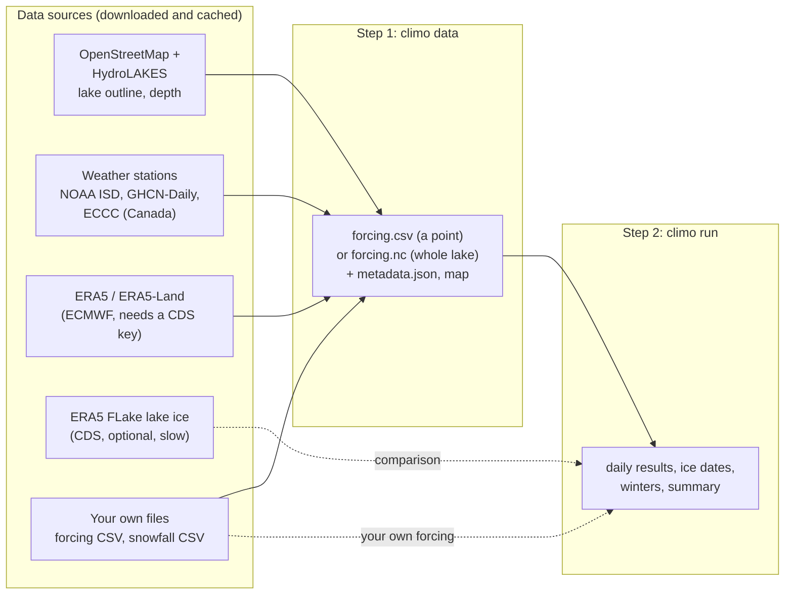

# How CLIMo runs

CLIMo works in two steps: first it builds daily weather (the **forcing**)
for a lake, then it runs the **ice model** on that forcing. Every step writes
plain files you can open, so you can stop after any step, check the result,
or bring your own file instead.

## The commands

| Command | What it does | Needs |
|---|---|---|
| `climo lake NAME` | finds a lake by name: outline, area, HydroLAKES mean depth | internet |
| `climo stations ...` | lists the weather stations within the distance limit of a lake and how much of the period each covers; writes a table and a map | internet |
| `climo data ...` | **step 1**: builds the forcing for a point (CSV) or for every cell of a lake (`--grid`, netCDF) | internet, CDS key (unless stations cover everything) |
| `climo run ...` | **step 2**: runs CLIMo for every snow scenario and writes the results | nothing (runs offline) |
| `climo batch sites.csv ...` | steps 1 and 2 for many lakes listed in a CSV, with combined tables; with `--forcing-only`, step 1 alone | as `climo data` |
| `climo gui` | the same in a window: Data, Model and Results tabs | as above |

Every command has `--help`. The same functions can be called from Python
(see the [README](overview.md#quick-start-in-python)).

## Step 1: building the forcing

CLIMo needs, for every day, the mean air temperature, relative humidity,
wind speed and cloud cover, and the snowfall (as a depth of fresh snow).

**One point** (`climo data`, the usual case):

1. **Where.** The lake is found by name (or read from an outline file, or
   given as latitude/longitude). CLIMo represents one point on it: a point
   inside the lake, or the one you give with `--lat/--lon` (e.g. a bay).
2. **Stations within the limit.** NOAA ISD (hourly, worldwide), ECCC
   (Canada: hourly records and daily snowfall) and NOAA GHCN-Daily (daily
   snowfall) are searched within `--max-station-distance` of the shore
   (default 5 km; on the lake or an island counts as 0), or of the point
   when there is no outline (default 50 km). Stations farther away are
   never used. Every station whose record could cover `--min-coverage` of
   the period is downloaded and its coverage measured; records of one
   station under successive ids (e.g. Yellowknife A, 2204100 then 2204101)
   are also spliced into one.
3. **Choice, per variable.** For each of temperature, humidity, wind,
   cloud and snowfall, the station nearest the lake point covering at
   least `--min-coverage` (90 %) of the days for that variable is used.
   You can choose stations yourself (`--station-for Snow=2204101`, or one
   per range of years, `Snow=2204100[1990-2012]+2204101[2013-2024]`), after
   looking at `climo stations` and its coverage of each year; they are used
   whatever their coverage. Your
   own snowfall file (`--snow-file`) replaces station or ERA5 snowfall.
4. **ERA5** at the nearest grid cell supplies every variable without a good
   enough station, and fills the days a station is missing (flagged in the
   `Filled` column). Cloud usually comes from ERA5, since few stations
   report it.
5. **Daily values** are means over the local solar day; snowfall water
   equivalent from ERA5-Land is converted to fresh-snow depth. With
   `--snow-method depth`, station snowfall is instead the daily rise of snow
   on the ground; short station gaps keep the station's change of depth and
   other days take ERA5-Land snowfall as above
   ([data.md](data.md#snowfall-from-snow-depth)).
6. **Files**: `forcing.csv`, `metadata.json` (every source, station,
   distance and setting, with citations) and `map.png` (lake, stations, the
   distance limit and the ERA5 cells).

**A whole lake** (`climo data --grid`): every reanalysis cell touching the
lake outline becomes its own CLIMo column, on the ERA5 grid (0.25°, about
28 km) or the ERA5-Land grid (0.1°, `--grid-source era5-land`). Stations
are not used. The folder also gets `cells.csv`, a table with a mixing depth
for each cell that you can edit or fill from lake depth data (`climo depths`),
and, with `--flake`, ERA5's own lake ice for comparison. See [grid.md](grid.md).

**Reuse.** `climo data` records its settings. Run it again with the same
folder and settings and it reuses the forcing without downloading anything;
change a setting and it rebuilds, saying what changed. Station files and
lake searches are also cached in `~/.cache/climo`, so a rebuild repeats only
part of the work. See [workflow.md](workflow.md#reusing-forcing-built-before).

**Your own forcing.** Any CSV with `Date, AirTemp, RelHum, WindSpd, Cloud,
Snow` columns can go straight to step 2: see
[workflow.md](workflow.md#your-own-forcing) for the units and rules.

## Step 2: running the model

`climo run` reads the forcing and, for every combination of snow percentage
(the share of snowfall that stays on the ice) and dry snow density, runs
CLIMo:

1. **Spin-up.** The first year is run once more before itself (or
   `--spinup-years` times), starting from 1 m of ice and 5 cm of snow, so
   that the first real year starts from a realistic state. The spin-up years
   are not in the results; CLIMo warns if the starting ice never melts
   during them (see [Spin-up years](#spin-up-years) below).
2. **Time stepping.** Four 6-hour steps per day, with the daily forcing
   interpolated between days. Each step solves the surface energy budget for
   the surface temperature, conducts heat through the snow and ice (one
   snow layer and four ice layers), and grows or melts ice at the top and
   bottom; flooded snow turns into snow ice. Open water stores heat in a
   mixed layer of depth `--mixing-depth`, which sets how late the lake
   freezes. The equations are in [model.md](model.md).
3. **Outputs**, in the forcing's folder (or `--out`):
   - `climo_daily.csv`: one row per day and scenario (ice thickness, snow
     depth, snow and congelation ice, temperatures, energy fluxes);
   - `climo_ice_dates.csv`: freeze-up, break-up and ice duration per ice
     season (August to July in the Northern Hemisphere), plus the effective
     break-up with `--breakup-threshold`;
   - `climo_winters.csv`: the maximum ice and snow of each winter;
   - `climo_summary.csv`: one row per scenario with the means over all
     winters.

   Whole-lake runs write `climo_daily.nc` and `climo_ice_dates.nc` (every
   cell) and the winters and summary of the lake mean. See
   [outputs.md](outputs.md).

## How long it takes

| Task | Typical time |
|---|---|
| Lake search | 1–5 s (cached for 30 days); the first HydroLAKES match downloads 79 MB once |
| Station search and download, one point, 10 years | 30 s – 3 min (cached afterwards) |
| ERA5 for one point, 10 years | 5–20 s |
| Whole-lake ERA5 grid, 10 years | 1–5 min (e.g. Great Slave Lake, 132 cells: about 3 min for 2 years) |
| Model, one point, 10 years, one scenario | about 1 s |
| Model, whole lake | about 2 s per cell and scenario over 10 years, spread over all CPU cores |
| ERA5 FLake lake ice (`--flake`) | one CDS request per decade, each typically 5–60 min in the CDS queue; shown before it starts |

## Choosing the options

**Point or whole lake?** A point is the default and suits most lakes,
especially small ones, and uses weather stations. Use `--grid` for large
lakes where conditions vary across the lake, or to map ice over the lake.
For lakes smaller than a grid cell, a point is better.

**Stations or ERA5?** Stations measure the local weather, including the
lake's own climate when they are on the shore; ERA5 is complete and
consistent but smooths over 28 km. The default (`--source auto`) uses
stations within the limit when they cover the period, and ERA5 for the
rest. `--source era5` gives forcing that is the same kind everywhere, which
helps when comparing many lakes. Keep the distance limit small enough that a
station shares the lake's weather: 5 km from the shore of a lake by default,
or 50 km from a point (less in mountains or on coasts).

**ERA5 or ERA5-Land grid?** ERA5-Land (0.1°) resolves smaller lakes and
shores better for temperature, humidity and wind; cloud is still ERA5
(0.25°).

**Mixing depth.** It controls freeze-up timing more than anything else. The
HydroLAKES mean depth, printed by `climo lake` and `climo data`, is a guide;
the validation cases use 10 m. For a grid, set a depth per cell in
`cells.csv` (deep basins freeze later than shallow bays).

**Snow scenarios.** Wind removes much of the snow from lake ice. Running
0, 50 and 100 % of the snowfall brackets the range, as in Duguay et al.
(2003).

### Spin-up years

Each run starts on 1 January of the first spin-up year
from a fixed state: 1 m of ice under 5 cm of snow, ice temperatures from
−28 °C at the surface to 0 °C at the base, and the water at freezing. The
spin-up years are copies of the start year, run from that state and left out
of the results; `--spinup-years` (default 1) sets how many. One is enough
for typical mixing depths: at the test sites (10 and 20 m), starting from
0 m or 2 m of ice instead of 1 m changes the reported results by 3 mm or
less. A deep mixed layer remembers the starting state for longer, because
it stores heat from one year to the next. At the S3A_209 test site (snow
50 %), with a 50 m mixing depth the first season's maximum ice was 8 mm
thicker when starting from 1 m of ice than from open water after one
spin-up year, and the same after two; with 100 m, one spin-up year gave
5 cm of ice in the first season from 1 m of starting ice and none from open
water, and 11.7 against 7.2 cm in the second; results agreed (within 1 mm)
from three spin-up years. Use three or more spin-up years for mixing depths
of about 50 m or more, and where ice may last through the summer. If the
starting ice has not melted out by the end of the spin-up, the first
seasons still show it: CLIMo then warns (in the log of `climo run`,
`climo batch` and the GUI, or as a `climo.model.SpinUpWarning` in Python)
and suggests more spin-up years.

**Effective break-up.** Lake ice usually breaks up and moves before it has
melted to nothing. `--breakup-threshold 0.1` also reports the day the ice
thins below 10 cm, which is often closer to observed break-up; the model
itself is unchanged.

**FLake comparison.** `--flake` (grid only) adds ERA5's own lake ice
model for comparison. It is off by default because the downloads are slow.

**Model options.** Without options, `climo run` is legacy CLIMo, bit for
bit. For new work, add `--fixes on`: it corrects three numerical faults of
the legacy surface-temperature solver without changing the physics, and
moves dates and thickness by at most a fraction of a day and a few
millimetres. The albedo and snow-density options (A1–A3, S1) change the
physics; whether they help depends on the lake, so run legacy first and
compare with observations. [options.md](options.md) says what each does,
where it helped and hurt at the six validation lakes, and which
combinations to use. All of them are also in the GUI's Model tab and in the
sites file of `climo batch`.

## Where files go

| Location | Contents |
|---|---|
| your data folder (`--out-dir`) | `forcing.csv`/`forcing.nc`, `metadata.json`, maps, `cells.csv`, `flake.nc`, and the results of `climo run` |
| `~/.cache/climo` (`CLIMO_CACHE`) | downloaded station files, lake searches, HydroLAKES, FLake requests: safe to delete |
| `~/.cdsapirc` | your CDS key: keep it private |
