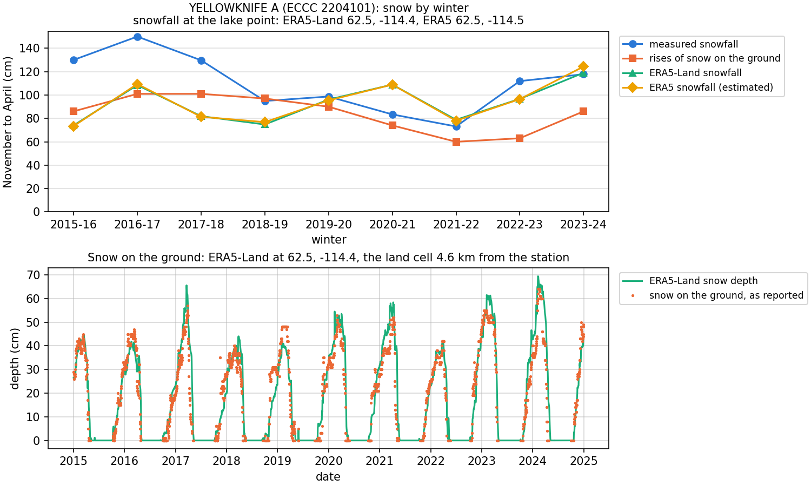
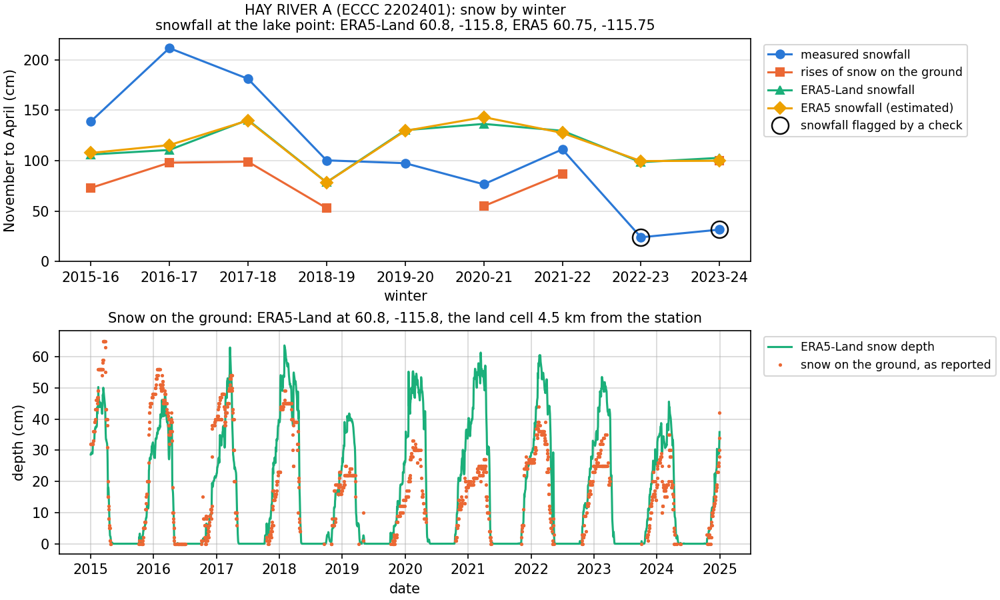
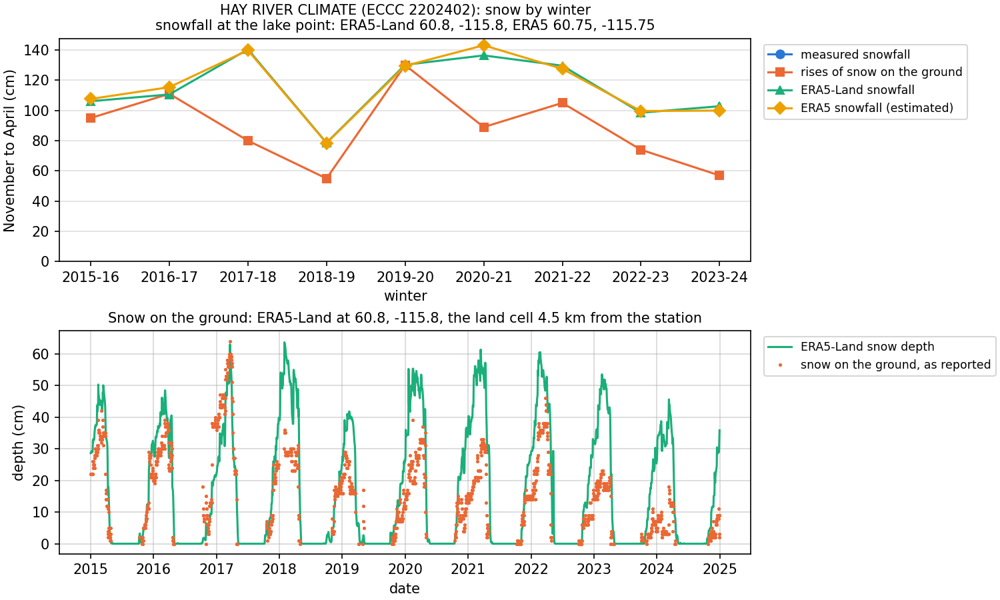
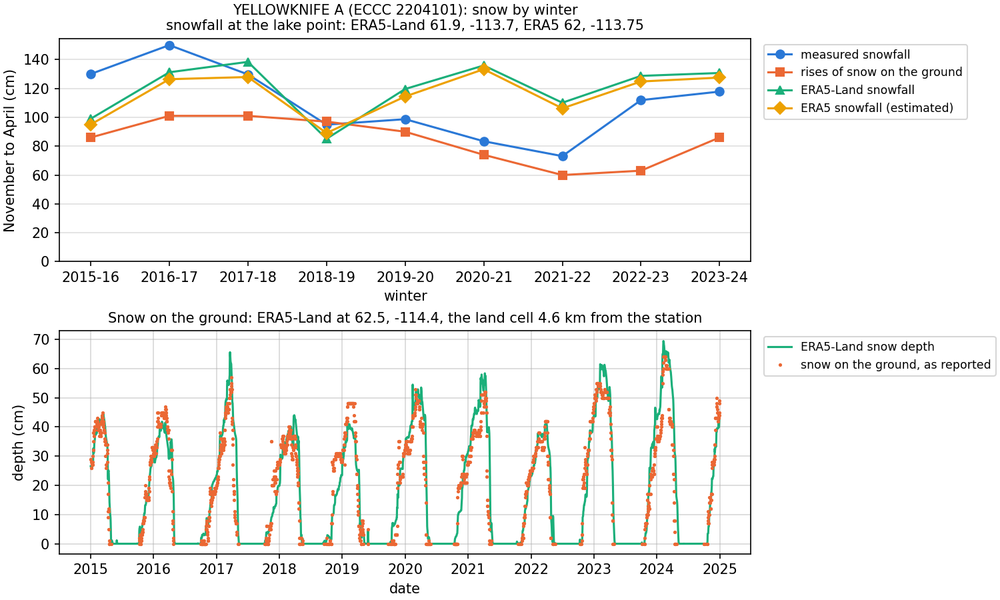

# Comparing snow sources

CLIMo can take `Snow` from a station or from a reanalysis, and the sources can
disagree by a factor of two. Before choosing, compare them for your station:
measured snowfall, the rises of snow on the ground, ERA5-Land and ERA5, winter by
winter, with checks for snowfall that looks incomplete.

The comparison only informs your choice. It never changes a forcing.

## Running it

**In the graphical interface:** on **2. Weather stations**, select a daily (snow)
station or a site and press **Compare snow...** ([gui.md](gui.md#data)). A window
shows the figure, the table and what they say, with a button to use the station
for `Snow`. The files are written next to the station list.

**On the command line:**

```bash
climo snow-compare --lat 60.84 --lon -115.78 --station 2202401 --start 2015-01-01 --end 2024-12-31 --max-station-distance 15 --out results/hay_river
```

Both write `<prefix>_snow_comparison_<id>.csv` (the winters and the reanalysis cells
used), `_daily.csv` (the daily series) and `.png`. ERA5 and ERA5-Land are read from
the ECMWF ARCO stores, so this needs the same CDS key as a forcing and makes no CDS
requests. The code is in `climo/data/snowcompare.py`.

## What is compared

| Source | Column | Where | What it is |
|---|---|---|---|
| Measured snowfall | ECCC `TOTAL_SNOW`, GHCN-Daily `SNOW` | the station | new snow measured each day |
| Rises of snow on the ground | ECCC `SNOW_ON_GROUND`, GHCN-Daily `SNWD` | the station | the rise from one day to the next, net of settling, melt and drifting ([how](data.md#snowfall-from-snow-depth)) |
| ERA5-Land snowfall | ARCO `sf`, 0.1° | the lake point | the source CLIMo fills gaps from |
| ERA5 snowfall (estimated) | ARCO `tp` and `t2m`, 0.25° | the lake point | precipitation in hours below 1 °C ([why estimated](#the-era5-estimate)) |
| ERA5-Land snow depth | ARCO `sde`, 0.1° | the land cell nearest the station | the daily mean, for the lower panel |

Reanalysis water equivalent is converted to fresh snow at 100 kg m⁻³ by default,
as for a forcing, so a change of density scales both reanalysis columns. Totals
are for **November to April**, on the days each source has a value, and a station
series is left blank for a winter if it has fewer than 70 % of those days. Snow
that falls in other months isn't counted, which matters most in the high Arctic
([by how much](data.md#how-a-station-is-judged-on-snow-on-the-ground)).

The lower panel sets snow on the ground, as reported, against ERA5-Land snow depth.
This compares the same quantity directly, with no conversion to snowfall. The figure,
the window, the command line and the table of winters all say which cell each column
uses ([why these cells](#which-cell-each-column-uses)).

**All of this is snow on land**, not on the ice. The CLIMo snow percentage stands
for what wind removes from a lake.

## How to read it

| What you see | What it suggests |
|---|---|
| Snowfall and rises both present, rises about 0.55–0.75 of snowfall | a healthy station: measured snowfall is the natural choice |
| Rises above snowfall | snowfall is probably incomplete that winter, since rises are net of settling and melt and should be smaller |
| A blank snowfall column, usable rises | the station reports only snow on the ground: use it with **Snow from** `depth`, or take ERA5-Land |
| Station peak depth well below ERA5-Land's | a wind-scoured site, or ERA5-Land too deep there: compare several stations before trusting either |
| Station far from both reanalyses in every winter | a consistent difference, which may be the site or the reanalysis cell: the comparison can't say which is right |

Reanalyses are not truth here. They are a consistent reference that doesn't depend
on an observer, which is what makes a sudden change at a station stand out.

## The checks on measured snowfall

A blank day is honest: CLIMo knows it is missing and fills it. A **0** looks like a
real report of no snow, and nothing fills it. Some stations report 0 or trace for
whole winters while snow is clearly falling, so their coverage still looks complete.
Across all 627 ECCC stations with snowfall, 2015–16 to 2024–25, at least two
independent tests confirm this at 9 stations, 7 of them staffed airports. The cause
isn't known.

Each winter gets two checks, neither of which uses the snowfall total alone:

- **Depth check:** the station's own snow on the ground rose at least 2 cm on 5 or
  more days and 15 cm in total, but snowfall is below the total of the rises and
  is above 0 (that day or the day before) on under 75 % of the days of those rises.
- **ERA5-Land check:** ERA5-Land has at least 20 cm and 5 days of 2 cm or more, but
  snowfall is under half its usual share of ERA5-Land, and is above 0 on under 0.7
  of its usual share of those big days. "Usual" is the median of at least 3 other
  winters in the period, so this check needs 4 or more winters.

The **Check** column says `likely` if both flag the winter, and `check` if one does.

**Treat a flag as a reason to look further, not a verdict.** The thresholds were
set after seeing the first case (Hay River A), so they haven't been tested blind.
In the survey above, scored against hourly weather reports at airports, each check
alone caught about half of the bad winters with few false alarms (the depth check 8 of
15, with 3 false alarms in 496 clean winters; the ERA5-Land check 8 of 15, with 2).
Requiring both had no false alarms but caught only 4 of 15, so **a clean result doesn't
prove the snowfall is complete**.

A flag changes nothing: a flagged winter stays in the forcing as reported unless you
choose otherwise, for example another station for those years with **By year...**,
or **Snow from** `depth`.

## Six stations

`python validation/snow_comparison.py` makes these, for 2015–2024, the medians of
nine winters (figures and tables in `validation/results/snow_comparison/`). They were
run at land points, so the depth and snowfall of ERA5-Land come from the same cell:

| Station | Latitude | Winters with snowfall / with depth | Snowfall / ERA5-Land | Rises / ERA5-Land | Rises / snowfall | Peak depth (cm), station / ERA5-Land | Flagged |
|---|---|---|---|---|---|---|---|
| Lloydminster A (3013961) | 53.3° N | 9 / 9 | 0.80 | 0.64 | 0.78 | 27 / 37 | none |
| La Ronge RCS (4064149) | 55.2° N | 0 / 9 | – | 0.75 | – | 53 / 55 | – |
| Hay River A (2202401) | 60.8° N | 9 / 7 | 0.86 | 0.76 | 0.56 | 35 / 55 | 2022–23 (check), 2023–24 (likely) |
| Hay River Climate (2202402) | 60.8° N | 0 / 9 | – | 0.78 | – | 36 / 55 | – |
| Yellowknife A (2204101) | 62.5° N | 9 / 9 | 1.16 | 0.94 | 0.78 | 52 / 55 | none |
| Inuvik Climate (2202578) | 68.3° N | 0 / 9 | – | 0.99 | – | 54 / 65 | – |

What they show:

- **Stations that report only snow on the ground are real data.** La Ronge RCS, Hay
  River Climate and Inuvik Climate have no measured snowfall, but nine usable winters
  of snow on the ground. They would look empty if you only looked at snowfall.
- **Snowfall and reanalysis don't agree on a single factor.** Measured snowfall ranges
  from 0.80 of ERA5-Land at Lloydminster to 1.16 at Yellowknife A, so one conversion
  won't fit every station.
- **Rises aren't a fixed share of snowfall.** They are 0.56–0.78 here in the median,
  and vary more from winter to winter (0.57 to 1.02 at Yellowknife A).

### A healthy station: Yellowknife A



Snowfall is above the rises in seven of the nine winters and about equal in the other
two (a ratio of 1.02), so neither check flags it. Each winter's peak snow on the ground
is within about 10 cm of ERA5-Land's.

### Snowfall that looks incomplete: Hay River A



Snowfall falls to 24 and 32 cm in the last two winters, while ERA5-Land stays near
100 cm and the station still reports a value on at least 90 % of the days. In 2023–24 the rises at the same station reach
100 cm, nearly three times the snowfall, so both checks flag it. In 2022–23 the
station's snow on the ground has too few days to use, so only the ERA5-Land check can
run, and the winter is marked `check`. From 2019–20 the snowfall is also lower against
ERA5-Land than before, without being flagged.

### Snow on the ground only: Hay River Climate



Less than 1 km from Hay River A, this station has no measured snowfall but usable rises
in all nine winters, including the two where Hay River A's snowfall looks incomplete. Its
rises in those winters (74 and 57 cm) stay within its range of 55–130 cm, unlike Hay River
A's snowfall. Choosing it means **Snow from** `depth`, with the smaller amounts rises give.

## Which cell each column uses

Reanalysis snowfall is read at the lake point, the cells a forcing would use. ERA5-Land
snow depth is read at the land cell nearest the station, since it stands beside the
snow on the ground at that station.

### At a point on a lake: Great Slave Lake

```bash
climo snow-compare --lat 61.9 --lon -113.7 --station 2204101 --start 2015-01-01 --end 2024-12-31 --max-station-distance 100 --out results/great_slave
```



**ERA5-Land snow depth is exactly 0 at a lake cell**, though its snowfall has values
there, so depth from the lake point would be a flat line at 0, as it was before this
was corrected. Here the point's cell (61.9, −113.7) is lake, and depth comes from
62.5, −114.4, the land cell 4.6 km from Yellowknife A, itself 73 km from the point.
Each winter's peak is then within 9 cm of the station's.

Snowfall stays at the lake cell, where it is larger than at the land cell, so measured
snowfall is 0.90 of ERA5-Land here but 1.16 of it at Yellowknife A's own cell. The
comparison says how much of that is place: "ERA5-Land snowfall there is 0.79 of that
at the lake point".

### How a land cell is recognised

The ARCO stores hold no land-sea or lake mask. ECMWF publishes both for ERA5-Land as
files attached to its
[documentation](https://confluence.ecmwf.int/display/CKB/ERA5-Land%3A+data+documentation),
which the comparison does not read, so it tells land from its snow. The rule was then
[checked against those files](#checked-against-ecmwfs-masks).

Depth above 0 isn't enough. Towards a lake, depth fades over a few cells: going south
from Yellowknife along 114.4° W, the three-year peak goes from 66 cm through 50 and 1 to
0. So a cell can have depth and still say little about the land.

Instead, a cell's own snow shows what it is. CLIMo sums the daily rises of depth over
three years (August 2015 to July 2018) and divides by the water that fell on the same
cell. Land gives about 4 to 7 metres of rises per metre of water, a lake about 0. A cell
is **land if its rate is at least 0.8 of the 90th percentile of the cells within 1°**,
and the nearest such cell is used. The years are fixed so that the cell doesn't depend
on the period being compared, even one without snow.

Dividing by snowfall matters in mountains, where depth differs far more than the rate.
`python validation/snow_comparison_cells.py` tried this at 28 places
(`land_cells.csv`), beside two simpler rules. Part of the table, as the distance from
the place and the peak depth in those years:

| Place | Nearest cell | This rule | Any depth at all | Peak at least 0.8 of its neighbours' |
|---|---|---|---|---|
| Yellowknife, on a large lake | 5 km, 66 cm | 5 km, 66 cm | 5 km, 66 cm | 5 km, 66 cm |
| Baker Lake, on a lake | 1 km, 21 cm | 11 km, 90 cm | 1 km, 21 cm | 11 km, 90 cm |
| Gore Bay, an island | 3 km, 25 cm | 13 km, 64 cm | 3 km, 25 cm | 9 km, 69 cm |
| Pelee Island, an island | 3 km, 0 cm | 36 km, 22 cm | 25 km, 11 cm | 44 km, 22 cm |
| Whitehorse, a mountain valley | 2 km, 88 cm | 2 km, 88 cm | 2 km, 88 cm | 60 km, 185 cm |
| Kelowna, a mountain valley | 5 km, 116 cm | 5 km, 116 cm | 5 km, 116 cm | 35 km, 150 cm |
| St. John's, by the sea | 4 km, 63 cm | 4 km, 63 cm | 4 km, 63 cm | 59 km, 102 cm |
| Vancouver, by the sea below mountains | 6 km, 26 cm | 14 km, 54 cm | 6 km, 26 cm | 47 km, 374 cm |
| Tampa, no snow | 5 km, 0 cm | none | none | none |

Of the 27 places with snow, this rule leaves the nearest cell at 23. The peak rule moves
14 of them, by up to 60 km and to deeper snow.

The limits of the rule:

- **A cell that passes can still read low.** La Ronge's is at 0.81, with a peak about 10 %
  below the next cells inland.
- **A small island may have no land cell of its own.** The cell is then on another shore,
  and it can depend on the years read: with 2019–2022 instead, Gore Bay moves from 13 to
  21 km and Pelee Island to the opposite shore. The other 25 places keep their cell. Look
  at the distance before trusting the depth.
- **A cold slope can be preferred to a mild coast.** Vancouver's nearest cell is land by
  ECMWF's masks but scores 0.69, perhaps because snow that melts the day it falls doesn't
  show as a rise. The rule goes 14 km to a cell with twice the peak.
- **With no land cell within 1°, depth is left blank**, not shown as 0.

### Checked against ECMWF's masks

`python validation/snow_comparison_cells.py --masks clake.nc lsm_1279l4_0.1x0.1.grb_v4_unpack.nc`
sets the rule against ECMWF's lake cover and land-sea mask for ERA5-Land, for every cell
with snowfall within 1° of the 28 places, 9,589 cells in all. The rule never sees these
masks, so they test it independently. The comparison itself doesn't read them: they are
two files of about 50 MB outside ARCO, and the rule is enough.

**The rule took none of the cells with lake cover of 0.5 or more as land**, and refused 3.1 %
of clean land (196 of 6,364 cells with lake cover below 0.1, a land-sea mask above 0.9 and
under 10 m of snow). It also refused all nine cells with 10 m of snow or more, which ECMWF
says mark glaciers, where depth is not well known.

| Lake cover | Cells | Taken as land | Median share of the rate of the cells around | Median peak depth (cm) |
|---|---|---|---|---|
| 0.1 or less | 7,018 | 97 % | 0.96 | 82 |
| 0.1–0.2 | 925 | 96 % | 0.98 | 80 |
| 0.2–0.3 | 355 | 81 % | 0.97 | 81 |
| 0.3–0.35 | 87 | 63 % | 0.87 | 68 |
| 0.35–0.4 | 80 | 46 % | 0.76 | 55 |
| 0.4–0.45 | 51 | 16 % | 0.50 | 33 |
| 0.45–0.5 | 44 | 9 % | 0.52 | 25 |
| 0.5–0.55 | 39 | 0 | 0.31 | 23 |
| 0.55–0.6 | 35 | 0 | 0.25 | 19 |
| 0.6–0.7 | 73 | 0 | 0.24 | 13 |
| 0.7–0.8 | 58 | 0 | 0.21 | 5 |
| Above 0.8 | 824 | 0 | 0.12 | 0 |

Depth doesn't fall in step with lake cover: a cell a quarter lake still has nearly the
depth of the land, and most of the loss comes between about 0.3 and 0.5
(`land_rule_by_lake_cover.csv`). So depth isn't a mean over the lake and land in a cell.
ERA5-Land runs on a 9 km grid and comes as 0.1°, and this fits cells that are mostly lake
being mixed with land on the way, though ECMWF doesn't say how the grid is made. The
land-sea mask alone wouldn't do either: by the sea it can be low with full depth (Cambridge
Bay's cell is 0.58 land at a share of 0.96), since ERA5-Land leaves the sea out rather than
counting it as water without snow.

**The threshold of 0.8 was set before this check, and it holds up** (`land_rule_thresholds.csv`):

| Threshold | Cells with lake cover of 0.5 or more taken as land | Clean land refused | Places given another cell than at 0.8 |
|---|---|---|---|
| 0.6 | 6 | 0.3 % | 4 of 27 |
| 0.7 | 0 | 0.8 % | 3 |
| 0.75 | 0 | 1.3 % | 1 |
| **0.8** | **0** | **3.1 %** | – |
| 0.85 | 0 | 6.7 % | 6 |
| 0.9 | 0 | 16.4 % | 10 |

Between 0.7 and 0.8 little changes. At 0.75 only Gore Bay differs, with a cell 8 km nearer
and the same peak, so 0.8 was kept rather than tuned to the test.

**Against the best rule found from the masks, nearest cell with lake cover below 0.35 and a
land-sea mask above 0.5, the two pick the same cell at 24 of the 27 places**
(`land_cells_masks.csv`):

| Place | This rule | From the masks | Better |
|---|---|---|---|
| Baker Lake | 11 km, 90 cm, lake cover 0.04 | 6 km, 58 cm, lake cover 0.26 | this rule: the masks' cell reads a third low |
| Gore Bay | 13 km, 64 cm, lake cover 0.26 | 6 km, 63 cm, lake cover 0.27 | the masks: as deep, and nearer |
| Vancouver | 14 km, 54 cm, lake cover 0.10 | 6 km, 26 cm, lake cover 0.07 | probably the masks: land, and nearer |

The 0.35 was chosen after seeing the table above, so this favours the masks. A stricter
rule of lake cover below 0.1 puts the cell of La Ronge, Sioux Lookout and Gore Bay 27 to
47 km from the place, though Sioux Lookout's nearest cell, with lake cover of 0.34, has the
full depth.

### Why snowfall stays at the lake point

The comparison is for choosing where `Snow` comes from, and what ERA5-Land would give
the lake is its snowfall at the lake cell. Moving the column to the station's cell would
compare with a series no forcing uses. The table sets the two side by side at ten points
on lakes, for 2015–2024 (`lake_and_station_snowfall.csv`):

| Lake point, station | km | ERA5-Land, lake cell / station's cell | Snowfall / ERA5-Land at the lake cell | at the station's cell | Daily correlation with snowfall, lake cell | at the station's cell | Winters flagged, either cell |
|---|---|---|---|---|---|---|---|
| Okanagan Lake, Okanagan Centre | 12 | 0.94 | 0.52 | 0.51 | 0.53 | 0.47 | none |
| Lake Simcoe, Baldwin | 16 | 1.04 | 0.85 | 0.87 | 0.67 | 0.68 | none |
| Lac Saint-Jean, Roberval A | 22 | 0.94 | 0.99 | 0.93 | 0.90 | 0.91 | none |
| Baker Lake, Baker Lake A | 26 | 1.02 | 0.78 | 0.80 | 0.53 | 0.54 | 3 |
| Lake Superior, Hazelwood | 40 | 1.07 | 0.89 | 0.93 | 0.60 | 0.63 | none |
| Lake of the Woods, Indian Bay | 51 | 1.03 | 0.66 | 0.71 | 0.63 | 0.62 | 1 |
| Great Slave Lake (west), Hay River A | 66 | 1.10 | 0.85 | 0.86 | 0.62 | 0.64 | 2 |
| Great Slave Lake, Yellowknife A | 73 | 1.29 | 0.90 | 1.16 | 0.57 | 0.62 | none |
| Lake Winnipeg, Hodgson 3 | 88 | 1.13 | 0.63 | 0.77 | 0.54 | 0.64 | none |
| Lake Nipigon, Geraldton A | 112 | 1.26 | 0.77 | 0.97 | 0.77 | 0.89 | none |

- **The checks flag the same winters at all ten**, with either cell. The depth check
  reads no reanalysis, and the ERA5-Land check sets a winter against the station's other
  winters, so a steady difference between cells drops out. Neither reads reanalysis depth,
  so moving the depth cell doesn't touch them: all six stations above keep their numbers
  and flags to the last digit.
- **Within about 60 km the choice hardly matters**: the ratio moves by at most 0.06, and
  the daily correlation by at most 0.06, in either direction.
- **Further away the ratio mixes place with source.** At 73 km and beyond the ratio is
  0.14 to 0.26 lower at the lake cell. Across winters, snowfall follows the station's
  own cell better at Lake Nipigon (a correlation of 0.87 against 0.51 at the lake cell)
  and Lake Winnipeg (0.35 against −0.05), though not at Great Slave Lake (0.17 against
  0.27). So with a distant station, read the ratio together with the line saying how the
  two cells differ, and don't take the gap as an error in the station.

ERA5-Land snowfall changes gradually over this distance, not at the shore: along 114.4° W
it rises by about a quarter over the 70 km south of Yellowknife, most of them over the
lake. So a distant station may be right about its own place and still not say what fell
on the lake.

## The ERA5 estimate

**The ARCO store of ERA5 single levels has no snowfall variable**, so true ERA5
snowfall isn't available from it, while ERA5-Land's does have one. The column here
is an estimate: ERA5 total precipitation (`tp`) in the hours when its 2 m temperature
(`t2m`) is below 1 °C. It is never used in a forcing.

The threshold was picked by comparing with ERA5-Land snowfall at five sites over nine
years (mean mm of water per year):

| Site | Total precipitation | Below −1 °C | Below 0 °C | Below 1 °C | ERA5-Land snowfall |
|---|---|---|---|---|---|
| Yellowknife | 299 | 100 | 106 | 112 | 114 |
| Hay River | 407 | 120 | 125 | 134 | 135 |
| Baker Lake | 412 | 148 | 159 | 181 | 180 |
| Lloydminster | 504 | 99 | 112 | 126 | 124 |
| Inuvik | 329 | 127 | 136 | 148 | 147 |

Over the six stations and the whole of 2015–2024, the estimate is 0.97–1.01 of
ERA5-Land snowfall, with a daily correlation of 0.96–0.98
(`validation/results/snow_comparison/era5_estimate.csv`). At the Great Slave Lake point,
whose 0.25° cell is centred 11 km from the point, it is 0.93.

Two limits follow:

- **It has not been checked against true ERA5 snowfall.** The threshold was chosen to
  match ERA5-Land, so that agreement can't be taken as independent evidence of accuracy.
- **It adds little beyond ERA5-Land.** ERA5-Land is driven by ERA5, so the two nearly
  coincide on the figures. What the ERA5 line can show is the difference a coarser
  cell makes (0.25° against 0.1°), which matters most in complex terrain.

## See also

- [Weather stations and the distance limit](data.md#weather-stations-and-the-distance-limit)
- [Snowfall from snow depth](data.md#snowfall-from-snow-depth): how rises and their gaps
  are handled in a forcing, and why measured snowfall stays the default
- [Snow on the ground as observed](data.md#snow-on-the-ground-as-observed): the
  `snow_depth.csv` written with a forcing
