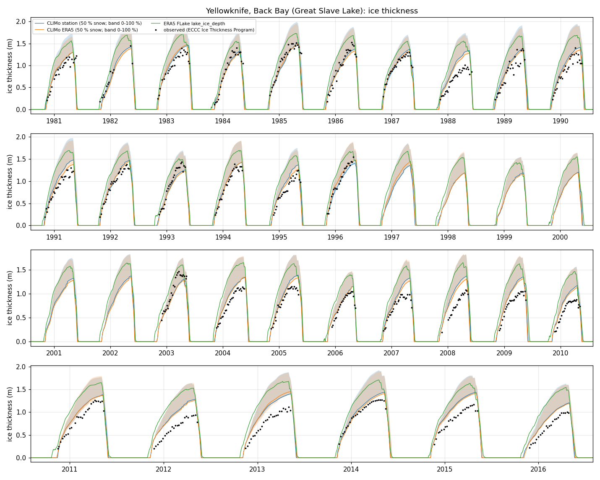
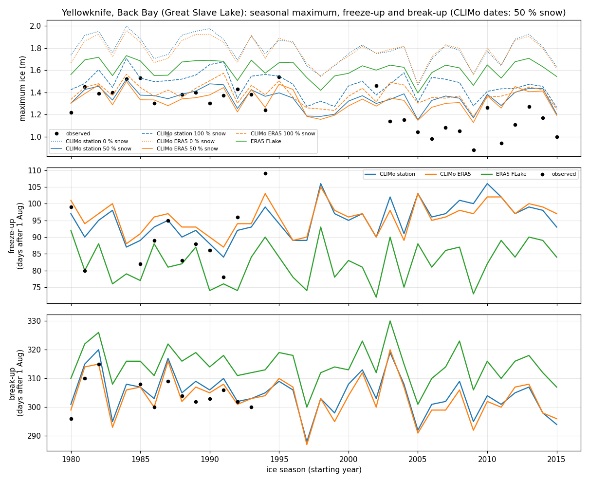
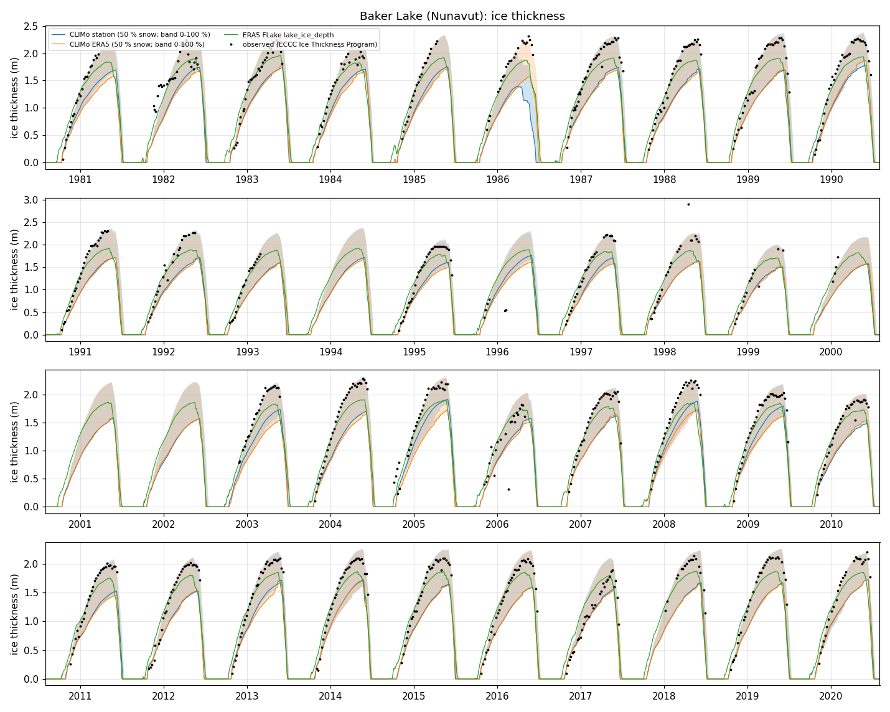
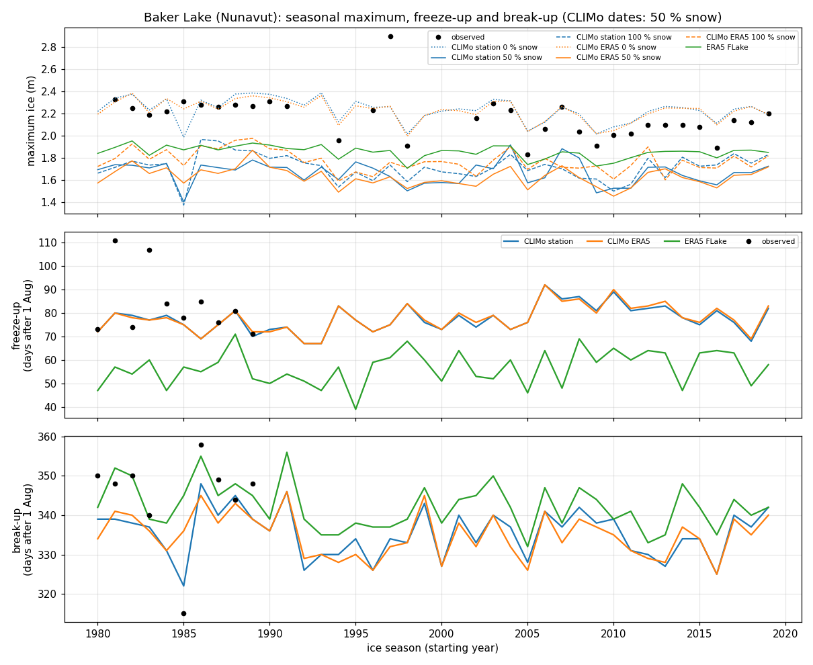
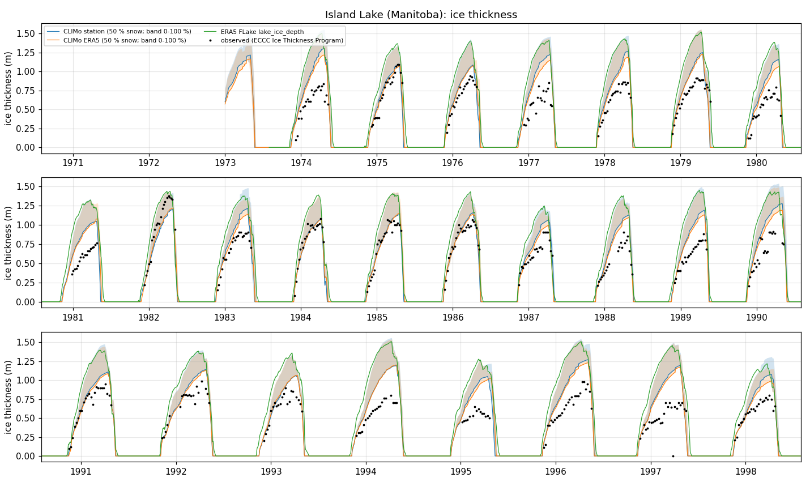
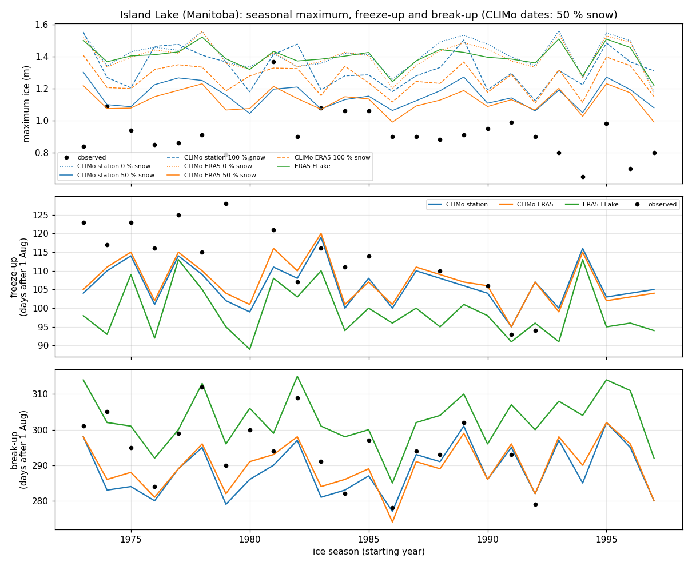

# Validation cases

CLIMo Classic is compared with lake-ice observations at six lakes of the
Canadian Ice Thickness Program, as roadmap step 7: two northern sites with
records to 2020, and four lakes further south from the program's 1947–2002
collection. Each site has four series:

1. **CLIMo, station forcing:** the nearest weather station (usually the
   airport), with days it misses filled from ERA5.
2. **CLIMo, ERA5 forcing:** ERA5, with ERA5-Land snowfall.
3. **ERA5 FLake:** ERA5's own lake ice (`lake_ice_depth`) at the same ERA5 cell.
4. **Observations:** weekly ice thickness and snow depth on the ice, plus
   freeze-up and break-up dates.

Nothing is calibrated. The snow scenarios (0, 50 and 100 % of the snowfall
staying on the ice) and the mixing depth (10 m) were fixed before the
comparison, and all of them are reported. The scripts are in
[`validation/`](../validation); results are in
[`validation/results/`](../validation/results).

```bash
pip install -e ".[validation]"        # data module + cdsapi, xlrd, openpyxl
python validation/run.py --list       # the sites
python validation/run.py --site gimli
python validation/run.py --site all
```

(`python validation/yellowknife.py` and `baker_lake.py` still run those two.)

The first run downloads the observations, builds the forcing (station data
and ERA5 from ECMWF's ARCO stores, as `climo data` does), and requests ERA5
FLake ice from the Copernicus Climate Data Store (CDS) with
`climo.data.flake`. The CDS step takes
about 10 minutes per decade per site, because the CDS handles one request at
a time per user. Later runs reuse everything in `validation/data/`, which is
not committed. It needs the CDS key described in
[data.md](data.md#setting-up-era5-access-cds-key) and acceptance of the ERA5
licence on the CDS.

## Sites

| Site | Point (lat, lon) | Lake | Seasons compared | Thickness measurements | Freeze-up / break-up |
|---|---|---|---|---|---|
| Yellowknife, Back Bay | 62.45, −114.37 | Great Slave Lake, sheltered bay at Yellowknife | 1980–81 to 2015–16 | 756 (1980–1996, 2002–2016) | 11 / 12 seasons, 1980–1995 |
| Baker Lake | 64.30, −96.08 | Baker Lake, Nunavut (1,665 km², HydroLAKES mean depth 60 m) | 1980–81 to 2019–20 | 1,022 (1980–2000, 2002–2020) | 10 / 9 seasons, 1980–1990 |
| Island Lake | 53.85, −94.65 | Island Lake, Manitoba (boreal Shield lake) | 1973–74 to 1997–98 | 555 (1973–1998) | 16 / 19 seasons, 1973–1992 |
| Big Trout Lake | 53.83, −89.87 | Big Trout Lake, Ontario | 1973–74 to 1991–92 | 489 (1973–1992) | 18 / 18 seasons, 1973–1991 |
| Gimli | 50.62, −96.98 | Lake Winnipeg (south basin) at Gimli, Manitoba | 1973–74 to 1990–91 | 275 (1973–1991) | 18 / 17 seasons, 1973–1990 |
| Lac des Sables | 46.05, −74.28 | Lac des Sables, Sainte-Agathe-des-Monts, Quebec (small, deep lake) | 1976–77 to 1991–92 | 248 (1976–1992) | 15 / 16 seasons, 1976–1991 |

Back Bay is the Ice Thickness Program site used in the CLIMo study of Great
Slave Lake by Ménard et al. (2002), and in Kheyrollah Pour et al. (2012).
Baker Lake has the longest recent record of the program's lake sites. The
program's other recent sites are mostly on sea ice, including Cambridge Bay
(Dease Strait), Resolute, Iqaluit, Alert, Eureka, Coral Harbour and Hall
Beach. Inuvik is on a channel of the Mackenzie River. They are not used,
because CLIMo is a freshwater lake model.

The four southern lakes were chosen from the 1947–2002 collection by three
criteria, fixed before any model run: a freshwater lake (not a river, bay of
the sea or reservoir), at least 10 seasons after 1972 with 10 or more
measurements, and a Canadian Lake Ice Database record of freeze-up and
break-up for the same lake; and a weather station with hourly records within
50 km. The other candidates either failed one of these (Primrose Lake: no
hourly station with a long record within 50 km; Fort Chipewyan: one season of
ice dates; Norway House: a river reach) or are further north (Cree Lake,
Schefferville). Their measurements end in the 1990s, before the 2002–2024
collection, which lists only northern sites. Gimli has only 7 seasons whose
measurements cover the whole winter (its measurements often end in March),
so its seasonal-maximum metric rests on few seasons; the other metrics use
every measurement. ECCC hourly records (new in `climo.data`) fill long gaps
in NOAA's archive at these sites: Big Trout Lake, for example, has ISD
records only for 1973–1977 but ECCC hourly records to 1992.

## Data sources

| Data | Source | Licence |
|---|---|---|
| Ice thickness and snow depth on the ice, about weekly from freeze-up to break-up | ECCC, Canadian Ice Thickness Program: [Ice Thickness Program Collection, 1947–2002](https://open.canada.ca/data/en/dataset/054cb024-e0bc-43ae-90c7-d9e23517ab8e) and [2002–2024](https://open.canada.ca/data/en/dataset/8b624b7b-2e8f-436b-b9bd-f31c2e6613cf) (files from the [ECCC ice thickness page](https://www.canada.ca/en/environment-climate-change/services/ice-forecasts-observations/latest-conditions/archive-overview/thickness-data.html)) | Open Government Licence – Canada |
| Freeze-up and break-up dates | Canadian Lake Ice Database records (Lenormand et al., 2002) contributed by W. Skinner (ECCC) to the [Global Lake and River Ice Phenology Database](https://nsidc.org/data/g01377/versions/1) (Benson et al., 2000), lake codes WRS201 (Back Bay), WRS203 (Baker Lake), WRS265 (Island Lake), WRS213 (Big Trout Lake), WRS311 (Lake Winnipeg) and WRS279 (Lac des Sables) | free; citation required |
| Station forcing | NOAA ISD-Lite and GHCN-Daily, and ECCC hourly and daily records (MSC GeoMet), via `climo.data` (see [data.md](data.md)) | public domain (NOAA); Open Government Licence – Canada (ECCC) |
| ERA5 forcing | ERA5 and ERA5-Land from ECMWF's ARCO stores via `climo.data` | CC-BY 4.0 (Copernicus) |
| ERA5 lake ice | ERA5 hourly single levels, `lake_ice_depth` (`licd`) at 12 UTC each day, and `lake_cover` (`cl`), from the CDS API (`reanalysis-era5-single-levels`) | CC-BY 4.0 (Copernicus) |

The small extracts used by the scripts are committed in
[`validation/observations/`](../validation/observations): one CSV of
thickness and one of ice dates per site. `common.extract_observations`
rebuilds them from the original files.

**Why the ERA5 lake ice comes from the CDS.** ECMWF's ARCO stores used by
`climo.data` (and by other pipelines) do not contain the lake variables. The
ERA5 single-level ARCO product holds 20 surface variables plus a wave store,
and the ERA5-Land ARCO product holds 2 m temperature, wind, pressure and
precipitation, radiation, skin and soil temperature, soil water and snow
(ECMWF product user guides, checked October 2026). Google's ARCO-ERA5 has
the lake variables, but each of its chunks holds one global field per hour,
so a daily series means reading about 15,000 global fields per site. A CDS
request for a 1° box, one time per day, downloads about 0.4 MB per decade.

## Method

**Forcing.** Both forcings are built by `climo.data.folder.prepare_forcing`,
the code behind `climo data --out-dir`, from 1 January of the first year to
31 December of the last (1980 for the northern sites, 1973 or 1976 for the
southern ones). Station forcing uses `source="auto"` with stations accepted
when they cover 80 % of the days (the default is 90 %). With that threshold
the airport snowfall records are used: they cover 88 % (Yellowknife A) and
81 % (Baker Lake A) of the 37–41 years. Days a station misses are filled
from ERA5 and flagged in `Filled`. Cloud comes from the airport ISD record
at the two northern sites and from ERA5 at the southern ones. ERA5 forcing uses `source="era5"`: ERA5 at the nearest
0.25° cell, plus ERA5-Land snowfall at the nearest land cell, converted to
fresh snow at 100 kg m⁻³ (see [data.md](data.md#snowfall)).

| Site | Stations used | ERA5 cell | ERA5-Land snow cell |
|---|---|---|---|
| Yellowknife | ISD 719360 Yellowknife (3.9 km); GHCN CAN02204100 Yellowknife A (snowfall) | 62.50, −114.25 (8.3 km) | 62.5, −114.4 (5.8 km) |
| Baker Lake | ISD 719260 Baker Lake (0.2 km); GHCN CAN02300500 Baker Lake A (snowfall) | 64.25, −96.00 (6.8 km) | 64.3, −96.1 (1.0 km) |
| Island Lake | ECCC 5061376 Island Lake A (0.0 km); GHCN CAN05061376 (snowfall) | 53.75, −94.75 (12.9 km) | at the site |
| Big Trout Lake | ECCC 6010738 Big Trout Lake (0.4 km); GHCN CAN06010738 (snowfall) | 53.75, −89.75 (11.9 km) | at the site |
| Gimli | ECCC 5031038 Gimli (3.0 km); GHCN CAN05031038 (snowfall) | 50.50, −97.00 (13.4 km) | at the site |
| Lac des Sables | ECCC 7036762 Ste-Agathe-des-Monts (0.3 km); GHCN CAN07036762 (snowfall) | 46.00, −74.25 (6.0 km) | at the site |

At the four southern sites the hourly records come from ECCC, which covers
the whole period at each (ISD has only parts of it), so cloud comes from
ERA5 there.

How the two forcings compare over the full periods at the northern sites
(ERA5 minus station):

| Site | Air temperature | Relative humidity | Wind | Cloud | Snowfall per season |
|---|---|---|---|---|---|
| Yellowknife | −0.10 °C, r = 0.998 | +4.6 %, r = 0.85 | −0.10 m s⁻¹, r = 0.86 | +0.05, r = 0.70 | 1.19 m vs 1.50 m (−21 %) |
| Baker Lake | +0.13 °C, r = 0.992 | +1.6 %, r = 0.84 | −0.24 m s⁻¹, r = 0.85 | +0.16, r = 0.60 | 1.87 m vs 1.36 m (+37 %) |

**CLIMo.** CLIMo Classic runs from the first to the last year, with the
first year repeated as spin-up. It uses the site latitude and a mixing depth of 10 m, the value of
the Yellowknife reference case in `tests/`. Neither site has a measured
value, and the HydroLAKES mean depth (60 m for Baker Lake) describes the
whole lake, not the sheltered, near-shore measurement sites. Runs at 5 m
and 20 m show how much the results depend on this choice; they are not
used to pick a value. Snow
scenarios are 0, 50 and 100 % of the snowfall reaching the ice, at the
default dry snow density of 330 kg m⁻³. 0 and 100 % are the no-snow and
full-snow bounds of earlier CLIMo studies (Duguay et al., 2003), and 50 %
is the midpoint.

**ERA5 FLake.** ERA5 represents lakes with the FLake model (Mironov et al.,
2010) in each grid cell that contains lake water (Balsamo et al., 2012).
Its ice is taken at the same cell as the ERA5 forcing. In the IFS, FLake
runs without its snow module: snow over lake ice affects only the albedo
and does not accumulate (Choulga et al., 2019). FLake ice should therefore
be compared with CLIMo's 0 % snow scenario. FLake freeze-up and break-up
are the first day of the season's longest run of days with more than 1 mm
of ice, and the first ice-free day after it.

**Comparison.** For every model series and snow scenario:

- *ice thickness*: model value on each measurement date, against the
  measurement;
- *maximum ice thickness*: the season's maximum, for seasons whose
  measurements cover the winter (at least 10 measurements, the last in
  April or later);
- *freeze-up and break-up*: model date minus observed date, in days;
- *effective break-up*: the first day after the season's maximum when
  CLIMo's ice is thinner than 0.1 m ([outputs.md](outputs.md#effective-break-up---breakup-threshold)),
  minus the observed break-up. The threshold was fixed in advance, not
  tuned;
- *snow depth on the ice*: model `SnowDepth` against the measured snow
  depth, as a check of the snow scenario rather than of the ice.

MAE is the mean absolute error and bias the mean of model minus
observation. ITP measurements and CLIMo days are both local dates; FLake
values are at 12 UTC (04–06 local solar time).

The ice-season label follows [outputs.md](outputs.md): 1 August to 31 July.
Only seasons simulated in full are compared, from the season starting in
the first model year to the season ending in the last.

## Results

The full tables are in
[`validation/results/metrics.csv`](../validation/results/metrics.csv) (all
runs, including the mixing-depth runs) and `<site>_seasons.csv` (per season:
observed and modelled maximum ice and dates). Figures:
`<site>_thickness.png` shows every season, and `<site>_seasons.png` shows
maxima, freeze-up and break-up.

**Yellowknife, Back Bay**, MAE / bias (model − observed)

| Model | Snow scenario | Ice thickness (m) | Seasonal maximum (m) | Freeze-up (days) | Break-up (days) | Snow on the ice (m) |
|---|---|---|---|---|---|---|
| CLIMo station | 0 % | 0.43 / +0.42 | 0.55 / +0.55 | 5.0 / +2.3 | 7.3 / +7.3 | 0.16 / −0.16 |
| CLIMo station | 50 % | 0.14 / +0.09 | 0.16 / +0.11 | 5.1 / +2.2 | 3.8 / +3.6 | 0.07 / +0.04 |
| CLIMo station | 100 % | 0.20 / +0.17 | 0.25 / +0.24 | 5.1 / +2.2 | 6.4 / +6.4 | 0.08 / +0.07 |
| CLIMo ERA5 | 0 % | 0.41 / +0.40 | 0.54 / +0.54 | 6.4 / +4.9 | 6.2 / +6.2 | 0.16 / −0.16 |
| CLIMo ERA5 | 50 % | 0.13 / +0.07 | 0.15 / +0.09 | 6.4 / +4.9 | 2.5 / +1.8 | 0.06 / +0.03 |
| CLIMo ERA5 | 100 % | 0.14 / +0.10 | 0.18 / +0.15 | 6.4 / +4.9 | 3.8 / +3.7 | 0.07 / +0.06 |
| ERA5 FLake | — | 0.36 / +0.35 | 0.37 / +0.37 | 7.6 / −7.6 | 11.8 / +11.8 | — |
| *n* | | 756 | 30 | 11 | 12 | 756 |




**Baker Lake**, MAE / bias (model − observed)

| Model | Snow scenario | Ice thickness (m) | Seasonal maximum (m) | Freeze-up (days) | Break-up (days) | Snow on the ice (m) |
|---|---|---|---|---|---|---|
| CLIMo station | 0 % | 0.10 / +0.07 | 0.12 / +0.06 | 9.3 / −8.3 | 5.3 / +3.1 | 0.04 / −0.04 |
| CLIMo station | 50 % | 0.37 / −0.36 | 0.49 / −0.49 | 9.3 / −8.3 | 7.9 / −6.1 | 0.17 / +0.17 |
| CLIMo station | 100 % | 0.36 / −0.35 | 0.45 / −0.45 | 9.3 / −8.3 | 7.0 / −3.9 | 0.21 / +0.21 |
| CLIMo ERA5 | 0 % | 0.09 / +0.06 | 0.10 / +0.06 | 9.3 / −8.3 | 6.9 / +2.7 | 0.04 / −0.04 |
| CLIMo ERA5 | 50 % | 0.40 / −0.39 | 0.53 / −0.53 | 9.3 / −8.3 | 10.2 / −5.6 | 0.20 / +0.19 |
| CLIMo ERA5 | 100 % | 0.35 / −0.34 | 0.39 / −0.39 | 9.3 / −8.3 | 8.0 / −1.8 | 0.23 / +0.23 |
| ERA5 FLake | — | 0.20 / −0.10 | 0.32 / −0.32 | 28.1 / −28.1 | 6.3 / +2.1 | — |
| *n* | | 1022 | 33 | 10 | 9 | 1022 |




All rows use a 10 m mixing depth. Freeze-up hardly depends on the snow
scenario, because snow falls on the ice only after freeze-up.

**The four southern lakes**, MAE / bias (model − observed), for the 50 %
snow scenario (the one whose snow depth on the ice matches the measurements
at all four) and ERA5 FLake. The other scenarios are in `metrics.csv`.

| Site | Model | Ice thickness (m) | Seasonal maximum (m) | Freeze-up (days) | Break-up (days) | Snow on the ice (m) |
|---|---|---|---|---|---|---|
| Island Lake | CLIMo station | 0.19 / +0.16 | 0.26 / +0.24 | 8.9 / −6.6 | 7.3 / −6.7 | 0.06 / +0.01 |
| | CLIMo ERA5 | 0.16 / +0.14 | 0.22 / +0.21 | 8.1 / −5.4 | 6.6 / −5.6 | 0.06 / +0.01 |
| | ERA5 FLake | 0.41 / +0.40 | 0.48 / +0.48 | 13.9 / −13.7 | 8.1 / +7.7 | — |
| | *n* | 555 | 25 | 16 | 19 | 555 |
| Big Trout Lake | CLIMo station | 0.11 / +0.00 | 0.11 / +0.02 | 4.8 / −3.6 | 12.3 / −12.1 | 0.06 / +0.03 |
| | CLIMo ERA5 | 0.12 / −0.04 | 0.10 / −0.02 | 2.9 / +0.3 | 12.5 / −12.4 | 0.06 / +0.02 |
| | ERA5 FLake | 0.26 / +0.23 | 0.27 / +0.27 | 8.4 / −8.4 | 3.4 / +0.7 | — |
| | *n* | 489 | 18 | 18 | 18 | 488 |
| Gimli (Lake Winnipeg) | CLIMo station | 0.14 / −0.06 | 0.15 / +0.04 | 3.7 / −1.9 | 10.3 / −10.3 | 0.08 / +0.05 |
| | CLIMo ERA5 | 0.14 / −0.07 | 0.15 / +0.01 | 4.5 / −4.3 | 12.3 / −12.3 | 0.08 / +0.05 |
| | ERA5 FLake | 0.20 / +0.20 | 0.26 / +0.26 | 17.1 / −17.1 | 2.6 / +0.2 | — |
| | *n* | 275 | 7 | 18 | 17 | 275 |
| Lac des Sables | CLIMo station | 0.16 / +0.11 | 0.19 / +0.17 | 5.2 / +4.8 | 3.8 / −1.6 | 0.07 / −0.02 |
| | CLIMo ERA5 | 0.13 / +0.08 | 0.14 / +0.11 | 3.9 / +3.6 | 4.9 / −4.5 | 0.07 / −0.03 |
| | ERA5 FLake | 0.24 / +0.21 | 0.24 / +0.24 | 15.1 / −15.1 | 3.2 / −1.5 | — |
| | *n* | 248 | 10 | 15 | 16 | 248 |




Figures for the other lakes: `big_trout_lake_*.png`, `gimli_*.png` and
`lac_des_sables_*.png` in [`validation/results/`](../validation/results).

**Effective break-up (ice thinner than 0.1 m)**, bias in days with station
forcing, beside the zero-ice break-up, in the scenario matching the
measured snow:

| Site | Scenario | Break-up (zero ice) | Effective break-up (< 0.1 m) |
|---|---|---|---|
| Yellowknife | 50 % | +3.6 | +2.0 |
| Baker Lake | 0 % | +3.1 | +1.8 |
| Island Lake | 50 % | −6.7 | −8.1 |
| Big Trout Lake | 50 % | −12.1 | −13.3 |
| Gimli | 50 % | −10.3 | −11.7 |
| Lac des Sables | 50 % | −1.6 | −3.2 |

**Mixing depth (sensitivity, 50 % snow).** Freeze-up bias in days:

| Site | Forcing | 5 m | 10 m | 20 m |
|---|---|---|---|---|
| Yellowknife | station | −6.6 | +2.2 | +15.6 |
| Yellowknife | ERA5 | −4.4 | +4.9 | +19.0 |
| Baker Lake | station | −16.3 | −8.3 | +4.0 |
| Baker Lake | ERA5 | −17.8 | −8.3 | +4.0 |
| Island Lake | station | −14.2 | −6.6 | +11.2 |
| Island Lake | ERA5 | −13.1 | −5.4 | +11.4 |
| Big Trout Lake | station | −10.7 | −3.6 | +12.3 |
| Big Trout Lake | ERA5 | −7.4 | +0.3 | +16.4 |
| Gimli | station | −12.3 | −1.9 | +15.3 |
| Gimli | ERA5 | −13.3 | −4.3 | +11.1 |
| Lac des Sables | station | −7.0 | +4.8 | +26.1 |
| Lac des Sables | ERA5 | −6.4 | +3.6 | +23.9 |

At the northern sites the bias of the seasonal maximum changes by less
than 0.05 m, and break-up by less than 1.5 days, between 5 and 20 m; at the
southern sites the seasonal maximum changes by up to 0.2 m (Lac des Sables,
where a deep mixed layer delays freeze-up by weeks).

### Findings

1. **Snow on the ice controls the thickness, and the measured snow picks
   out the scenario.** At both northern sites, the snow scenario whose snow depth
   on the ice matches the Ice Thickness Program measurements is also the
   one closest in thickness:
   - At Yellowknife, 50 % gives a snow bias of +0.03 to +0.05 m and a
     thickness bias of +0.07 to +0.09 m.
   - At Baker Lake, 0 % gives −0.04 m of snow and +0.06 to +0.07 m of ice.

   Baker Lake is open tundra, and wind leaves little snow on its ice: the
   mean measured depth in February to April is 4.5 cm, against 22 cm at
   Back Bay. With 50 or 100 % of the snowfall on the ice, CLIMo's ice there
   is 0.35–0.53 m too thin. This is a consistency check, not a calibration.
   The same three scenarios were run at every site. At the four southern
   lakes, which are sheltered by forest, 50 % matches the measured snow
   (bias −0.03 to +0.05 m). It is also the scenario closest in thickness
   at Island Lake and Big Trout Lake; at Gimli the three scenarios are
   within 0.01 m of each other, and at Lac des Sables 0 % is slightly
   closer.
   No scenario works at every site: the share of snowfall that stays on
   the ice is a property of the site.
2. **Station or ERA5 forcing matters little.** In the scenario that
   matches the measured snow, the MAE with ERA5 forcing is within 0.05 m of
   the MAE with station forcing, for both thickness and seasonal maximum,
   at all six sites, and ERA5 is as good or slightly better at most.
   In the other scenarios the gap is up to 0.07 m. ERA5-Land snowfall
   differs from the gauges by −21 % (Yellowknife) and +37 % (Baker Lake),
   but air temperature agrees closely (r ≥ 0.99, bias ≤ 0.13 °C), and
   temperature drives congelation growth.
3. **Freeze-up depends mostly on the mixing depth.** With 10 m, freeze-up
   is within 9 days at every site (bias −8.3 to +4.9 days, MAE 3–9 days).
   Moving the mixing depth from 5 to 20 m shifts freeze-up by 20–33 days,
   so agreement in freeze-up mostly tests this parameter. No site has a
   measured value.
4. **Break-up** is within a few days at the northern sites in the
   scenarios that match the measured snow: Yellowknife 50 % is +1.8 to
   +3.6 days (MAE 2.5–3.8), and Baker Lake 0 % is +2.7 to +3.1 days (MAE
   5–7). At the southern lakes CLIMo breaks up **early**: by 2–5 days at Lac
   des Sables, 6–7 days at Island Lake and 10–12 days at Big Trout Lake and
   Gimli (50 % snow). The ice reaches a realistic maximum there, so the
   early break-up points to spring melt that is too fast for these lakes,
   for instance from the melt-season albedo, which the conservative update
   specification (step 3 of the roadmap) addresses. FLake, which has no
   snow on its ice, has break-up biases of −1.5 to +7.7 days at these
   lakes. Each comparison rests on 9–19 seasons, all before 1996.
5. **The effective break-up moves break-up 1–2 days earlier.** That brings
   CLIMo closer at the northern sites, where it is late, and further away
   at the southern ones, where it is early. The observed dates are the
   Canadian Lake Ice Database's ice-off (the lake clear of ice), which is
   closer in meaning to CLIMo's zero-ice break-up than to a thickness
   threshold; the diagnostic is meant for comparisons with satellite or
   camera break-up, which these cases do not have.
6. **The thinning since 2002 is not reproduced** (northern sites; the
   southern records end in the 1990s). The observed seasonal
   maximum fell from 1.37 m (1980–1999) to 1.11 m (2002–2016) at Back Bay,
   and from 2.26 m to 2.09 m at Baker Lake. Over the same periods, mean
   November–March air temperature at the airports rose by 1.2 °C and
   1.6 °C, while snowfall and the measured snow on the ice hardly changed.
   CLIMo's ice thins less, so its bias grows after 2002: from about 0 to
   +0.2 m (Yellowknife, 50 % snow) and from 0.00 to +0.10 m (Baker Lake,
   0 %). This holds for both forcings. In the station forcing, the snowfall
   after 2013 (Yellowknife) and 2014 (Baker Lake) is ERA5-Land; see the
   limitations below. Possible causes, not tested here, are:
   - a weaker sensitivity of the model to warm winters;
   - processes CLIMo does not represent;
   - changes in the measurements between the two collections (site,
     observers, method).
7. **ERA5 FLake** has no snow on its ice (Choulga et al., 2019).
   - At Yellowknife its ice is 0.35 m too thick, freezes up 8 days early
     and breaks up 12 days late, between CLIMo's 0 % and 50 % scenarios.
     This matches the thick ice and late break-up that Mansingh (2025)
     found for ERA5-Land's FLake against satellite observations.
   - At Baker Lake it is 0.32 m too thin at the seasonal maximum, even
     without snow, and freezes up 28 days early (late September).

   The ERA5 cells are only partly lake (lake cover 0.20 at Yellowknife and
   0.38 at Baker Lake), and FLake runs with ERA5's lake depth for the cell,
   which these cases did not retrieve. A shallow lake depth in the Baker
   Lake cell would explain the early freeze-up and thinner ice, but this
   has not been checked. FLake's ice is the reanalysis's own lake, not a
   forecast for the measurement site.
   - At the four southern lakes it is 0.24–0.48 m too thick at the
     seasonal maximum and freezes up 8–17 days early, but its break-up
     bias is only −1.5 to +7.7 days. The cell of Lac des Sables, a small
     lake, is only 4 % lake (Island Lake 32 %, Big Trout Lake 29 %,
     Gimli 28 %), so FLake there represents other water in the cell.

**Tests.** `tests/test_validation.py` checks the helpers (metrics, FLake
ice dates, season selection) and the committed observation extracts. With
`CLIMO_NETWORK_TESTS=1` it also rebuilds the Yellowknife and Island Lake
extracts from the original ECCC and NSIDC files and compares them with the
committed ones.

## Experiment harness: judging the step 3 options

The switchable formulations of roadmap step 3 (spec A1–A3, S1–S3, P1, D1 in
the conservative update specification)
are added one at a time, each behind a flag that defaults to legacy CLIMo.
`validation/compare.py` judges each one in the same way, on the six sites
above:

```bash
python validation/compare.py --check                 # check the frozen forcing, run nothing
python validation/compare.py --list-options          # option names the model accepts
python validation/compare.py --name E0               # legacy against legacy: the self-test
python validation/compare.py --name E1_A1 --option thin_snow_albedo=exponential
python validation/compare.py --name E2_A2 --option ice_type_albedo=surface_threshold
python validation/compare.py --name E3_A3 --option melt_albedo_transition=linear
python validation/compare.py --name F1_solver --option surface_solver=fixed
python validation/compare.py --name F2_newton_F1 --option newton_acceptance=fixed --option surface_solver=fixed
python validation/compare.py --name F3_F1F2 --option newton_step=limited --option surface_solver=fixed --option newton_acceptance=fixed
python validation/compare.py --name E4_S1 --option snow_density_scheme=bulk_relaxation
python validation/compare.py --name FIXES --option fixes=on   # F1 + F2 + F3 as users switch them on
```

`--option NAME=VALUE` takes any field of `climo.Parameters` (repeat it for
several), so a new flag can be tested as soon as it is a `Parameters` field,
including the solver switches `surface_solver`, `newton_acceptance` and
`newton_step`, which users switch on together as `fixes`
([options.md](options.md#fixes)) and which are not on the command line.
Values are read as Python literals (`0.05`, `True`) or as text
(`exponential`). The run stops before anything is computed for an unknown
name, a repeated name, a value `Parameters` rejects, or one of the three
settings the harness fixes (`latitude`, `snow_percentage`,
`breakup_threshold`). A run takes about 45 s on 16 CPUs (72 model runs in
parallel; `--jobs` sets the number of processes) and needs no network.

### What a run does, step by step

1. **Checks the frozen forcing.** Every run reads the same 12 forcing files
   (6 sites × station and ERA5 forcing), listed with their SHA-256 hashes in
   [`validation/frozen_forcing.json`](../validation/frozen_forcing.json). If
   any file is missing or differs by one byte, nothing runs. *Why:* the
   station search of `climo.data` changed after the results above were made
   (stations spliced across id changes, one station per variable). Building
   the forcing again today would give Yellowknife spliced snowfall
   (2204100+2204101), Island Lake cloud from ISD and Lac des Sables cloud
   from Mirabel. A formulation's score would then mix the effect of the new
   physics with the effect of new forcing. The frozen files are the ones
   the committed results above were produced from (built 27 October 2026).
   The baseline reproduces those results exactly: all 432 values of
   `results/metrics.csv` for the two CLIMo forcings, at its 3 decimals.
   `python validation/run.py` would now rebuild `validation/data/<site>/`
   with the new station search, because the request settings recorded with
   the old forcing differ; it does not touch the frozen copies in
   `validation/data/frozen/`.
2. **Runs two configurations of the model everywhere.** The *baseline* is
   legacy CLIMo (all `Parameters` defaults); the *candidate* is the same
   with the `--option` values. Each runs for every site, both forcings and
   the 0, 50 and 100 % snow scenarios: 36 cases, with the 10 m mixing depth
   and the 1 spin-up year of the validation. Only the options differ.
3. **Scores both against the observations** with the validation's own
   comparison (`common.compare`), so the numbers are those of the tables
   above. For each case:
   - *ice thickness*: the model on each measurement day against the
     measurement. **MAE** (mean absolute error) is the typical size of the
     miss, whatever its sign. **Bias** (mean of model − observed) says
     whether the model is too thick (+) or too thin (−) on average. A small
     MAE needs both a small bias and little scatter; a small bias alone can
     hide large errors that cancel.
   - *seasonal maximum*: the winter's thickest ice, for seasons whose
     measurements cover the winter. It shows whether the model grows the
     right amount of ice over the whole winter.
   - *freeze-up* and *break-up*: model date − observed date (days). Freeze-up
     depends mostly on the mixing depth; break-up on the spring melt, which
     the albedo options target.
   - *effective break-up*: the first day after the winter maximum when the
     model ice is thinner than 0.1 m, against the observed break-up. Thin,
     rotten ice breaks up and drifts before it has melted to nothing, so
     this is a second reading of the model's break-up, 1–2 days earlier.
   - *snow depth on the ice*: model snow against the measured snow. It
     checks the snow scenario and the snow options (density, conductivity,
     snowfall conversion), which change the depth of a given snow mass.
   - *snow ice* and *congelation ice*: the mean seasonal amount of each kind
     of ice (no observations). Snow ice forms when the weight of snow pushes
     the ice below the water level and the flooded snow freezes; congelation
     ice grows at the bottom. A snow option can move ice from one kind to
     the other and leave the total unchanged, so the change in each is
     reported.
4. **Checks closure** (below) for every case.
5. **Compares candidate with baseline, case by case.** For MAE and closure,
   smaller is better. For bias, a smaller absolute value is better (−0.20 m
   to +0.10 m is an improvement). A change within 0.005 m (half the 1 cm
   resolution of the measurements), 0.5 days, or 1 % of a closure value
   (but at least 0.01 W m⁻² for energy and 10⁻⁶ kg m⁻² for mass, so that
   rounding noise is not judged) counts as **unchanged**; otherwise the case is **improved** or
   **degraded**. Snow-ice and congelation amounts have no observations, so
   they are only **changed** or **unchanged**.
6. **Writes the report** in `validation/experiments/<name>/`:
   - `summary.md`, one page: the count of improved / degraded / unchanged
     cases for every metric, over all 36 cases and over the 12 "matching
     snow" cases; a per-site table of those 12 cases; closure and the mean
     energy terms; warnings. The matching-snow case is, per site and
     forcing, the scenario whose snow on the ice is closest to the
     measurements in the baseline: 0 % at Baker Lake, 50 % elsewhere;
   - `summary.csv` (the counts), `comparison.csv` (every case and metric:
     baseline, candidate, difference, verdict), `baseline_metrics.csv`,
     `candidate_metrics.csv`, `closure.csv` and `run.json` (options, code
     version, settings, checks). The records written before 2 November 2026
     name the code by an old commit ID;
     [`validation/commit_ids.md`](../validation/commit_ids.md) gives the
     current ID for each.
7. **Checks the baseline itself.** The fresh baseline is compared with the
   committed results (`results/metrics.csv`) and with the stored baseline
   in `experiments/E0/`. If the legacy model has changed since E0, the
   summary says so first: a comparison is only valid against a baseline
   from the same legacy code. With no options, every difference between
   baseline and candidate must be exactly zero (the self-test). `--name E0`
   refuses options, so a candidate cannot overwrite the stored baseline.

The warnings point at the trade-offs the specification rules out: break-up
that improves while winter thickness degrades, snow depth that degrades,
and closure that gets worse. The specification puts it this way: a change
"should not be accepted solely because it improves ice-off".

**How an option is judged.** An option is a candidate for acceptance when:

- it improves the metrics it targets in most cases, at the northern and
  southern sites alike (break-up for the albedo options; snow depth and
  thickness for the snow options);
- it degrades neither winter thickness, the seasonal maximum, snow on the
  ice nor closure.

Read the changes in snow ice, congelation ice and the mean energy terms to
see *why* an option helps. Run one experiment per option (E1–E6), then the
packages (E7–E9), as in the specification's experiment sequence. Nothing is
tuned: an option's own parameters are set from the literature before its
run. Write down the expected effect before the run
(`experiments/<name>/expectations.md`). The results of each experiment are
discussed in [formulations.md](formulations.md) (E1: A1, thin-snow albedo;
E2: A2, clear-ice versus snow-ice albedo; E3: A3, smooth melt-state albedo
transition).

Two closure checks are at rounding level in legacy CLIMo: the bottom energy
residual (about 10⁻¹⁰ W m⁻²) and the mass residuals (10⁻¹¹ kg m⁻²). Any
option changes them by rounding; a 1 % tolerance alone would count those
changes as improved or degraded at random, so closure tolerances have a floor
(0.01 W m⁻², 10⁻⁶ kg m⁻²) and such changes count as unchanged. A verdict on
these checks means the values left the rounding level.

### Closure checks

The specification asks for mass and energy closure at every time step.
`climo/closure.py` records the terms of each time step with ice and of each
day, without changing any model output (a test checks the outputs are
identical):

- **Surface energy residual.** The model looks for the surface temperature
  at which the surface energy budget (radiation and turbulent fluxes)
  matches the heat conducted into the snow and ice, to within 0.01 K. The
  residual is the surface flux at the temperature the step ends with minus
  the flux at the temperature it was computed with. It catches a solver
  that settles on an inconsistent temperature (legacy notes 4–5). It also
  catches the jump in albedo at the melting point, which spec A3 is meant
  to smooth.
- **Bottom energy residual.** The latent heat of the ice grown or melted at
  the bottom, against the heat conducted up from the bottom and the heat
  from the water. CLIMo computes the growth from these fluxes, so this is
  zero to rounding. It flags a change that alters bottom growth outside
  that balance.
- **Short-wave residual.** Sunlight entering the ice, minus the sunlight
  absorbed in it and passed to the water below. Legacy CLIMo does not
  conserve it: absorption and transmission carry the extinction
  coefficient κ = 1.5 m⁻¹ as a factor (legacy note 7). Also, the thin-ice
  shortcut below 0.2 m ignores the light absorbed inside the ice, and the
  lowest absorption point uses another cell width.
- **Ice and snow mass residuals.** The daily change in ice mass and in snow
  mass, minus the counted exchanges:
  - snowfall and snow melt;
  - snow turned into snow ice, and the lake water frozen in its pores;
  - bottom growth and melt, and surface and internal melt;
  - first ice from open water, and negative ice returned to the lake as
    heat.

  The exchanges are counted where the model changes the masses, so the
  residual is zero unless a code path changes a mass without counting it.
  A density option that does not conserve snow mass would do exactly that,
  against the guardrail "preserve snow mass when density changes".
- **Energy terms.** The means of every component: short-wave in and out,
  long-wave in and out, sensible and latent heat, penetrating short-wave,
  conduction at the top and bottom, heat from the water, and melt energy.
  A better break-up that comes from a compensating error in another flux
  shows up here.

**Not checked:** the heat content of the whole ice and snow column. CLIMo
re-divides its layers every time step as the ice grows or melts, without
moving their heat, and its heat capacities depend on temperature. The
column's heat content is therefore not conserved by design, and its
residual would measure that re-layering rather than an option. Rain,
sublimation and liquid water in snow are not in the model and have no
terms.

**Baseline (E0, legacy CLIMo)**, over the 36 cases:

| Check | Range over the 36 cases |
|---|---|
| Surface energy residual, mean of daily absolute | 0.20–1.56 W m⁻² (largest at Baker Lake) |
| Surface energy residual, largest daily absolute | 9.7–59.8 W m⁻² (largest at Lac des Sables) |
| Short-wave residual, mean | −1.8 to −5.3 W m⁻²: 41–45 % of the penetrating short-wave (the κ factor) |
| Bottom energy residual, largest daily absolute | 1 × 10⁻¹⁰ W m⁻² (rounding) |
| Ice and snow mass residuals, largest daily absolute | 3 × 10⁻¹¹ kg m⁻² (rounding) |

An option should not make these larger. The summary marks any check that
grows by more than 1 % in any case.

Most of the legacy surface residual is the solver, not the physics: with
the fixes F1 and F2 (`surface_solver` and `newton_acceptance` `fixed`; with
F3, the option `fixes` on, which gives the same numbers) the
mean of daily absolute residuals is 0.014–0.038 W m⁻² and the largest daily
1.5–24.6 W m⁻² (the rest is legacy's albedo jump at the melting point);
with A3 on snow and ice as well, 0.012–0.025 and at most 4.2 W m⁻² (1 K)
or 6.5 W m⁻² (2 K). See
[formulations.md, F2](formulations.md#f2-newton-raphson-acceptance-legacy-note-4).
The fix F3 (`newton_step` `limited`, a 20 K limit on the solver's Newton
step) changes none of these numbers; it removes a rare failure that shows
only with very light snow (S1 sensitivities), where the closure residual
alone does not reveal it: on a spurious root at −72.5 K the budget and the
conduction agree, so the residual of that step is zero. See
[formulations.md, F3](formulations.md#f3-newton-step-limit).

The snow-density option S1 (`snow_density_scheme`) changes the density of
the snow but never its mass, so the snow and ice mass residuals stay at
rounding in every S1 run; its lighter fresh-snow sensitivities raise the
legacy solver's surface residual, which F1 and F2 remove (see
[formulations.md, S1](formulations.md#s1-bulk-snow-density-evolution)).

### The frozen forcing

The 12 files and their metadata are in
`validation/data/frozen/<site>/<station|era5>/`. Like the rest of
`validation/data/`, they are not committed (about 9 MB). The committed
manifest `validation/frozen_forcing.json` has their SHA-256 hashes, the
stations used for each variable, and the request settings.
`python validation/compare.py --freeze` made it once, from
`validation/data/`, before that forcing could be rebuilt.

If the files are lost, they cannot be rebuilt bit for bit: the station
search, the station archives and `climo.data` have all changed. To start
again:

1. Rebuild each forcing with the stations recorded in the manifest
   (`station_for`), for example:

   ```bash
   climo data --lat 62.45 --lon -114.37 --start 1980-01-01 --end 2016-12-31 --min-coverage 0.8 \
       --station-for "AirTemp,RelHum,WindSpd,Cloud=719360-99999; Snow=CAN02204100" \
       --out-dir validation/data/yellowknife/station
   ```

   Use `--source era5` for the ERA5 forcing. At the four southern sites,
   cloud came from ERA5 and has no station to name.
2. Run `python validation/compare.py --refreeze`.
3. Run a new E0. It is a new baseline: earlier experiments are not
   comparable with later ones. State how the new baseline differs from
   `results/metrics.csv`.

**Tests.** `tests/test_compare.py` checks that:

- a changed or missing forcing file stops the run (the hash check);
- unknown and fixed options are rejected;
- legacy against legacy gives zero differences on a test forcing;
- an option does change the verdicts.

`tests/test_closure.py` checks that:

- the closure diagnostic leaves the outputs unchanged;
- mass and the bottom balance close on a synthetic forcing;
- the short-wave residual has the size the κ factor gives;
- a snow-mass leak is detected.

None of these tests needs the network.

## Known biases and limitations

- **Observation sites.** The Ice Thickness Program measures at one
  near-shore spot in sheltered water, usually weekly, to the nearest cm.
  CLIMo represents a point, and ERA5 a 0.25° cell (8 and 7 km from the
  sites). Published values are used as they are, including evident
  outliers: Baker Lake 2.90 m on 17 April 1998 (neighbouring values
  1.98 and 2.10 m), and 0.32 m on 18 February 2006 (1.30 and 1.51 m).
- **Freeze-up and break-up observations** come from the Canadian Lake Ice
  Database and end in 1995 (Back Bay), 1990 (Baker Lake) and 1990–1992 at
  the southern lakes. They are
  observers' ice-on and ice-off dates, which are not defined in the same
  way as the model's daily ice-presence diagnostics. Only 9–12
  seasons per site are available.
- **Station data quality.** `climo.data` has no plausibility check on
  station values. The Baker Lake ISD air temperature for 20 March to
  24 April 1986 is about 20 °C warmer than ERA5 (51 days differ by more than
  10 °C; no other period at either site differs by more than 5 °C on
  average in a month). The station-forced run therefore loses its ice in
  April 1986, which is visible in `baker_lake_thickness.png`. The values
  were left as built, so the metrics include that season.
- **Mixed snowfall sources.** Station snowfall is gap-filled from
  ERA5-Land: 1,619 days at Yellowknife and 2,859 at Baker Lake. Most of
  those days come from 2013 on (Yellowknife) and 2014 on (Baker Lake),
  when the airports' snowfall records continue under new GHCN station ids
  (CAN02204101, CAN02300503). `climo.data` uses one snowfall station per
  site and does not join successor stations. From those years on, the
  "station" snowfall is therefore ERA5-Land.
  ERA5-Land snowfall is converted at 100 kg m⁻³, and CLIMo adds it at
  330 kg m⁻³ (see [data.md](data.md#snowfall)); the snow scenarios absorb
  that factor together with wind redistribution.
- **Mixing depth** is not measured at either site. 10 m was fixed in
  advance, and the sensitivity runs show freeze-up shifting by about
  3 weeks across 5–20 m.
- **ERA5 FLake** is read once a day (12 UTC). Its cells are partly lake,
  and its lake depth was not retrieved: a CDS request for
  `lake_total_depth` returned lake total-layer temperature instead.
- **Six sites, one country.** All are Canadian lakes with seasonal ice of
  0.7–2.3 m, from 46 °N to 64 °N; the southern records end in the 1990s
  and cover few seasons (Gimli: 7 seasons whose measurements cover the
  winter). The results say nothing about lakes with thin or intermittent
  ice, or about recent decades south of 60 °N.
- **Cloud at the southern sites** comes from ERA5, because ECCC hourly
  records have no cloud cover and the ISD records there are incomplete.

## References

- Balsamo, G., Salgado, R., Dutra, E., Boussetta, S., Stockdale, T., and Potes, M. (2012). On the contribution of lakes in predicting near-surface temperature in a global weather forecasting model. *Tellus A*, 64, 15829. https://doi.org/10.3402/tellusa.v64i0.15829
- Benson, B., Magnuson, J., and Sharma, S. (2000). *Global Lake and River Ice Phenology Database*, Version 1 (G01377). National Snow and Ice Data Center, Boulder, Colorado. https://doi.org/10.7265/N5W66HP8
- Choulga, M., Kourzeneva, E., Balsamo, G., Boussetta, S., and Wedi, N. (2019). Upgraded global mapping information for earth system modelling: an application to surface water depth at the ECMWF. *Hydrology and Earth System Sciences*, 23, 4051–4076. https://doi.org/10.5194/hess-23-4051-2019
- Duguay, C. R., Flato, G. M., Jeffries, M. O., Ménard, P., Morris, K., and Rouse, W. R. (2003). Ice-cover variability on shallow lakes at high latitudes: model simulations and observations. *Hydrological Processes*, 17, 3465–3483. https://doi.org/10.1002/hyp.1394
- Environment and Climate Change Canada. Ice Thickness Program Collection, 1947–2002, and Ice Thickness Program Collection, 2002–. Open Government Licence – Canada. https://open.canada.ca/data/en/dataset/054cb024-e0bc-43ae-90c7-d9e23517ab8e, https://open.canada.ca/data/en/dataset/8b624b7b-2e8f-436b-b9bd-f31c2e6613cf
- Hersbach, H., et al. (2020). The ERA5 global reanalysis. *Quarterly Journal of the Royal Meteorological Society*, 146, 1999–2049. https://doi.org/10.1002/qj.3803
- Kheyrollah Pour, H., Duguay, C. R., Martynov, A., and Brown, L. C. (2012). Simulation of surface temperature and ice cover of large northern lakes with 1-D models: a comparison with MODIS satellite data and in situ measurements. *Tellus A*, 64, 17614. https://doi.org/10.3402/tellusa.v64i0.17614
- Lenormand, F., Duguay, C. R., and Gauthier, R. (2002). Development of a historical ice database for the study of climate change in Canada. *Hydrological Processes*, 16, 3707–3722. https://doi.org/10.1002/hyp.1235
- Mansingh, A. (2025). *Assessment of ERA5-Land Lake Ice Related Variables from Satellite Observations*. Thesis, University of Waterloo. https://hdl.handle.net/10012/22773
- Ménard, P., Duguay, C. R., Flato, G. M., and Rouse, W. R. (2002). Simulation of ice phenology on Great Slave Lake, Northwest Territories, Canada. *Hydrological Processes*, 16, 3691–3706. https://doi.org/10.1002/hyp.1230
- Mironov, D., Heise, E., Kourzeneva, E., Ritter, B., Schneider, N., and Terzhevik, A. (2010). Implementation of the lake parameterisation scheme FLake into the numerical weather prediction model COSMO. *Boreal Environment Research*, 15, 218–230.
- Muñoz-Sabater, J., et al. (2021). ERA5-Land: a state-of-the-art global reanalysis dataset for land applications. *Earth System Science Data*, 13, 4349–4383. https://doi.org/10.5194/essd-13-4349-2021

ERA5 and ERA5-Land data: generated using Copernicus Climate Change Service
information. Neither the European Commission nor ECMWF is responsible for
any use that may be made of the Copernicus information or data it contains.
